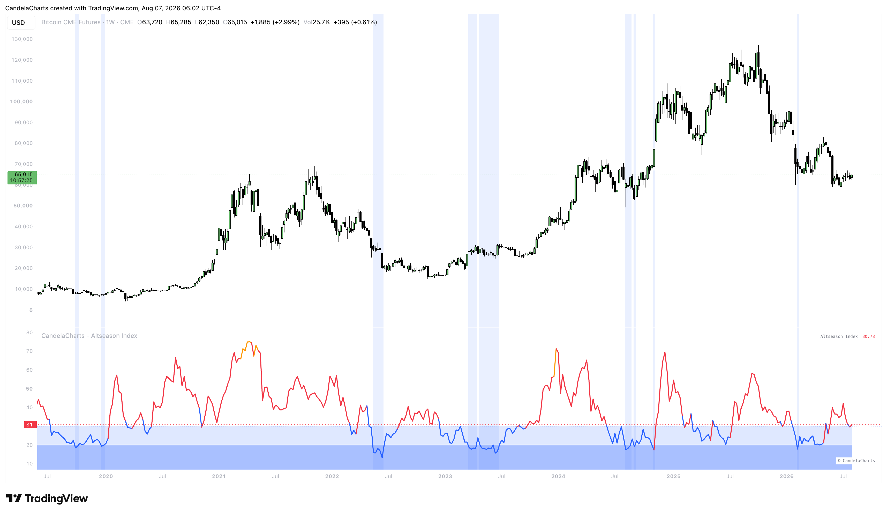

# Altseason Index


Available on: <a href="https://www.tradingview.com/scripts/marketplace/CandelaCharts/" class="button secondary small" data-icon="chart-fft">TradingView</a><a href="https://www.candelacharts.com/algorithms" class="button secondary small" data-icon="chart-scatter-bubble">CandelaCharts</a>


> Track capital rotation between Bitcoin and altcoins on a 0–100 composite scale to catch deep accumulation zones and overheated euphoria.

<figure><figcaption></figcaption></figure>

### Introduction

Crypto market cycles follow distinct capital-rotation rhythms: Bitcoin frequently absorbs liquidity first before capital spills aggressively down the risk curve into large-cap and small-cap altcoins—and just as abruptly drains back out when speculation overheats. Watching a single altcoin-versus-BTC chart rarely captures whether that rotation is genuinely stretched or just getting started.

The **CandelaCharts – Altseason Index** blends four complementary crypto breadth, trend-extension, and cross-asset relative strength gauges into a single **0 to 100** oscillator evaluated on confirmed higher-timeframe bars. It clearly zones **Opportunity** (`< 30`), **Deep Opportunity** (`< 20`), **Neutral** (`30–70`), and **Risk** (`70+`) regimes.

Built for **crypto investors, altcoin rotators, and cycle traders**, it highlights high-conviction altcoin accumulation stretches on both the oscillator and main chart alongside real-time extreme alerts.


**TL;DR:** Readings below **30** (**Green**, with **Deep Opportunity** below **20**) signal heavy altcoin undervaluation relative to Bitcoin and broader tech risk appetite; readings pushing above **70–80** (**Red**) warn of overextended altseason euphoria and rotation-back risk.


### How It Works

**CandelaCharts – Altseason Index** combines four independent crypto and cross-market pillars—altcoin market momentum, long-horizon trend stretch, altcoin-versus-Bitcoin relative strength, and altcoin-versus-equity tech performance—weighted and normalized onto one standardized **0–100** scale using confirmed bar closes.

Lower boundary fills clearly separate **Opportunity (`20–30`)** from **Deep Opportunity (`0–20`)**, with optional vertical green background highlights (`Highlight Oscillator` and `Highlight Main Chart`) firing whenever readings enter Deep Opportunity territory, plus a compact corner readout displaying the live index score.

#### Reading the Indicator

Track the composite oscillator line across three color-coded regimes and lower accumulation zones:

| Zone / Visual Element                     | Default Color                                                  | Meaning                                                                                                                             |
| ----------------------------------------- | -------------------------------------------------------------- | ----------------------------------------------------------------------------------------------------------------------------------- |
| **>= 70 (Risk / Extreme Euphoria >= 80)** | **Red** line                                                   | Altcoins are heavily stretched versus peers and Bitcoin; heightened profit-taking and rotation-back risk                            |
| **30 to 70 (Neutral / Transitional)**     | **Orange** line                                                | Balanced rotation without extreme undervaluation or euphoria; crossing upward through mid-range signals building altseason momentum |
| **< 30 (Opportunity)**                    | **Green** line + subtle lower green zone fill                  | Altcoins are washed out and historically cheap relative to Bitcoin and tech leaders                                                 |
| **< 20 (Deep Opportunity)**               | **Green** line + deeper green zone & optional chart highlights | Extreme multi-pillar altcoin compression; historic high-conviction accumulation zone                                                |
| **Live Level Line & Value Badge**         | Dotted horizontal line + corner table (`Altseason Index`)      | Projects the current index score cleanly across the pane for historical comparison                                                  |

All symbol feeds, component weights, timeframes, lookbacks, and regime colors (`Risk`, `Neutral`, `Opportunity`) are customizable in settings.

### Features

* **Four-Pillar Crypto Rotation Model:** Combines breadth momentum, trend valuation stretch, altcoin-vs-Bitcoin dominance, and altcoin-vs-equity tech strength into one `0–100` gauge.
* **Non-Repainting Higher-Timeframe Discipline:** Evaluates completed bar closes so historical **Opportunity** and **Risk** signals stay stable.
* **Tiered Accumulation & Background Highlights:** Clearly separates `20–30` **Opportunity** from `< 20` **Deep Opportunity** and optionally mirrors deep buy-zone highlights directly onto your main price chart.
* **Full Weight & Feed Customizability:** Adjust component weights, calculation timeframes, comparator symbols, and zone colors to match your portfolio universe.
* **Two Extreme-Zone Alerts:** Instant notifications when the index drops into **Deep Opportunity (`< 20`)** or surges into **Extreme Risk (`> 80`)**.

### How To Use

#### 1. Accumulating During Deep Opportunity Zones (`< 20` / Green)

Watch for the oscillator dropping below **30**—and especially below **20** with **Deep Opportunity** background shading active:

* Sentiment and relative performance toward altcoins are deeply compressed, often marking major cyclical bottoms before capital rotates back out of Bitcoin dominance.
* Enable **Highlight Main Chart** if you want those washed-out windows projected directly behind your BTC, ETH, or altcoin price bars for staged DCA planning.

#### 2. Confirming Active Altseason Expansion (`30` to `70+`)

Follow transitions rising up out of **Green** (`< 30`) through **Orange** (`30–70`):

* Steady higher lows and climbs through the middle range show altcoins gaining sustained breadth and relative momentum against Bitcoin, favoring overweight rotation into quality altcoins.

#### 3. Rotating Defensively at Extreme Risk (`70–80+` / Red)

When the line turns **Red** above **70** and crosses above **80**:

* Altcoin speculation and relative valuation have stretched to historical extremes.
* Use **Extreme Risk** zones to scale out partial altcoin profits, tighten trailing stops, or rotate capital back toward Bitcoin and stablecoins before sharp drawdowns hit.

### Alerts

**CandelaCharts – Altseason Index** includes two built-in TradingView alert conditions:

1. **Altseason Index enters Deep Opportunity Zone:** Fires when the index crosses below `20`.
2. **Altseason Index enters Extreme Risk Zone:** Fires when the index crosses above `80`.

### FAQs

#### 1. Can I view Altseason Index on any TradingView crypto chart?

Yes. Because the model pulls its composite crypto market cap and cross-asset inputs directly via dedicated symbol settings, it renders consistently whether you load it on `BTCUSD`, `ETHUSD`, `SOLUSD`, `TOTAL3`, or any individual altcoin chart.

#### 2. Why does the index compare altcoins against both Bitcoin and tech equities?

Evaluating altcoins strictly against Bitcoin can miss broad macro liquidity shifts. Pairing altcoin-vs-Bitcoin rotation with relative strength against traditional mega-cap tech leadership helps distinguish true crypto-native altseason expansion from simple equity-beta drift.

#### 3. Should I buy altcoins immediately as soon as the line crosses below 20?

Treat `< 20` **Deep Opportunity** as a staged accumulation zone rather than an exact single-candle bottom. During severe crypto bear markets, the index can linger below `20` while base formation builds—scaling in gradually or waiting for an upward turn toward `30` reduces early drawdown risk.

#### 4. What happens if I set a component weight to 0?

The model normalizes strictly across active positive weights. Setting any single pillar's weight to `0` disables its contribution without breaking the `0–100` scale.

#### 5. Which chart timeframes work best?

Because the core pillars anchor to higher-timeframe daily closes by default, **Daily (`1D`)** and **Weekly** charts provide the clearest cycle perspective, though readings remain consistent across lower timeframes too.
