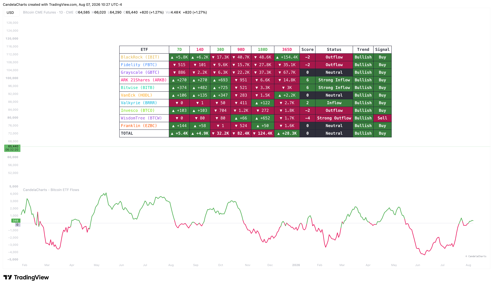

# Bitcoin ETF Flows


Available on: <a href="https://www.tradingview.com/scripts/marketplace/CandelaCharts/" class="button secondary small" data-icon="chart-fft">TradingView</a>


> Monitor institutional inflows, outflows, and holdings dominance across 10 US Spot Bitcoin ETFs in Money, Coins, Z-Score, or Percentage views.

<figure><figcaption></figcaption></figure>

### Introduction

Following US Spot Bitcoin ETF adoption transformed Bitcoin market structure: institutional demand, pension allocations, and wealth-management flows now move billions of dollars through regulated spot ETF vehicles. Watching spot price candles alone hides whether rallies are backed by sustained institutional ETF absorption or fragile leveraged drift.

The **CandelaCharts – Bitcoin ETF Flows** indicator tracks holdings changes and relative market share across **10 major US Spot Bitcoin ETFs**—BlackRock (`IBIT`), Fidelity (`FBTC`), Grayscale (`GBTC`), ARK 21Shares (`ARKB`), Bitwise (`BITB`), VanEck (`HODL`), Valkyrie (`BRRR`), Invesco (`BTCO`), WisdomTree (`BTCW`), and Franklin (`EZBC`). It pairs a dual-mode sub-pane chart with a multi-horizon **Dashboard** spanning `7D` through `365D`.

Designed for **Bitcoin investors, macro crypto traders, and institutional flow watchers**, it summarizes multi-horizon ETF demand into clear `Money`, `Coins`, `Z-Score`, and `Percentage` readouts alongside live flow scores and signals.


**TL;DR:** **Teal** readings above `0` reflect net institutional BTC ETF accumulation (`Inflow` / `Strong Inflow`), **Red** readings below `0` signal net redemptions (`Outflow` / `Strong Outflow`), and **Dominance** mode reveals how holdings share shifts across all 10 ETF issuers.


### How It Works

**CandelaCharts – Bitcoin ETF Flows** tracks daily holdings balances across 10 US Spot Bitcoin ETFs on **Daily (`1D`) and higher** timeframes. Because spot ETF settlement balances update strictly on daily sessions, attempting to load the script on an intraday timeframe below `1D` displays a prompt to switch to `1D` or higher.

You can switch the main sub-pane between **Inflows & Outflows** (smoothed net aggregate flow around `0`) and **Dominance** (stacked `0%–100%` share layers across active ETFs), while the on-chart **Dashboard** evaluates every issuer and the combined `TOTAL` across six rolling windows (`7D`, `14D`, `30D`, `90D`, `180D`, and `365D`).

#### Reading the Indicator

Combine the selected chart `Plot Mode` with the multi-horizon **Dashboard** columns:

| Visual / Dashboard Element                                     | Display / Values                                                                | How to Read It                                                                                         |
| -------------------------------------------------------------- | ------------------------------------------------------------------------------- | ------------------------------------------------------------------------------------------------------ |
| **Inflows & Outflows Mode**                                    | **Teal** (`>= 0`) / **Red** (`< 0`) line around `0`                             | Smoothed aggregate capital (`Money`) or BTC (`Coins`) entering or leaving active spot ETFs             |
| **Dominance Mode**                                             | Color-coded `0%–100%` stacked layers + `Dom %` column                           | Tracks each ETF's proportional share of total spot ETF Bitcoin holdings                                |
| **Data Format (`Money` / `Coins` / `Z-Score` / `Percentage`)** | Fiat USD flow, raw BTC count, standard-deviation score (`σ`), or `%` flow share | View dollar-scale flows, pure coin accumulation, statistical outliers, or flow share                   |
| **Horizon Columns (`7D`–`365D`)**                              | Green (`▲`) net inflow / Red (`▼`) net outflow                                  | Compares weekly (`7D`, `14D`), monthly (`30D`), and quarterly-to-annual (`90D`, `180D`, `365D`) demand |
| **Score & Status**                                             | `Strong Inflow`, `Inflow`, `Neutral`, `Outflow`, `Strong Outflow`               | Summarizes multi-horizon alignment per issuer and across the `TOTAL` row                               |
| **Trend & Signal**                                             | `Bullish` / `Bearish` and `Buy` / `Hold` / `Sell`                               | Tracks whether near-term ETF flows are accelerating ahead of broader flow trends                       |

Every individual ETF feed can be toggled on/off, recolored, or pointed to a custom data symbol under **ETF** settings.

### Features

* **10 Major Spot Bitcoin ETFs:** Monitors BlackRock (`IBIT`), Fidelity (`FBTC`), Grayscale (`GBTC`), ARK 21Shares (`ARKB`), Bitwise (`BITB`), VanEck (`HODL`), Valkyrie (`BRRR`), Invesco (`BTCO`), WisdomTree (`BTCW`), and Franklin (`EZBC`).
* **Four Flexible Data Formats:** Toggle effortlessly between **Money** (USD value), **Coins** (raw BTC accumulation), **Z-Score** (standardized anomaly detection), and **Percentage** (proportional flow share).
* **Inflows & Outflows vs. Dominance Mode:** Visualize aggregate net institutional demand or inspect long-term issuer market-share concentration on one `0%–100%` canvas.
* **Intelligent Multi-Horizon Dashboard:** Breaks down `7D` through `365D` flows alongside automated `Score`, `Status`, `Trend`, `Signal`, and `TOTAL` institutional balance readings.
* **Modular Feed Control:** Isolate specific issuers (for example, comparing BlackRock and Fidelity inflows against Grayscale redemptions) using individual checkboxes.

### How To Use

#### 1. Confirming Spot Demand Behind Bitcoin Breakouts

Check the **TOTAL** row and **Inflows & Outflows** curve whenever Bitcoin challenges key resistance:

* Sustained **Teal** flows (`Inflow` / `Strong Inflow` and `Buy` signal in **TOTAL**) confirm that institutional spot ETF buyers are actively absorbing supply behind price expansion.
* Price breakouts occurring alongside fading inflows or rising **Red** outflows warn that spot ETF demand is cooling beneath the move.

#### 2. Detecting Institutional Demand Inflections via `Z-Score` & `Coins`

* Switch **Data Format** to **Coins** to strip out BTC price swings and see pure Bitcoin supply absorbed or distributed across `7D`–`365D`.
* Switch to **Z-Score** to spot extreme `σ` flow anomalies—identifying when institutional buying accelerates sharply off a quiet lull or hits unsustainable short-term extremes.

#### 3. Watching Issuer Rotation in `Dominance` Mode

Switch **Plot Mode** to **Dominance** on daily/weekly charts to see whether long-term holdings concentration is consolidating toward top institutional leaders or stabilizing across legacy trusts.

### Alerts

This indicator does not currently include built-in alerts.

### FAQs

#### 1. Why does the indicator stop with an error on intraday charts?

Spot Bitcoin ETF balance feeds publish daily settlement updates. Switch your chart timeframe to **Daily (`1D`)**, **Weekly**, or **Monthly** for clean, accurate readings.

#### 2. Should I track flows in `Money` or `Coins`?

**Money** highlights headline USD capital size at current prices, whereas **Coins** isolates the actual number of BTC entering or leaving ETFs—making historical comparisons much cleaner across vastly different Bitcoin price levels.

#### 3. Can I exclude an ETF like Grayscale (`GBTC`) to inspect inflows from newer issuers alone?

Yes. Unchecking any ETF under the **ETF** settings group excludes its balances from both the aggregate **Total Flow** plot and the **TOTAL** dashboard summary.

#### 4. Why does the table show `7D` through `365D` columns?

Displaying six horizons from weekly (`7D`) to annual (`365D`) lets you separate short-term ETF flow bursts from persistent multi-month institutional accumulation or distribution trends.

#### 5. What does a `Z-Score` reading tell me?

A high positive **Z-Score** shows ETF inflows are unusually strong relative to their own recent norm, while a deep negative **Z-Score** flags unusually heavy redemptions compared with recent history.
