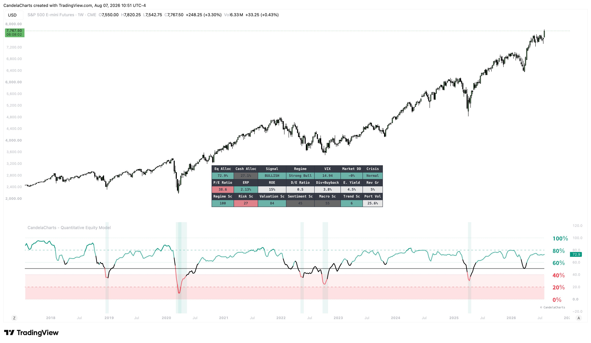

# Quantitative Equity Model


The Dip Index is available on the <a href="https://www.candelacharts.com/algorithms" class="button secondary medium" data-icon="chart-kanban">CandelaCharts</a> platform as part of Algorithms, in the Professional plan, and on the<a href="https://www.tradingview.com/u/CandelaCharts/" class="button secondary medium" data-icon="display-chart-up">TradingView</a> platform as part of<a href="https://www.candelacharts.com/indicators" class="button secondary medium" data-icon="chart-kanban">CandelaCharts</a> Indicators, in the Investing and Institutional plans.


> Combine market regime, risk control, fundamental valuation, sentiment, and macro signals into an optimal 0–100% equity allocation compass.

<figure><figcaption></figcaption></figure>

### Introduction

Deciding how heavily to stay invested in equities—versus holding defensive cash or safe-haven reserves—is difficult when price, valuation, credit spreads, and volatility send conflicting signals. Overreacting to shallow pullbacks creates whipsaws, while staying fully leveraged into systemic crises causes severe drawdowns.

The **CandelaCharts – Quantitative Equity Model** solves this by synthesizing **five distinct market pillars**—**Market Regime**, **Risk Metrics**, **Valuation**, **Sentiment**, and **Macro**—into one dynamic **Equity Allocation %** guideline (`0%` to `100%`). It layers optional **Portfolio Risk Scaling** and automated **Crisis Detection** on top, visually marking deep-fear **Buy Zones** when capital preservation dominates.

Designed for **long-term equity investors, portfolio allocators, and swing position traders**, it keeps all five pillars, fundamental ratios, and risk constraints organized in one comprehensive dashboard.


**TL;DR:** Readings near **80%–100%** (**Blue**) favor full equity exposure during healthy bull regimes, readings near **50%** (**Aqua**) call for balanced selectivity, and sharp drops into **0%–40%** (**Orange** with optional **Buy Zone** shading) signal aggressive de-risking that also highlights historic panic-driven accumulation windows.


### How It Works

**CandelaCharts – Quantitative Equity Model** reads multi-asset price structure, realized and implied volatility, corporate fundamental metrics, market breadth/safe-haven flows, and credit/yield-curve conditions simultaneously, weighting all five pillars into a smoothed allocation target between `0%` and `100%`.

You can tune overall aggressiveness via `Allocation Type` (`Risk-Averse`, `Balanced`, `Risk-Seeking`, or `Adaptive`), enforce personal `Target Volatility (%)` and `Max Drawdown (%)` ceilings through **Risk Scaling**, and configure custom **Weights** or **Crisis Thresholds** in settings.

#### Reading the Indicator

Track the `Equity Allocation %` curve alongside the 3-row-group **Analytics Dashboard**:

| Visual / Dashboard Group            | Readings / Colors                                                                                   | How to Read It                                                                                    |
| ----------------------------------- | --------------------------------------------------------------------------------------------------- | ------------------------------------------------------------------------------------------------- |
| **60%–100% Equity Allocation**      | **Blue** line (`80%` dashed, `100%` dotted reference)                                               | Constructive multi-pillar backdrop favoring high or full equity exposure                          |
| **40%–60% Equity Allocation**       | **Aqua** transition around solid `50%` midline                                                      | Mixed signals; balanced sizing between equities and defensive cash reserves                       |
| **0%–40% Bearish / Buy Zone**       | **Orange** line, lower zone fills & optional **Buy Zone** background                                | Defensive risk-off regime calling for reduced beta—also marking extreme fear accumulation windows |
| **Dashboard Row 1 — Overview**      | `Eq Alloc`, `Cash Alloc`, `Signal`, `Regime` (`Strong Bull`–`Crisis`), `VIX`, `Market DD`, `Crisis` | Headline allocation split, active regime (`Normal`, `CRISIS`, `SEVERE`), and stress telemetry     |
| **Dashboard Row 2 — Fundamentals**  | `P/E Ratio`, `ERP`, `ROE`, `D/E Ratio`, `Div+Buyback`, `E. Yield`, `Rev Gr`                         | Real-time equity valuation and corporate health context behind the Valuation pillar               |
| **Dashboard Row 3 — Pillar Scores** | `Regime Sc`, `Risk Sc`, `Valuation Sc`, `Sentiment Sc`, `Macro Sc`, `Trend Sc`, `Port Vol`          | Granular pillar breakdown showing which dimensions are supporting or dragging exposure            |

Toggle `Overlay on Chart` in settings to project deep **Buy Zone** fear highlights directly onto your main price candles.

### Features

* **Five-Pillar Allocation Engine:** Synthesizes **Market Regime**, **Risk Metrics**, **Valuation**, **Sentiment**, and **Macro** into one unified `0%–100%` equity versus cash allocation model.
* **Portfolio Risk Scaling & Crisis Overrides:** Scales suggested equity exposure around your personal `Target Volatility (%)` and `Max Drawdown (%)` tolerances while capping exposure automatically when crisis conditions align.
* **Four Behavioral Profiles:** Choose `Risk-Averse`, `Balanced`, `Risk-Seeking`, or `Adaptive` to tailor how conservatively or quickly allocation shifts.
* **Comprehensive 21-Metric Dashboard:** Displays top-level positioning (`Eq Alloc`, `Cash Alloc`, `Regime`), live fundamental ratios (`P/E Ratio`, `ERP`, `ROE`), and individual pillar scores (`Regime Sc` through `Port Vol`).
* **Visual Buy Zones & Full Customizability:** Customize all underlying benchmark symbols, pillar weights, crisis thresholds, smoothing, and pane/chart background highlights.

### How To Use

#### 1. Rebalancing Core Equity vs. Cash Exposure

Use **Eq Alloc** and **Cash Alloc** as a disciplined rebalancing compass rather than an all-or-nothing switch:

* When smoothed allocation holds in the upper **Blue** tiers (`60%–100%`) alongside `Bull Market` or `Strong Bull` in the dashboard, maintain full core equity exposure.
* As allocation slides beneath the **50%** midline toward **40% or lower**, systematically trim leveraged or high-beta positions and raise cash or defensive Treasury reserves.

#### 2. Using Deep Fear & Crisis Regimes for Long-Term Accumulation

Enable **Show Buy Zones** (and optionally **Overlay on Chart**) to spot washed-out market bottoms:

* While a drop toward `0%–20%` (`BEARISH` / `CRISIS`) signals immediate capital preservation for active portfolios, those same shaded clusters mark extreme capitulation where long-term spot investors prepare staggered **Buy Zone** deployment once panic cools.

#### 3. Auditing Which Pillar Is Driving Allocation Shifts

Inspect the bottom row of the dashboard (`Regime Sc`, `Risk Sc`, `Valuation Sc`, `Sentiment Sc`, `Macro Sc`, `Trend Sc`):

* A sudden drop driven purely by `Risk Sc` or `Sentiment Sc` while `Valuation Sc` and `Macro Sc` stay healthy often behaves like a sharp corrective reset, whereas broad deterioration across **all five pillars** signals a deeper structural bear phase.

### Alerts

This indicator does not currently include built-in alerts.

### FAQs

#### 1. Should I treat a drop into the 0–40% Buy Zone as a sell signal or a buy signal?

It serves both roles depending on your timeframe: for active risk management, falling toward `0%–40%` warns of elevated drawdown and crisis risk where cutting leverage protects capital; for patient long-term investors, deep **Buy Zone** extremes historically highlight capitulation windows to begin staging accumulation.

#### 2. What do the four `Allocation Type` modes change?

`Risk-Averse` keeps equity exposure more conservative, `Risk-Seeking` leans more aggressively into risk assets, `Balanced` maintains neutral weighting, and `Adaptive` adjusts responsiveness based on recent market return momentum.

#### 3. Do my custom pillar `Weights` have to add up to exactly 100?

No. While defaults are organized to total 100 across the five pillars, the model normalizes your weights automatically so any custom proportions work smoothly—and setting a pillar's weight to `0` removes its influence.

#### 4. Which chart assets and timeframes work best?

Because the model evaluates broad US equity fundamentals, volatility indexes, credit spreads, and Treasury yields, it works best on **Daily (`1D`)** and **Weekly** charts of broad equity benchmarks like `SPY` or `SPX` (or customized via the **Symbols** inputs).

#### 5. What does `Port Vol` in the dashboard show?

`Port Vol` displays the estimated annualized portfolio volatility based on your current recommended `Eq Alloc` percentage, letting you verify at a glance how it tracks against your `Target Volatility (%)` setting.
