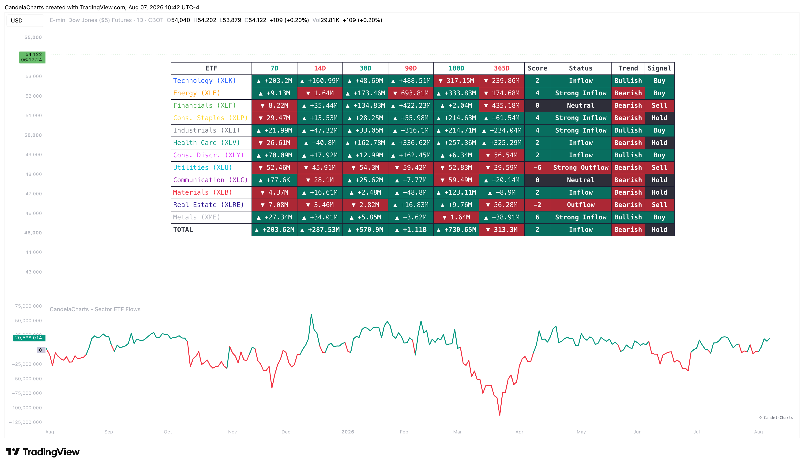

# Sector ETF Flows


The Sector ETF Flows is part of <a href="https://www.candelacharts.com/indicators" class="button secondary medium" data-icon="chart-kanban">CandelaCharts</a>Indicators, for the TradingView platform, available in the Investing and Institutional plans.


> Track capital inflows, outflows, and holdings dominance across 12 US sector ETFs to spot institutional rotation and shifting risk appetite.

<figure><figcaption></figcaption></figure>

### Introduction

Index price charts tell you what moved, not where institutional capital is actively migrating beneath the surface. Money constantly rotates between cyclical growth leaders, defensive safe havens, and commodity-sensitive industries long before broad benchmarks reverse direction.

The **CandelaCharts – Sector ETF Flows** indicator tracks capital flows and relative dominance across **12 customizable equity sectors**—spanning Technology, Energy, Financials, Consumer Staples, Industrials, Health Care, Consumer Discretionary, Utilities, Communication Services, Materials, Real Estate, and Metals. It pairs a clean sub-pane visual with an institutional multi-horizon **Dashboard** covering rolling windows from `7D` through `365D`.

Designed for **sector rotators, swing traders, and macro equity investors**, it translates raw sector flows into clear `Money`, `Z-Score`, and `Percentage` views alongside automated trend and flow status labels.


**TL;DR:** **Teal** readings above `0` show net capital inflows entering tracked sectors, **Red** readings below `0` signal net outflows, and switching `Plot Mode` to **Dominance** reveals each sector's stacked share of total sector participation.


### How It Works

**CandelaCharts – Sector ETF Flows** monitors daily capital flow changes across 12 sector ETFs on **Daily (`1D`) and higher** timeframes. Viewing it on an intraday timeframe below `1D` displays a reminder banner because daily flow calculations rely on completed daily sessions.

Depending on your selected `Plot Mode`, the pane displays either an **Inflows & Outflows** oscillator around a zero baseline or a stacked **Dominance** area chart summing to `100%`, while the on-chart **Dashboard** evaluates every sector across six rolling horizons (`7D`, `14D`, `30D`, `90D`, `180D`, and `365D`).

#### Reading the Indicator

Use the sub-pane visual mode and on-chart dashboard columns together to read sector capital rotation:

| Visual / Dashboard Element                           | Display / Values                                                  | How to Read It                                                                                               |
| ---------------------------------------------------- | ----------------------------------------------------------------- | ------------------------------------------------------------------------------------------------------------ |
| **Inflows & Outflows Mode**                          | **Teal** (`>= 0`) / **Red** (`< 0`) line around `0`               | Smoothed aggregate net capital entering or exiting active sectors                                            |
| **Dominance Mode**                                   | Color-coded stacked `0%–100%` layers + `Dom %` column             | Relative market share held by each enabled sector over time                                                  |
| **Data Format (`Money` / `Z-Score` / `Percentage`)** | Fiat flow, standard-deviation score (`σ`), or `%` flow share      | Lets you compare raw dollar flow, statistical extremity, or proportional leadership                          |
| **Horizon Columns (`7D`–`365D`)**                    | Green (`▲`) inflows / Red (`▼`) outflows                          | Tracks short-term tactical rotation (`7D`, `14D`, `30D`) through multi-quarter trend (`90D`, `180D`, `365D`) |
| **Score & Status**                                   | `Strong Inflow`, `Inflow`, `Neutral`, `Outflow`, `Strong Outflow` | Summarizes multi-horizon alignment for each sector and the overall `TOTAL` row                               |
| **Trend & Signal**                                   | `Bullish` / `Bearish` and `Buy` / `Hold` / `Sell`                 | Compares short-term flow momentum against broader flow direction                                             |

Every sector can be toggled on or off individually, reassigned to a custom symbol, or recolored directly in settings.

### Features

* **12 Customizable Sector Feeds:** Covers all 11 standard US equity sectors (`XLK`, `XLE`, `XLF`, `XLP`, `XLI`, `XLV`, `XLY`, `XLU`, `XLC`, `XLB`, `XLRE`) plus Metals (`XME`) with individual toggles, colors, and symbol inputs.
* **Dual Charting Modes:** Toggle seamlessly between **Inflows & Outflows** velocity tracking and stacked **Dominance** share analysis.
* **Three Dashboard Data Formats:** View every sector across `Money`, `Z-Score`, or `Percentage` without adding extra scripts to your layout.
* **Six-Horizon Scoring Table:** Synthesizes `7D` through `365D` rolling windows into instant `Score`, `Status`, `Trend`, `Signal`, and `TOTAL` market summaries.
* **Flexible Dashboard Placement:** Anchor the table to any corner or edge and scale typography (`Tiny` to `Auto`) to fit your workspace cleanly.

### How To Use

#### 1. Confirming Risk-On vs. Defensive Capital Rotation

Scan the **Status** and **Signal** columns across cyclical versus defensive sectors in the dashboard:

* Heavy inflows (`Inflow` / `Strong Inflow` and `Buy`) clustering in **Technology (`XLK`)**, **Consumer Discretionary (`XLY`)**, **Financials (`XLF`)**, or **Industrials (`XLI`)** indicate constructive risk appetite.
* Outflows from growth sectors accompanied by inflows into **Consumer Staples (`XLP`)**, **Utilities (`XLU`)**, or **Health Care (`XLV`)** warn that institutional capital is rotating defensively.

#### 2. Identifying Short-Term Inflections with Z-Score Format

Switch **Data Format** to `Z-Score` when comparing sectors of very different dollar sizes:

* A sector shifting from negative intermediate readings (`90D` / `180D`) into positive short-term `7D` and `14D` `▲` Z-scores highlights early inflow acceleration before a multi-month trend turns.
* Extreme positive or negative `σ` spikes flag crowded short-term capital bursts where follow-through or cooling should be watched closely.

#### 3. Tracking Structural Share Shifts in Dominance Mode

Set **Plot Mode** to `Dominance` on higher-timeframe charts to observe which sector bands are expanding or shrinking over time—making structural winners and multi-quarter laggards stand out visually.

### Alerts

This indicator does not currently include built-in alerts.

### FAQs

#### 1. Why does the chart show a warning banner on intraday timeframes?

Sector flow calculations use daily-session price and volume changes. Switch your chart to **Daily (`1D`)** or higher (**Weekly**, **Monthly**) for accurate readings.

#### 2. Which Data Format should I start with?

Start with **Money** for an intuitive view of dollar-weighted flow scale, or switch to **Z-Score** when ranking sectors fairly by how unusual current inflows or outflows are relative to recent history.

#### 3. Can I isolate a few specific sectors instead of tracking all 12?

Yes. Uncheck any sector under the **Sectors** group in settings to remove it from both the aggregate `Total Flow` calculation and `Dominance` stack while dimming its dashboard row cleanly.

#### 4. What is the difference between `Status`, `Trend`, and `Signal` in the table?

**Status** summarizes multi-horizon alignment from `7D` through `365D`, **Trend** compares near-term flow momentum against intermediate flow momentum, and **Signal** highlights whether short-term windows (`7D` and `14D`) agree directionally.

#### 5. Can I track non-US or custom ETFs?

Yes. All 12 symbol fields accept any valid TradingView ETF ticker with price and volume history.
