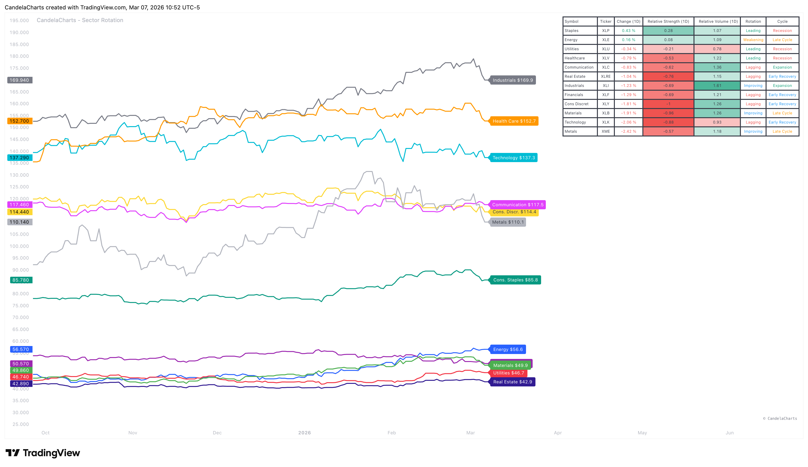

# Sector Rotation Map


The Sector Rotation Map is part of <a href="https://www.candelacharts.com/indicators" class="button secondary medium" data-icon="chart-kanban">CandelaCharts</a>Indicators, for the TradingView platform, available in the Investing and Institutional plans.


> Compare 12 market sectors across live relative performance plots, rotation quadrants, and business-cycle phases in one view.

<figure><figcaption></figcaption></figure>

### Introduction

Institutional capital constantly rotates across industries as economic growth accelerates, peaks, slows, and recovers. Watching individual tickers in isolation makes it easy to stay overweight yesterday's winners while emerging leaders quietly take over.

The **CandelaCharts – Sector Rotation Map** brings all **11 US GICS business sectors plus Metals** into one comparative workspace. It combines color-coded comparative price curves, hoverable macro cycle tooltips, and a live sortable dashboard classifying each sector's **Rotation Phase** (`Leading`, `Weakening`, `Lagging`, `Improving`) and **Economic Cycle** alignment.

Built for **equity investors, sector rotators, and macro swing traders**, it answers two questions immediately: which sectors have leadership momentum right now, and where those leaders sit in the broader business cycle.


**TL;DR:** Watch the **Rotation** column to catch sectors shifting from **Lagging** (**Red**) into **Improving** (**Blue**) and **Leading** (**Green**), and use the **Cycle** column to check whether market leadership aligns with Early Recovery, Expansion, Late Cycle, or Recession conditions.


### How It Works

**CandelaCharts – Sector Rotation Map** monitors 12 sector ETFs (`XLK`, `XLE`, `XLF`, `XLP`, `XLI`, `XLV`, `XLY`, `XLU`, `XLC`, `XLB`, `XLRE`, and `XME`) simultaneously, allowing you to view comparative **Line Plots**, the analytical **Dashboard**, or **Both**.

In the **Dashboard**, each sector's percentage change, **Relative Strength**, and **Relative Volume** are evaluated on your chosen **Timeframe** and classified into four rotation quadrants against the active sector peer average alongside its historical business-cycle leadership stage.

#### Reading the Indicator

Use the sortable dashboard columns and rotation colors to read sector momentum at a glance:

| Dashboard Column / Status | Color / Values                                                                         | How to Read It                                                                        |
| ------------------------- | -------------------------------------------------------------------------------------- | ------------------------------------------------------------------------------------- |
| **Change**                | Green (`> 0%`) / Red (`< 0%`)                                                          | Percentage move over the selected dashboard timeframe                                 |
| **Relative Strength**     | Green-shaded (`> 0`) to Red-shaded (`< 0`)                                             | Volatility-normalized directional strength (`+` bullish impulse, `-` bearish impulse) |
| **Relative Volume**       | Green-shaded (above normal) to Red-shaded (quiet)                                      | Participation activity compared with recent volume norms                              |
| **Rotation — Leading**    | Green                                                                                  | Above-average strength with rising momentum; established market leaders               |
| **Rotation — Weakening**  | Orange                                                                                 | Still above peer average, but momentum is slowing; watch for profit-taking            |
| **Rotation — Lagging**    | Red                                                                                    | Below-average strength and negative momentum; out-of-favor laggards                   |
| **Rotation — Improving**  | Blue                                                                                   | Below peer average overall, but momentum is turning upward; early rotation watch      |
| **Cycle**                 | `Early Recovery` (Blue), `Expansion` (Green), `Late Cycle` (Orange), `Recession` (Red) | Business-cycle stage each sector historically tends to outperform in                  |

When **Line Plots** are enabled, hovering over any right-side sector label reveals a tooltip detailing that sector's asset class profile, cycle phase, and core macro drivers.

### Features

* **All 12 Key Equity Sectors:** Tracks Technology (`XLK`), Energy (`XLE`), Financials (`XLF`), Consumer Staples (`XLP`), Industrials (`XLI`), Health Care (`XLV`), Consumer Discretionary (`XLY`), Utilities (`XLU`), Communication Services (`XLC`), Materials (`XLB`), Real Estate (`XLRE`), and Metals (`XME`).
* **RRG-Style Rotation Classification:** Categorizes every sector as `Leading`, `Weakening`, `Lagging`, or `Improving` relative to the active peer group average.
* **Business Cycle Anchoring:** Maps each sector to its typical macro outperformance stage (`Early Recovery`, `Expansion`, `Late Cycle`, or `Recession`).
* **Sortable Multi-Metric Dashboard:** Rank sectors dynamically by `Change`, `Rel. Volume`, or `Relative Strength` (or keep fixed order with `None`) on any timeframe.
* **Interactive Cycle Tooltips:** Hover over right-edge line labels to review each sector's fundamental macro role without leaving your chart.

### How To Use

#### 1. Catching Early Rotation Inflections (`Lagging` to `Improving`)

Sort the dashboard by **Relative Strength** or **Change** and scan the **Rotation** column:

* Sectors flipping from **Lagging** (Red) to **Improving** (Blue) are showing early relative momentum recovery before breaking to headline highs—ideal watchlist candidates for emerging leadership.
* Confirm that **Relative Volume** is picking up alongside the shift to separate high-conviction institutional accumulation from brief dead-cat bounces.

#### 2. Managing Winners When Leaders Turn `Weakening`

When top holdings move from **Leading** (Green) into **Weakening** (Orange):

* Relative strength remains above average, yet momentum has rolled over.
* Tighten trailing stops or trim concentrated overweight exposure rather than adding aggressively until leadership stabilizes back to **Leading**.

#### 3. Reading the Macro Tape Through Sector Leadership

Check which **Cycle** tags populate the top **Leading** rows:

* Leadership concentrated in `Early Recovery` or `Expansion` groups (`XLK`, `XLF`, `XLY`, `XLI`) points toward pro-cyclical risk-on appetite.
* Leadership clustering in `Late Cycle` (`XLE`, `XLB`, `XME`) or `Recession` (`XLP`, `XLU`, `XLV`) signals defensive caution or late-cycle inflation dynamics.

### Alerts

This indicator does not currently include built-in alerts.

### FAQs

#### 1. What do the three `Mode` options display?

**Both** renders the comparative sector price lines alongside the ranked dashboard table, **Line Plots** displays only the color-coded sector curves and tooltip labels, and **Dashboard** shows only the analytics table for a clean compact view.

#### 2. How should I choose the `Sort By` option?

Sort by **Relative Strength** to surface the strongest risk-adjusted trends, by **Change** for pure session leaderboard rankings, or by **Rel. Volume** to spot unusual institutional participation spikes.

#### 3. Does changing the dashboard `Timeframe` affect `Line Plots`?

No. `Line Plots` follow your current chart timeframe, while the **Dashboard** evaluates `Change`, `Relative Strength`, `Relative Volume`, and `Rotation` on the independent `Timeframe` chosen in dashboard settings (default `1D`).

#### 4. Can I hide sectors or customize ETF tickers?

Yes. Under **Assets**, each of the 12 sectors has an independent toggle, color picker, and symbol input so you can focus on specific sectors or substitute custom tickers.

#### 5. Is the `Cycle` column dynamic or fixed?

The **Cycle** column anchors each sector to its established business-cycle leadership phase so you can immediately interpret whether real-time **Rotation** leaders belong to early-cycle, expansion, late-cycle, or defensive recession groups.
