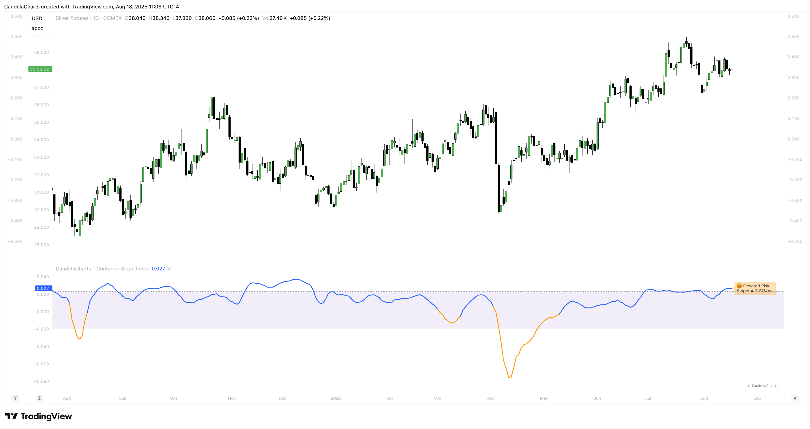

# Contango Slope Index


The Contango Slope Index is available on the <a href="https://www.candelacharts.com/algorithms" class="button secondary medium" data-icon="chart-kanban">CandelaCharts</a> platform as part of Algorithms, in the Professional plan, and on the<a href="https://www.tradingview.com/u/CandelaCharts/" class="button secondary medium" data-icon="display-chart-up">TradingView</a> platform as part of<a href="https://www.candelacharts.com/indicators" class="button secondary medium" data-icon="chart-kanban">CandelaCharts</a> Indicators, in the Investing and Institutional plans.


> Measure the steepness and direction of the VIX volatility term structure to spot market complacency, structural stress, and panic-driven reversals.

<figure><figcaption></figcaption></figure>

### Introduction

Spot volatility alone only tells part of the story—it shows current fear, not whether options markets expect stress to fade or worsen over time. When near-term volatility jumps above longer-term expectations (**backwardation**), traders are pricing acute panic; when longer-term volatility stays above near-term volatility (**contango**), markets are calm and risk appetite is intact.

The **CandelaCharts – Contango Slope Index** turns the shape and steepness of the VIX volatility curve into a clean, readable oscillator. Instead of monitoring multiple volatility contracts separately, you get one continuous reading paired with trend context and clear regime labels.

Built for **equity index traders, volatility analysts, and macro allocators**, it helps you spot excessive complacency before pullbacks and recognize panic-driven capitulation zones that historically precede market rebounds.

> **TL;DR:** Readings above zero (**Blue**) signal a calm contango environment; drops below zero (**Orange**) signal backwardation (near-term panic), where a shift from **Capitulation** to **Recovery** often marks major equity bottoming windows.

### How It Works

**CandelaCharts – Contango Slope Index** evaluates the steepness of the volatility term structure across your selected VIX contracts and compares that slope against a configurable Moving Average trend filter. Positive values reflect normal upward-sloping contango, while negative values reflect an inverted curve during acute market fear.

By tracking both the level of the curve and whether volatility structure is improving or weakening relative to its trend, the indicator automatically classifies the market into six intuitive regimes with live right-edge labels and optional background shading.

#### Reading the Indicator

The plotted slope switches between **Blue** (contango) and **Orange** (backwardation) around a flat zero line, framed by a shaded neutral zone and an elevated contango reference line:

| Regime Label         | Curve State       | Trend Direction       | Badge Color | How to Read It                                                       |
| -------------------- | ----------------- | --------------------- | ----------- | -------------------------------------------------------------------- |
| **Elevated Risk**    | Steep Contango    | Improving above trend | Orange      | High complacency; markets may be vulnerable to a volatility spike    |
| **Cooling Phase**    | Steep Contango    | Weakening below trend | Blue        | Elevated complacency starting to normalize toward neutral            |
| **Bullish Contango** | Moderate Contango | Improving above trend | Green       | Healthy risk-on volatility backdrop supporting uptrends              |
| **Normal**           | Moderate Contango | Weakening below trend | Gray        | Balanced volatility structure with mild softening                    |
| **Recovery**         | Backwardation     | Improving above trend | Green       | Near-term fear remains, but panic is receding—classic bottoming zone |
| **Capitulation**     | Backwardation     | Weakening below trend | Red         | Deepening curve inversion and acute near-term market stress          |

A live badge on the latest bar shows the active regime icon, regime name, annualized slope readout, and—when the Moving Average overlay is enabled—the trend direction.

### Features

* **Flexible VIX Tenor Selection:** Toggle which VIX curve contracts you want to track depending on whether you prefer slow macro structure or fast front-month sensitivity.
* **Six Real-Time Regimes:** Combines curve steepness with Moving Average trend context to separate _Capitulation_ from _Recovery_ and _Bullish Contango_ from _Elevated Risk_.
* **Optional Trend Overlay & Fill:** Display the Moving Average line directly on the oscillator with subtle green and red trend fills.
* **Custom Regime Background Shading:** Optionally tint the oscillator pane by active regime for fast visual scanning.
* **Six Built-In Alerts:** Receive instant notifications on backwardation flips, contango exits, complacency spikes, and trend crossovers.

### How To Use

#### 1. Identifying Panic Extremes & Bottoming Windows

Watch for the slope line turning **Orange** below the zero line into backwardation:

* **Capitulation (Red):** Fear is actively accelerating. Avoid catching falling knives blindly while the curve continues inverting downward.
* **Recovery (Green):** As soon as the slope turns back above its trend while still in backwardation, panic is subsiding—historically a strong confirmation window for contrarian long setups and equity index rebounds.

#### 2. Spotting Excessive Complacency

When the slope pushes above the upper reference line into **Elevated Risk**:

* Options markets are pricing very little near-term risk compared with longer-term maturities.
* Treat sustained **Elevated Risk** and **Cooling Phase** transitions as a prompt to tighten trailing stops or avoid chasing extended rallies.

#### 3. Adapting to Your Trading Horizon

* **Macro & Swing Context:** Use the default long-end VIX selection on Daily or Weekly equity index charts to filter broader market regimes without reacting to every intraday headline.
* **Faster Sensitivity:** Enable shorter-term VIX contracts in settings if you want quicker reactions to sudden short-term volatility shocks, and toggle the Moving Average line on to visualize momentum crossovers clearly.

### Alerts

**CandelaCharts – Contango Slope Index** includes six built-in TradingView alert conditions:

1. **Backwardation Detected (Bullish Signal):** Fires when the volatility curve is inverted in backwardation.
2. **Exit Backwardation:** Fires when the curve shifts back above zero into contango.
3. **Elevated Complacency:** Fires when contango steepens above its historical benchmark into elevated complacency.
4. **Potential Bullish Setup:** Fires when the slope crosses below zero into backwardation.
5. **Slope Crosses Above 200EMA:** Fires when curve momentum crosses above its Moving Average trend, signaling improving structure.
6. **Slope Crosses Below 200EMA:** Fires when curve momentum crosses below its Moving Average trend, signaling rising stress.

### FAQs

#### 1. What is the difference between contango and backwardation?

**Contango** means longer-dated volatility expectations are higher than near-term volatility, which is typical during calm or rising markets. **Backwardation** means immediate fear exceeds longer-term expectations, typically occurring during sharp sell-offs and market stress.

#### 2. Why are the longer-term VIX contracts enabled by default?

Focusing on longer-dated VIX contracts filters out noisy short-term expirations and highlights broader institutional risk appetite. You can toggle shorter-term VIX contracts on at any time for faster reaction speed.

#### 3. Why can backwardation act as a bullish signal for equities?

Peak backwardation usually coincides with maximum hedging demand and investor panic. Once the curve stops worsening and shifts from **Capitulation** into **Recovery**, forced selling often subsides and equity indices frequently stage strong rebounds.

#### 4. Does the Moving Average setting affect the regime badge even if the MA line is hidden?

Yes. The Moving Average trend comparison powers the six-regime classification (such as distinguishing _Capitulation_ from _Recovery_) at all times. Turning the MA display toggle on lets you also see that trend line and fill directly on the pane.

#### 5. Which markets and timeframes work best?

The indicator is designed primarily for **Daily** and **Weekly** equity index charts (such as the S\&P 500 or Nasdaq) as a macro sentiment and risk-regime filter.
