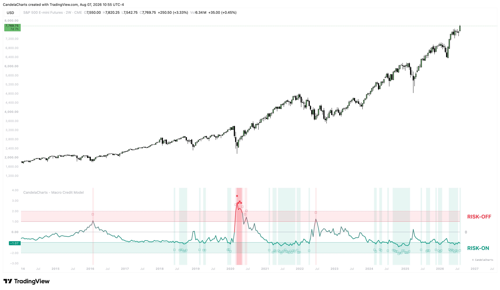

# Macro Credit Model


The Macro Credit Model is available on the <a href="https://www.candelacharts.com/algorithms" class="button secondary medium" data-icon="chart-kanban">CandelaCharts</a> platform as part of Algorithms, in the Professional plan, and on the<a href="https://www.tradingview.com/u/CandelaCharts/" class="button secondary medium" data-icon="display-chart-up">TradingView</a> platform as part of<a href="https://www.candelacharts.com/indicators" class="button secondary medium" data-icon="chart-kanban">CandelaCharts</a> Indicators, in the Investing and Institutional plans.


> Measure systemic corporate credit stress and Risk-On / Risk-Off regime shifts using standardized credit spread Z-Scores and cycle momentum.

<figure><figcaption></figcaption></figure>

### Introduction

Credit markets often sense trouble before stock indices break down. When investors demand higher compensation to hold riskier High Yield corporate debt instead of safer Investment Grade bonds, credit conditions tighten and equity volatility usually follows. When credit risk stays calm and compressed, risk assets tend to thrive.

The **CandelaCharts – Macro Credit Model** converts corporate credit pressure into a standardized **Credit Spread Z-Score** oscillator. Rather than staring at raw bond yields that shift across interest-rate cycles, you get a normalized view showing whether credit stress is unusually elevated (**RISK-OFF**), normal, or unusually calm (**RISK-ON**).

Designed for **macro investors, equity traders, and portfolio risk managers**, the indicator combines clear visual threshold bands, regime markers, and a real-time seven-row dashboard tracking regime bias, momentum, credit cycle phase, and VIX context.


**TL;DR:** High readings rising into **ELEVATED** or **STRESS** (**Red / RISK-OFF**) warn of widening credit stress and fragile equity conditions. Low readings in the **LOW** zone (**Teal / RISK-ON**) reflect calm, supportive credit appetite.


### How It Works

**CandelaCharts – Macro Credit Model** monitors relative stress between High Yield and Investment Grade corporate credit (or absolute High Yield stress when `Calculate Excess Spread` is unchecked), applies optional smoothing, and standardizes the spread into a rolling Z-Score over your selected lookback window.

As credit stress widens, the oscillator pushes higher into **RISK-OFF** territory; as credit stress eases, it falls into **RISK-ON** territory. Short-term spread momentum is also tracked continuously to identify whether an elevated or calm regime is worsening, stabilizing, or turning around.

#### Reading the Indicator

The plotted line shifts along a **Teal → Gray → Red** gradient around a neutral zero midline, with labeled **RISK-OFF** and **RISK-ON** zones and optional square markers:

| Regime            | Visual Zone & Color                  | Chart Marker      | Bias     | What It Means for Your Trading                                    |
| ----------------- | ------------------------------------ | ----------------- | -------- | ----------------------------------------------------------------- |
| **STRESS**        | Top Red zone + dark Red shade        | Solid Red (`◼`)   | RISK-OFF | Acute credit stress; high risk of equity volatility and drawdowns |
| **ELEVATED**      | Upper Red zone + light Red shade     | Hollow Red (`☐`)  | RISK-OFF | Credit conditions tighter than normal; exercise defensive caution |
| **NORMAL**        | Neutral band around zero             | —                 | NEUTRAL  | Balanced credit backdrop without extreme stress or complacency    |
| **LOW**           | Lower Teal zone + light Teal shade   | Hollow Teal (`☐`) | RISK-ON  | Loose, supportive credit conditions favoring risk assets          |
| **LOW (Extreme)** | Bottom Teal zone + deeper Teal shade | Solid Teal (`◼`)  | RISK-ON  | Exceptionally calm credit markets and strong risk appetite        |

The on-chart **Dashboard** summarizes seven live metrics: `Spread Z`, `Regime`, `Momentum`, `Bias`, `Status`, `Credit Cycle` (`DETERIORATING`, `RECOVERING`, `TIGHTENING`, `LOOSENING`, or `STABLE`), and current `VIX`.

### Features

* **Normalized Credit Spread Z-Score:** Measures current credit stress relative to its own rolling historical norm so regimes remain comparable across different rate environments.
* **Excess vs. High-Yield Modes:** Toggle `Calculate Excess Spread` to isolate High Yield vs. Investment Grade stress, or switch it off to view absolute High Yield pressure directly.
* **Clear RISK-OFF / RISK-ON Zones:** Displays labeled horizontal threshold lines, optional zone fills, and dynamic background highlights when stress or calm deepens.
* **Configurable Regime Markers:** Plots hollow (`☐`) and solid (`◼`) markers for elevated/low vs. stress/extreme conditions, with a filter to show all signals or extremes only.
* **Seven-Row Macro Dashboard:** Tracks `Spread Z`, `Regime`, `Momentum`, `Bias`, `Status`, `Credit Cycle` phase, and `VIX` in one compact panel.
* **Five Built-In Alerts:** Alerts on critical credit stress, threshold crossings, regime shifts, and rapid credit widening.

### How To Use

#### 1. Using Credit Regimes as a Market Filter

Check the **Bias** and **Regime** rows before adding broad market exposure:

* **RISK-OFF (`ELEVATED` / `STRESS`):** Credit spreads are widening relative to history. Trim leverage, favor defensive sectors or hedges, and avoid assuming shallow equity dips will immediately bounce.
* **RISK-ON (`LOW`):** Credit appetite is healthy and supportive—conditions favor holding trend positions and buying pullbacks in risk assets.

#### 2. Spotting Turning Points with Momentum & Credit Cycle

Use the Dashboard's **Credit Cycle** and **Momentum** readouts to anticipate transitions early:

* **DETERIORATING:** Stress is elevated and still widening—stay defensive.
* **RECOVERING:** Stress remains elevated, but momentum has turned negative—an early clue that peak credit panic may be passing.
* **TIGHTENING vs. LOOSENING:** Shows whether calm credit conditions are continuing to improve or starting to soften toward neutral.

#### 3. Customizing Signal Noise & Thresholds

* Set `Signals` to **Stress & Extreme Only** if you only want major `◼` markers without intermediate `☐` signals.
* Adjust `Smoothing`, `Lookback`, and threshold levels in settings to match slower macro allocation or faster tactical risk monitoring.

### Alerts

**CandelaCharts – Macro Credit Model** includes five built-in TradingView alert conditions:

1. **Credit Stress:** Fires when spreads reach critical stress levels, warning of elevated default risk.
2. **Spreads Widening:** Fires when the oscillator crosses above the elevated threshold.
3. **Spreads Tightening:** Fires when the oscillator crosses below the low-risk threshold as risk appetite increases.
4. **Regime Change:** Fires whenever the regime shifts between `STRESS`, `ELEVATED`, `NORMAL`, and `LOW`.
5. **Rapid Widening:** Fires when credit spread stress is both widening and accelerating.

### FAQs

#### 1. Why does a rising line mean RISK-OFF instead of RISK-ON?

The oscillator measures **credit stress**. When High Yield credit weakens relative to safer Investment Grade bonds, spreads widen and the Z-Score moves upward—signaling tighter financial conditions and higher risk for equities.

#### 2. When should I enable or disable Calculate Excess Spread?

Keep **Calculate Excess Spread** enabled (default) to isolate pure corporate credit risk from general interest-rate moves. Disable it if you want to focus strictly on absolute High Yield credit weakness.

#### 3. What is the difference between the hollow and solid square markers?

Hollow squares (`☐`) highlight initial entry into **Elevated** (Red) or **Low** (Teal) conditions, while solid squares (`◼`) highlight full **Stress** (Red) or **Extreme Calm** (Teal) extremes.

#### 4. How should I use the Credit Cycle row in the Dashboard?

`Credit Cycle` tells you which direction stress is moving inside the active regime—helping you distinguish worsening stress (**DETERIORATING**) from stress that has started to ease (**RECOVERING**).

#### 5. Why is VIX included in the Dashboard?

Showing live **VIX** alongside credit metrics lets you instantly verify whether bond-market stress is confirmed by equity-options volatility.
