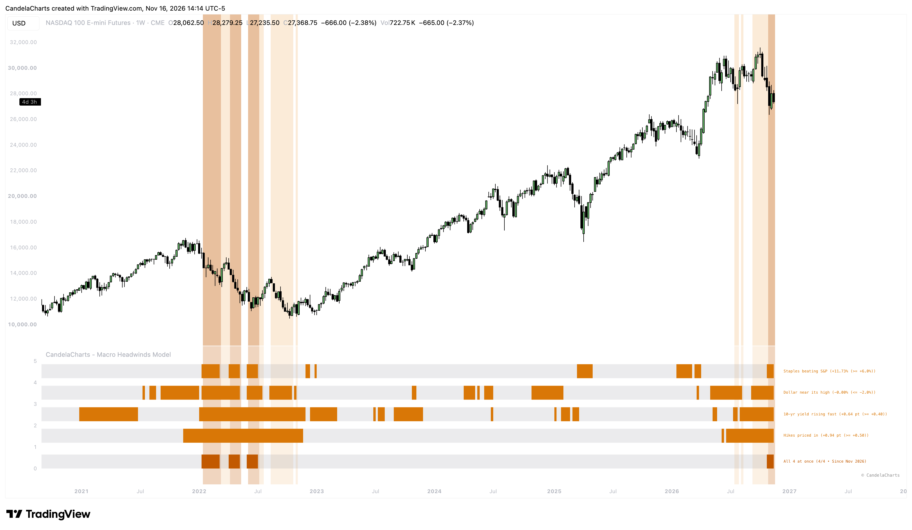

# Macro Headwinds Model


The Macro Headwinds Model is part of <a href="https://www.candelacharts.com/algorithms" class="button secondary medium" data-icon="chart-kanban">CandelaCharts</a>Algorithms, available with the Professional plan.


> Monitor four classic cross-asset macro tightening pressures—defensive rotation, dollar strength, surging long-term yields, and hawkish rate pricing—on a single chart.

<figure><figcaption></figcaption></figure>

### Introduction

Major equity drawdowns rarely happen out of nowhere—they typically unfold when multiple macroeconomic pressures tighten at the same time. Relying on delayed economic reports leaves investors behind the curve, while live cross-asset markets show tightening conditions immediately.

The **CandelaCharts – Macro Headwinds Model** tracks four proven macro headwinds simultaneously: defensive **Consumer Staples leadership**, **US Dollar strength**, **rapidly rising long-term Treasury yields**, and **hawkish Fed rate-hike pricing**. Each factor appears as its own continuous horizontal barcode strip, with a composite fifth strip lighting up when all four pressures align.

Built for **macro traders, equity index investors, and growth-stock allocators**, the model projects clear warning shading directly onto your main price chart whenever **3 of 4** or **all 4** headwinds activate together.


**TL;DR:** **0–2/4** active headwinds mean normal conditions (no chart shading); **3/4** active headwinds paint light shading for elevated risk; and **4/4** active headwinds paint dark shading—historically flagging major macro tightening environments.


### How It Works

**CandelaCharts – Macro Headwinds Model** monitors four independent intermarket pressures on daily data so readings remain consistent across Daily, Weekly, and Monthly charts:

1. **Staples beating S\&P:** Tracks whether defensive Consumer Staples are meaningfully outperforming the broad market (risk-off equity rotation).
2. **Dollar near its high:** Tracks whether the US Dollar Index is pressing near multi-month highs (tightening global dollar liquidity).
3. **10-yr yield rising fast:** Tracks sharp upward velocity in long-term Treasury yields (discount-rate pressure on valuations).
4. **Hikes priced in:** Tracks whether front-end Treasury yields sit well above the Effective Federal Funds Rate (market-implied policy tightening).

Rather than reacting to one isolated factor, the model counts how many of these four headwinds are active simultaneously and escalates visual shading when multi-factor alignment reaches **3/4** or **4/4**.

#### Reading the Indicator

The lower pane displays five horizontal strips paired with optional right-edge labels and main-chart background shading:

| Strip / Shading             | Active Appearance                        | Inactive Appearance  | What It Indicates                                                      |
| --------------------------- | ---------------------------------------- | -------------------- | ---------------------------------------------------------------------- |
| **Staples beating S\&P**    | Highlighted theme strip                  | Dim gray track       | Defensive sector rotation outperforming broad equities                 |
| **Dollar near its high**    | Highlighted theme strip                  | Dim gray track       | Strong US dollar tightening global financial liquidity                 |
| **10-yr yield rising fast** | Highlighted theme strip                  | Dim gray track       | Fast-rising long-end rates pressuring growth valuations                |
| **Hikes priced in**         | Highlighted theme strip                  | Dim gray track       | Bond market pricing tighter Federal Reserve policy                     |
| **All 4 at once**           | Dark theme strip                         | Dim gray track       | All four cross-asset headwinds firing simultaneously                   |
| **Chart & Pane Shading**    | Light shade (`3/4`) / Dark shade (`4/4`) | No shading (`0–2/4`) | Highlights elevated (`3/4`) vs. full (`4/4`) macro tightening on price |

Right-edge labels display each factor's live status (and optional numeric reading vs. threshold), while the bottom label shows the current active score (`0/4` to `4/4`) and when that regime began.

### Features

* **Five-Row Barcode Timeline:** Displays all four individual macro headwinds plus the `All 4 at once` composite row across decades of market history.
* **Two-Tier Chart Shading:** Projects light shading onto your price chart at **3/4** headwinds and dark shading at **4/4** headwinds so macro risk is impossible to miss.
* **Timeframe-Consistent Evaluation:** Keeps lookbacks uniform whether you view Daily, Weekly, or Monthly charts.
* **Live Strip Labels & Tooltips:** Shows current readings, thresholds, and regime start dates directly on the right edge, with hover tooltips explaining the 0–4 scale.
* **12 Preset Color Themes & Full Customization:** Choose from 12 built-in themes or custom colors, toggle chart/pane shading independently, and customize symbols or thresholds.
* **Two Built-In Confluence Alerts:** Notifies you automatically when `3+` or `all 4` headwinds turn on.

### How To Use

#### 1. Gating Risk on Equity Indices & Growth Stocks

Apply the model to **Daily** or **Weekly** charts of major indices (such as the S\&P 500 or Nasdaq) or long-duration growth stocks:

* **0–2 / 4 Headwinds (Unshaded):** Macro headwinds are absent or isolated; normal trend and technical setups carry less macro drag.
* **3 / 4 Headwinds (Light Shading):** Elevated caution—three independent markets confirm tightening pressure. Tighten stops and size positions more conservatively.
* **4 / 4 Headwinds (Dark Shading):** Full macro alignment—all four headwinds are active at once. Prioritize capital preservation and defensive risk management until pressure eases.

#### 2. Seeing Which Macro Force Is Driving Pressure

Scan the top four barcode strips to understand _why_ risk is elevated:

* Active **10-yr yield rising fast** and **Hikes priced in** strips highlight an interest-rate and Fed-policy driven headwind.
* Active **Staples beating S\&P** and **Dollar near its high** strips highlight defensive equity rotation and global liquidity stress.
* Watching individual strips turn back to gray gives an early heads-up that macro headwinds are starting to fade.

#### 3. Customizing Display & Sensitivity

* Toggle **Chart Shading** off if you prefer a clean price pane while keeping the five barcode strips visible below.
* Toggle **Label Values** off for compact strip titles, or switch among the 12 color themes to match dark or light chart layouts.

### Alerts

**CandelaCharts – Macro Headwinds Model** includes two built-in TradingView alert conditions:

1. **3+ Macro Headwinds Active:** Fires when three or more macro headwinds become active simultaneously.
2. **All 4 Macro Headwinds Active:** Fires when all four macro headwinds line up at the same time.

### FAQs

#### 1. Why does the indicator wait for 3 or 4 headwinds before shading the chart?

Any single factor can turn active temporarily during normal market noise. Requiring **3 of 4** (light shading) or **4 of 4** (dark shading) ensures multiple independent asset classes confirm real macro tightening before flagging a regime.

#### 2. Does changing my chart timeframe change how the headwinds are measured?

No. All underlying macro comparisons run on daily market data, so the active headwind count remains consistent across Daily, Weekly, and Monthly charts.

#### 3. Can I customize the benchmarks or sensitivity thresholds?

Yes. Every symbol and threshold in the **Intermarket Symbols** and **Headwind Thresholds** sections can be edited if you want stricter or looser triggers.

#### 4. How can I view the exact score on past candles?

Check the **Headwind Count (0-4)** readout in TradingView's Data Window or status line while hovering over any historical bar, or look at the five barcode strips directly.

#### 5. What should I do when 4/4 headwinds are active?

Treat `4/4` dark shading as a high-alert risk environment rather than an automatic short signal—focus on tighter risk limits, reduced leverage, and waiting for individual strips to begin turning off before deploying aggressive risk.
