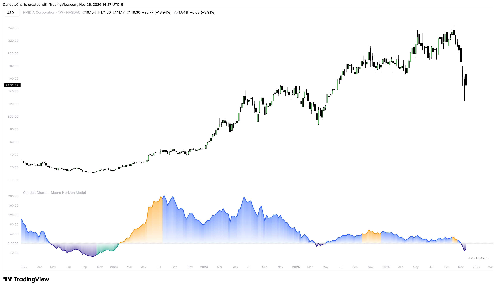

# Macro Horizon Model


Available on:<a href="https://www.candelacharts.com/algorithms" class="button secondary small" data-icon="chart-scatter-bubble">CandelaCharts</a>


> Identify four macroeconomic cycle regimes—aligned expansions, peak divergences, contractions, and trough divergences—by tracking market price against a forward-shifted macro horizon line.

<figure><figcaption></figcaption></figure>

### Introduction

In financial markets, investor mood (reflected in price) moves first, while economic headlines, earnings revisions, and policy narratives catch up months later. By the time news turns uniformly optimistic or bleak, major market turns are often already underway.

The **CandelaCharts – Macro Horizon Model** adapts Alan Hall's Socionomic "Lag Line" concept (from Robert Prechter's _The Socionomic Theory of Finance_) into an interactive cycle oscillator. It tracks the percentage **Horizon Gap** between current market price (social mood) and a forward-shifted trailing baseline (the tone of lagging economic news), filtering noise with built-in buffer bands.

Built for **Daily, Weekly, and Monthly charts**, it classifies every market phase into four color-coded regimes and forecasts upcoming baseline turn dates ahead of time in an optional status panel.


**TL;DR:** Positive gaps show price leading above lagging news (**States 1 & 4**); negative gaps show price below lagging news (**States 2 & 3**). The classic macro cycle rotates sequentially through **State 1 → State 2 → State 3 → State 4 → State 1**.


### How It Works

Designed exclusively for **Daily (`1D`), Weekly (`1W`), and Monthly (`1M`)** charts (intraday charts are blocked because the horizon model operates on calendar-month cycles), **CandelaCharts – Macro Horizon Model** compares current price against a forward-displaced multi-month baseline.

To prevent minor fluctuations around zero from causing false flips, both price crossings and baseline direction changes require clearing configurable hysteresis buffer bands (`Price Band` and `Slope Band`). Because the baseline is shifted forward in time, the indicator can also inspect the already-determined path ahead to estimate the next **Projected Turn** date in the optional HUD panel.

#### Reading the Indicator

The gap renders as an **Area** gradient (default), **Columns**, or **Line** around the zero baseline and dotted upper/lower buffer bands, colored by the four cycle regimes:

| State | Regime Name                       | Default Color | Condition                       | How to Read It                                                   |
| ----- | --------------------------------- | ------------- | ------------------------------- | ---------------------------------------------------------------- |
| **1** | **Aligned Expansion (Bullish)**   | **Blue**      | Price above line, trend rising  | Mood and macro trend aligned upward; supportive expansion        |
| **2** | **Peak Divergence (News Lags)**   | **Navy**      | Price below line, trend rising  | Price breaks down while news stays upbeat; distribution warning  |
| **3** | **Aligned Contraction (Bearish)** | **Teal**      | Price below line, trend falling | Mood and macro trend aligned downward; contraction phase         |
| **4** | **Trough Divergence (News Lags)** | **Orange**    | Price above line, trend falling | Price recovers while news stays gloomy; early accumulation phase |

When **Panel** is toggled on, the table displays `Macro Regime` (with a full cycle-reference tooltip), `Active Since`, `Horizon Gap`, `Horizon Trend`, and `Projected Turn`. Early bars without enough prior history appear gray (`Insufficient History`) until full cycle context is available.

### Features

* **Four-State Socionomic Cycle Engine:** Automatically classifies markets into **Aligned Expansion**, **Peak Divergence**, **Aligned Contraction**, and **Trough Divergence**.
* **Hysteresis Buffer Bands:** Uses configurable `Price Band` and `Slope Band` buffers to filter sideways chop around the zero line.
* **Scheduled Turn Outlook:** Reports the upcoming **Projected Turn** date in the optional status panel based on the already-fixed forward path of the horizon line.
* **Multiple Visual Styles:** Switch cleanly between gradient **Area** fills, **Columns**, or a **Line** oscillator with customizable colors per state.
* **Six Built-In Alerts:** Covers upper and lower band crossings plus transitions into each of the four cycle states.

### How To Use

#### 1. Navigating the Four Macro Cycle States

Apply the indicator to **Daily**, **Weekly**, or **Monthly** charts of major equity indices or liquid macro assets:

* **State 1 (Blue — Aligned Expansion):** Price and trend are aligned upward; favor pro-trend equity positioning.
* **State 2 (Navy — Peak Divergence):** Price has slipped meaningfully below the horizon line even though the broader trend is still rising—treat as a distribution and risk-reduction warning.
* **State 3 (Teal — Aligned Contraction):** Both price and trend are falling; keep risk defensive.
* **State 4 (Orange — Trough Divergence):** Price breaks back above the horizon line while headlines remain gloomy—watch for early accumulation and bottoming formations.

#### 2. Using the Buffer Bands to Avoid Whipsaws

Watch the dotted **Upper Band** and **Lower Band** flanking zero:

* Minor dips or bounces inside the buffer bands do not change the active state, keeping you aligned with the primary cycle during noisy consolidations.
* Confirmed closes beyond the outer bands generate clean `Up cross` and `Down cross` signals.

#### 3. Checking the Optional Panel & Projected Turn

Enable **Panel** when you want an at-a-glance cycle summary:

* Use **Active Since** and **Horizon Gap** to see how extended the current phase is.
* Use **Projected Turn** to see when the lagging horizon trend is scheduled to turn up or down if current market levels hold.

### Alerts

**CandelaCharts – Macro Horizon Model** includes six built-in TradingView alert conditions:

1. **Up cross:** Fires on a confirmed close above the upper price buffer band.
2. **Down cross:** Fires on a confirmed close below the lower price buffer band.
3. **State 1:** Fires upon entering **State 1 – Aligned Expansion** (price above line, trend rising).
4. **State 2:** Fires upon entering **State 2 – Peak Divergence** (price below line, trend rising).
5. **State 3:** Fires upon entering **State 3 – Aligned Contraction** (price below line, trend falling).
6. **State 4:** Fires upon entering **State 4 – Trough Divergence** (price above line, trend falling).

### FAQs

#### 1. Why can I only use Macro Horizon Model on Daily, Weekly, or Monthly charts?

Because the model tracks multi-month calendar horizons, intraday bars do not provide meaningful cycle context. Switch to a **Daily (`1D`)**, **Weekly (`1W`)**, or **Monthly (`1M`)** chart to run the indicator.

#### 2. How can the panel show a Projected Turn date in the future?

Because the trailing baseline is displaced forward in time, the path of the horizon line over the coming months is already determined by historical price closes. The panel scans ahead along that fixed segment to show the next scheduled turn date.

#### 3. Why do the dotted Upper and Lower Bands exist?

They provide a hysteresis buffer around zero so brief, shallow moves across the baseline do not cause rapid state flip-flops.

#### 4. Does the cycle always move through States 1 → 2 → 3 → 4 → 1?

That is the classic progression from expansion (`1`) to peak divergence (`2`), contraction (`3`), and trough divergence (`4`). During unusually sharp V-shaped reversals, the indicator can occasionally skip an intermediate state if both price and slope reverse rapidly.

#### 5. Why do early bars on a chart appear gray?

Determining the direction of the forward-shifted horizon line requires a full baseline history window. While the gap plots from early bars, the four-state color classification activates once enough history is loaded.
