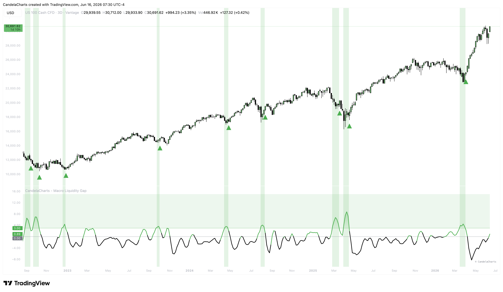

# Macro Liquidity Gap


Available on: <a href="https://www.tradingview.com/scripts/marketplace/CandelaCharts/" class="button secondary small" data-icon="chart-fft">TradingView</a><a href="https://www.candelacharts.com/algorithms" class="button secondary small" data-icon="chart-scatter-bubble">CandelaCharts</a>


> Spot macro value zones and liquidity tailwinds by comparing global central bank liquidity growth against equity market performance.

<figure><figcaption></figcaption></figure>

### Introduction

Market prices and underlying financial liquidity rarely stay disconnected indefinitely. When stock indices surge far faster than global money supply growth, rallies become fragile; when markets sell off or stagnate while central bank liquidity keeps expanding, a favorable **liquidity gap** builds underneath prices.

The **CandelaCharts – Macro Liquidity Gap** monitors this divergence in real time on **Daily and higher timeframes**. Starting with US liquidity by default, you can toggle up to eight major central bank money supplies—plus an optional Federal Reserve Net Liquidity blend—and compare aggregate global liquidity growth directly against the S\&P 500 or any ticker you choose.

Designed for **macro investors, position traders, and asset allocators**, the indicator highlights green **Buy Zones** when liquidity strongly outpaces price, optional main-chart exit signals, and a live component-weights dashboard.


**TL;DR:** Positive readings (**Teal**) mean global liquidity is growing faster than your benchmark index; negative readings (**Red**) mean price is outpacing liquidity. When the surplus crosses above your **Buy Level**, the green **Buy Zone** activates to flag macro value conditions.


### How It Works

On **Daily (`1D`) or higher** timeframes, **CandelaCharts – Macro Liquidity Gap** tracks the net divergence between global liquidity growth and your selected benchmark index (`Comparing To`, defaulting to the S\&P 500). On intraday charts, it displays a clean reminder to switch to a Daily or higher timeframe.

You can customize which global liquidity pools are included across eight major economies (**US**, **China**, **Eurozone**, **Japan**, **UK**, **Canada**, **Switzerland**, and **India**), with live currency normalization and an optional **Fed Net Liquidity** blend for sharper responsiveness to US liquidity shifts.

#### Reading the Indicator

The divergence line plots around a zero baseline using **Teal** for positive liquidity divergence and **Red** for negative divergence, paired with shaded **Buy Zones** and a live dashboard:

| Element                  | Visual Appearance                                          | What It Means for Your Trading                                                                  |
| ------------------------ | ---------------------------------------------------------- | ----------------------------------------------------------------------------------------------- |
| **Buy Zone**             | Green gradient fill + optional pane/chart background shade | Liquidity growth is strongly outpacing market prices—macro value zone active                    |
| **Positive Divergence**  | Teal line above zero                                       | Global liquidity is expanding faster than the comparison index (tailwind)                       |
| **Zero Line**            | Gray horizontal baseline                                   | Liquidity growth and market price growth are balanced                                           |
| **Negative Divergence**  | Red line below zero                                        | Market prices are outpacing underlying liquidity expansion                                      |
| **Buy Zone Exit Signal** | Green upward triangle below price (`Show Signals`)         | Divergence has exited the Buy Zone as price begins catching up to liquidity                     |
| **Component Dashboard**  | Corner table                                               | Lists active liquidity weights, live divergence %, and active `Signal` (`Buy Zone` / `Neutral`) |

### Features

* **Eight Global Central Bank Feeds:** Individually enable or disable US, China, Eurozone, Japan, UK, Canada, Switzerland, and India money supply pools, automatically normalized to USD.
* **Optional Fed Net Liquidity Blend:** Combine traditional US money supply with Federal Reserve Net Liquidity at your preferred blend percentage for faster policy sensitivity.
* **Automated Buy Zones & Chart Overlay:** Highlights liquidity-surplus value regimes on the pane and optionally projects shaded zones directly behind your price candles.
* **Main-Chart Exit Triangles:** Optionally display upward signals on price when the market exits a macro Buy Zone.
* **Live Weights Dashboard:** Displays each enabled liquidity component's real-time share alongside current divergence and zone status.
* **Built-In & Webhook Alerts:** Ships with five TradingView alert conditions plus dynamic bar-close alerts for automated workflows.

### How To Use

#### 1. Identifying Macro Value Zones

Look for the oscillator climbing into the shaded green **Buy Zone**:

* This happens when central bank liquidity is expanding meaningfully faster than equity prices—typically during market pullbacks or early liquidity infusions.
* Enable **Show Chart Overlay** to view these macro Buy Zones shaded directly across your price chart history.

#### 2. Timing Catch-Up Moves with Exit Signals

Turn **Show Signals** on if you want clear visual markers on the main chart:

* Green upward triangles appear as the divergence drops back out of the Buy Zone, indicating that asset prices are beginning to catch up to the prior liquidity surplus.
* Pair these macro signals with your preferred price-action or trend entries rather than trading them blindly on a single candle.

#### 3. Tailoring Liquidity Pools to Your Market

* Keep the default US configuration for a clean domestic liquidity baseline, or enable **Fed Net Liquidity** when focusing closely on US Treasury and Fed liquidity shifts.
* Enable European, Asian, and other major central bank pools when analyzing global risk assets like broad equity indices, gold, or crypto, and check the **Dashboard** to see each region's active weight.

### Alerts

**CandelaCharts – Macro Liquidity Gap** includes five built-in TradingView alert conditions (plus matching bar-close webhook alerts):

1. **Divergence Turned Positive:** Fires when liquidity growth crosses above comparison index growth.
2. **Divergence Turned Negative:** Fires when comparison index growth crosses above liquidity growth.
3. **Entered Buy Zone:** Fires when positive divergence reaches your Buy Level threshold.
4. **Large Positive Divergence:** Fires on strong liquidity-surplus extremes.
5. **Large Negative Divergence:** Fires on strong liquidity-deficit extremes.

### FAQs

#### 1. Why does Macro Liquidity Gap require Daily (1D) or higher timeframes?

Central bank money supply and Federal Reserve liquidity data update on macro schedules rather than intraday ticks. Using Daily or higher charts keeps comparisons accurate and consistent.

#### 2. Why does the Buy Zone trigger on high positive divergence?

Because the indicator tracks **Liquidity Growth minus Market Growth**, a large positive reading means liquidity is expanding significantly faster than prices—creating a supportive cushion or undervaluation gap relative to available capital.

#### 3. What does enabling Fed Net Liquidity do?

Broad money supply updates slowly. Blending in **Fed Net Liquidity** lets the US component react more quickly to shifts in Federal Reserve liquidity conditions.

#### 4. Can I compare liquidity against assets other than the S\&P 500?

Yes. Enter any TradingView ticker (such as the Nasdaq, Gold, or Bitcoin) in the `Comparing To` input to measure global liquidity divergence against that asset.

#### 5. When do the green triangles appear on the main chart?

When `Show Signals` is enabled, green triangles appear on the price chart as the indicator exits a green **Buy Zone**, marking the transition where price begins closing the gap with liquidity.
