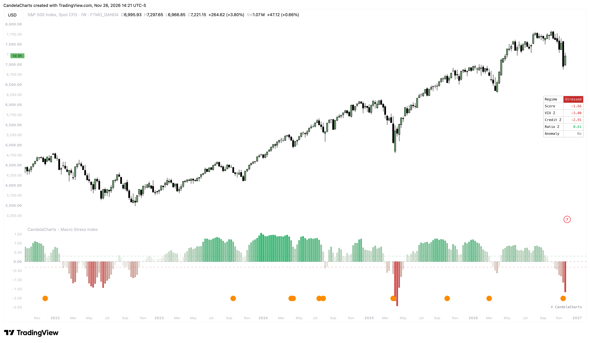

# Macro Stress Index


Available on:<a href="https://www.candelacharts.com/algorithms" class="button secondary small" data-icon="chart-scatter-bubble">CandelaCharts</a>


> Condense market volatility, corporate credit risk, and stock-to-Treasury appetite into one timeframe-consistent macro regime score.

<figure><figcaption></figcaption></figure>

### Introduction

Monitoring macro risk across separate charts—checking volatility on one tab, credit spreads on another, and equity-vs-bond rotation on a third—makes it easy to miss gradual shifts in the broader backdrop until price has already moved.

The **CandelaCharts – Macro Stress Index** blends those three macro pillars into a single normalized composite score oscillating around **0**: **implied volatility**, **high-yield credit spreads**, and **stock-vs-Treasury leadership**. Because every component is measured relative to its own recent history, the score shows immediately whether overall macro conditions are unusually calm and supportive or unusually stressed.

Designed for **macro traders, swing traders, and asset allocators**, it delivers identical non-repainting daily readings on any chart timeframe, flags statistical **Anomalies**, and includes an on-chart HUD panel.


**TL;DR:** Positive scores above the **Bull Threshold** (**Green**) indicate a **Supportive** risk-on macro backdrop; negative scores below the **Bear Threshold** (**Red**) indicate a **Stressed** risk-off environment. Orange dots along the bottom flag extreme statistical anomalies.


### How It Works

**CandelaCharts – Macro Stress Index** pulls all underlying market data on a daily basis so the composite score reads identically whether you place it on a 4-hour, Daily, or Weekly chart—without intrabar repainting. Rising fear (higher volatility and wider credit spreads) pushes the score **down** into negative territory, while equities outperforming Treasuries push the score **up** into positive territory.

You can adjust the relative weights of the three components, switch on **Use Macro Preset (>6 months)** for a slower multi-quarter perspective, and monitor **Anomaly Detection** markers whenever the score stretches unusually far from recent norms.

#### Reading the Indicator

The composite renders as **Columns** (default), **Area**, or **Line** with adaptive transparency—fading near zero during neutral conditions and sharpening at extremes:

| Element                | Visual Appearance                  | What It Means for Your Trading                                                                                                |
| ---------------------- | ---------------------------------- | ----------------------------------------------------------------------------------------------------------------------------- |
| **Supportive Regime**  | Vivid Green above `Bull Threshold` | Calm volatility, contained credit risk, and equity leadership—favorable for risk-on setups                                    |
| **Neutral Zone**       | Faded / translucent around `0`     | Mixed or transitioning macro forces; rely on selective price setups                                                           |
| **Stressed Regime**    | Vivid Red below `Bear Threshold`   | Rising fear, widening credit spreads, or defensive flight to Treasuries                                                       |
| **Anomaly Marker**     | Orange circle along the bottom     | Statistical extreme caution flag—conditions have stretched unusually far, unusually fast                                      |
| **On-Chart HUD Panel** | Main-chart corner table            | Shows `Regime` badge (`Supportive`/`Neutral`/`Stressed`), `Score`, `VIX Z`, `Credit Z`, `Ratio Z`, and `Anomaly` (`Yes`/`No`) |

### Features

* **Three-Signal Macro Composite:** Combines market volatility, high-yield credit spreads, and stock-to-Treasury rotation into one unified oscillator.
* **Normalized Component Weighting:** Adjust relative emphasis across the three legs while keeping the overall score on a consistent scale.
* **One-Click Macro Preset:** Toggle `Use Macro Preset (>6 months)` to switch immediately to a smoother, longer-horizon configuration.
* **Timeframe-Consistent Readings:** Evaluates all components on daily data so readings stay identical across intraday, daily, and weekly charts with no intrabar repainting.
* **Statistical Anomaly Detection:** Flags extreme deviations with orange bottom markers and a live `Anomaly` status row.
* **Adaptive Visuals & Main-Chart HUD:** Choose `Columns`, `Area`, or `Line` styles and view component breakdowns directly in the on-chart HUD table.
* **Three Built-In Alerts:** Alerts on bullish threshold breakouts, bearish threshold breakdowns, and statistical anomalies.

### How To Use

#### 1. Using MSI as a Top-Down Regime Filter

Use the Macro Stress Index to set your broader directional bias before taking lower-timeframe entries:

* **Supportive (Green above Bull Threshold):** Macro winds are at your back. Favor long trend setups and standard risk sizing.
* **Neutral (Near Zero):** Macro conditions are undecided; avoid over-sizing and focus on higher-conviction structures.
* **Stressed (Red below Bear Threshold):** Macro conditions are fragile. Trim exposure, tighten risk, or wait for the score to stabilize back above the bearish band.

#### 2. Diagnosing Drivers in the HUD Panel

Check the individual rows inside the **HUD Panel** (`VIX Z`, `Credit Z`, and `Ratio Z`) to see what is moving the score:

* When all three rows align green or red, the regime signal carries broad cross-asset confirmation.
* When only one leg dips while the others remain calm, stress may be localized rather than a full systemic shift.

#### 3. Using Anomaly Dots & the Macro Preset

* **Anomaly Markers:** Treat orange dots as an early caution flag that conditions have moved to a statistical extreme—ideal for tightening risk rather than acting as a standalone buy or sell trigger.
* **Macro Preset:** Enable **Use Macro Preset (>6 months)** when managing longer-term portfolios to filter short-term noise.

### Alerts

**CandelaCharts – Macro Stress Index** includes three built-in TradingView alert conditions:

1. **MSI Bull Signal:** Fires when the score crosses above your `Bull Threshold` into supportive conditions.
2. **MSI Bear Signal:** Fires when the score crosses below your `Bear Threshold` into stressed conditions.
3. **MSI Anomaly:** Fires when a statistical extreme is detected by the anomaly detector.

### FAQs

#### 1. Why are positive scores Supportive and negative scores Stressed?

Higher volatility and wider credit spreads reflect market fear, so they count negatively toward the score, while equities outperforming Treasuries count positively. This makes the indicator intuitive: **positive = calm/supportive**, **negative = stressed**.

#### 2. Does the score change if I switch chart timeframes?

No. Because all underlying legs update on daily market data, the score stays identical on 4-hour, Daily, and Weekly charts and does not repaint intrabar.

#### 3. How should I use the orange Anomaly markers?

Treat an Anomaly marker as a caution warning that macro stress or calm has reached an unusual extreme relative to recent history—a cue to review exposure rather than an automatic entry signal.

#### 4. What does Use Macro Preset (>6 months) do?

Enabling `Use Macro Preset (>6 months)` automatically switches the indicator to a slower, smoother configuration tailored for multi-quarter macro positioning.

#### 5. Can I customize the underlying symbols or weights?

Yes. Under **Symbols** and **Component Weights**, you can replace any of the four market tickers or adjust how strongly each pillar influences the composite score (keeping total weights near `1.0`).
