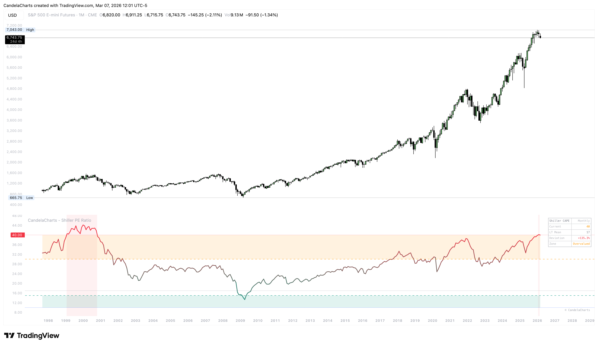

# Shiller PE Ratio


The Shiller PE Ratio is part of <a href="https://www.candelacharts.com/indicators" class="button secondary medium" data-icon="chart-kanban">CandelaCharts</a>Indicators, for the TradingView platform, available in the Investing and Institutional plans.


> Gauge long-term stock market valuation against 10 years of inflation-adjusted earnings to spot historic overvaluation extremes and deep value zones.

<figure><figcaption></figcaption></figure>

### Introduction

Standard price-to-earnings (`P/E`) ratios only look at one year of earnings, which can make markets look deceptively expensive during recessions (when earnings temporarily plunge) and deceptively cheap near cyclical peaks (when profit margins are unusually high).

The **CandelaCharts – Shiller PE Ratio** plots Yale Professor Robert Shiller's Cyclically Adjusted Price-to-Earnings Ratio (**CAPE / CAPE10**) directly on your TradingView chart. By smoothing earnings over a full 10-year inflation-adjusted cycle, it filters out short-term noise and frames current valuations against more than a century of market history.

Designed for **long-term investors, macro allocators, and position traders**, it visualizes valuation zones, historical-mean deviation, optional candle coloring, and a live summary dashboard.


**TL;DR:** Readings in the **Undervalued** zones point to historically attractive long-term entry windows, readings near the **Historical Mean** reflect balanced norms, and readings in **Overvalued** or **Ext. Overvalued** warn of stretched expectations and elevated drawdown risk.


### How It Works

**CandelaCharts – Shiller PE Ratio** streams the official Shiller CAPE10 benchmark in either **Monthly** (default) or **Yearly** resolution, with optional smoothing. It classifies the active CAPE reading into five customizable valuation zones and tracks how far current valuations sit above or below your chosen **Historical Mean** reference.


**General Formula:** Shiller PE Ratio (CAPE) = Current S\&P 500 Price / 10-Year Average Inflation-Adjusted Earnings


#### Reading the Indicator

The CAPE line shifts along a cool-to-hot gradient from **Dark Cyan** (deep value) through **Gray** (fair value) to **Bright Red** (extreme overvaluation), paired with horizontal zone guides, shaded bands, and extreme background pulses:

| Valuation Zone       | Visual Guide & Shading                                    | What It Means for Your Investing                                                      |
| -------------------- | --------------------------------------------------------- | ------------------------------------------------------------------------------------- |
| **Ext. Undervalued** | Dark Cyan line + dotted Blue guide + subtle Blue BG pulse | Generational deep-value territory with historically strong multi-year forward returns |
| **Undervalued**      | Green line + dashed Teal guide + Teal zone fill           | Historically attractive long-term valuation below fair value norms                    |
| **Fair Value**       | Gray line around dotted `Historical Mean` midline         | Balanced valuation range consistent with long-term averages                           |
| **Overvalued**       | Orange line + dashed Orange guide + Orange zone fill      | Stretched multiples; higher vulnerability to cyclical corrections                     |
| **Ext. Overvalued**  | Bright Red line + dotted Red guide + subtle Red BG pulse  | Historic bubble territory; elevated long-horizon valuation risk                       |

The top-right **Dashboard** displays the active `Resolution` (`Monthly` or `Yearly`), `Current` CAPE value, `LT Mean` baseline, percentage `Deviation` from mean, and active `Zone` classification.

### Features

* **Official Shiller CAPE10 Series:** Displays authoritative long-term market valuation data in either **Monthly** or **Yearly** resolution.
* **Five Valuation Regimes:** Clearly frames **Ext. Undervalued**, **Undervalued**, **Fair Value**, **Overvalued**, and **Ext. Overvalued** zones with customizable thresholds and shaded bands.
* **Extreme Regime Background Pulses:** Subtly highlights historic valuation extremes on the pane for rapid visual recognition.
* **Historical Mean Deviation:** Tracks real-time percentage stretch above or below your chosen long-term mean in the Dashboard.
* **Optional Bar Coloring & Smoothing:** Project valuation colors directly onto your main price candles (`Bar Color`) or apply optional smoothing to the CAPE curve.

### How To Use

#### 1. Aligning Long-Term Expectations with Valuation Zones

Use the **Zone** and **Deviation** readouts to set realistic forward return and risk expectations:

* **Overvalued / Ext. Overvalued:** Expect heightened sensitivity to macro or earnings disappointments. Emphasize quality, diversification, and disciplined risk management rather than chasing late-cycle euphoria.
* **Undervalued / Ext. Undervalued:** Historically depressed multiples relative to 10-year real earnings—ideal windows for long-horizon dollar-cost averaging and strategic accumulation.

#### 2. Tracking Deviation from the Historical Mean

Monitor the **Dashboard**'s `Deviation` percentage relative to your `Historical Mean`:

* Extreme positive deviations show how far market optimism has stretched above long-term norms.
* You can keep the long-term post-1881 average or adjust `Historical Mean` in settings if you prefer benchmarking against modern post-WWII averages.

#### 3. Choosing Monthly vs. Yearly & Bar Color

* **Monthly (Default):** Updates monthly for sharper cyclical timing on Daily, Weekly, or Monthly charts.
* **Yearly:** Smooths intra-year moves for multi-decade secular charts.
* **Bar Color:** Toggle on to paint your main price candles directly with the valuation gradient.

### Alerts

This indicator does not currently include built-in alerts.

### FAQs

#### 1. How is Shiller PE different from a standard P/E ratio?

A standard P/E ratio divides price by just one year of earnings, which spikes artificially during recessions and shrinks near cycle peaks. The **Shiller PE (CAPE)** averages **10 years** of inflation-adjusted earnings to reveal true structural valuation.

#### 2. Does Shiller PE change if I switch my chart to a different ticker?

No. The indicator always tracks the broad US equity market **Shiller CAPE10** benchmark as a macro valuation backdrop, regardless of which stock, ETF, or asset is open on your chart.

#### 3. What is the difference between Monthly and Yearly resolution?

**Monthly** updates on a monthly cadence for finer cycle tracking, while **Yearly** shows annual readings for broad multi-decade historical perspective.

#### 4. Can I adjust the Historical Mean or valuation zone levels?

Yes. All five zone thresholds (`Extreme Overbought`, `Overbought`, `Historical Mean`, `Oversold`, and `Extreme Oversold`) are customizable in settings, and the Dashboard's `Deviation` percentage updates automatically.

#### 5. What does the Bar Color option do?

Enabling **Bar Color** colors your main price chart candles with the same cool-to-hot valuation gradient as the CAPE line, letting you see macro valuation context directly on price.
