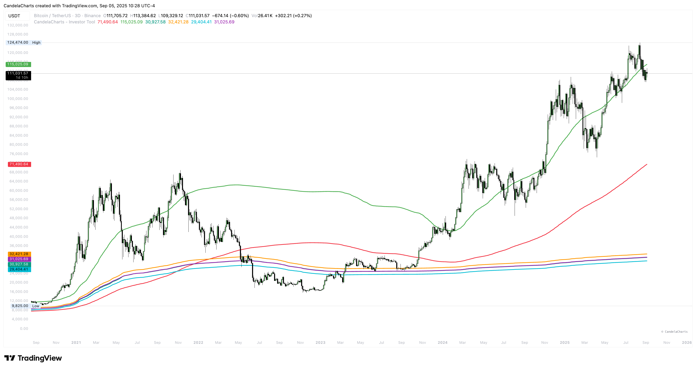

# Investor Tool


Available on: <a href="https://www.candelacharts.com/algorithms" class="button secondary small" data-icon="chart-scatter-bubble">CandelaCharts</a>


> Frame long-term market cycles, valuation stretch zones, and institutional volume-weighted fair value directly on your price chart.

<figure><figcaption></figcaption></figure>

### Introduction

Long-term investing feels chaotic when you only stare at raw price swings. Without objective trend baselines and fair-value anchors, it is easy to mistake a late-cycle parabolic blow-off for a safe entry—or panic-sell near generational cycle bottoms.

The **CandelaCharts – Investor Tool** overlays three complementary long-horizon tools directly onto your main chart: timeframe-adaptive **Investor Bands** for spotting cycle tops and bottoms, a **4-VWAP** suite anchored to key calendar resets (`Open`, `High`, `Low`, and `Close`), and optional **Percentage Bands** for ultra-long-term secular framing.

Built for **position traders, macro investors, and long-term capital allocators**, it keeps trend slope, overextension bands, and anchored volume-weighted fair value clearly visible on one clean overlay.


**TL;DR:** Use the **Investor Bands** (`Investor Top`, `Investor Bottom`, and `Lower Band`) to gauge macro cycle stretch, and use the anchored **4-VWAP** lines as dynamic fair-value magnets for scaling in and out across days, quarters, or years.


### How It Works

**CandelaCharts – Investor Tool** runs three toggleable overlay layers directly on price:

1. **Investor Bands (`Enable Investor Bands`):** Plots a multi-year moving baseline (**Investor Bottom**, Red) flanked by an upper stretch band (**Investor Top**, Green) and a lower support band (**Lower Band**, Blue), automatically adapting its period scale when you switch between Daily, Weekly, Monthly, and intraday charts.
2. **4-VWAP Suite (`Enable 4-VWAP`):** Plots four concurrent anchored volume-weighted average price lines (**Open**, **High**, **Low**, and **Close**) that reset cleanly at your chosen calendar `Anchor` (`Day`, `Week`, `Month`, `Quarter`, `Year`, `Decade`, or `Century`).
3. **Percentage Bands (`Enable Percentage Bands`, optional):** Overlays an all-history cumulative baseline flanked by upper and lower percentage bands for broad secular cycle perspective.

#### Reading the Indicator

All three layers plot directly over your price candles with distinct, easy-to-track colors:

| Layer / Line                         | Color                                    | What It Represents                                                                |
| ------------------------------------ | ---------------------------------------- | --------------------------------------------------------------------------------- |
| **Investor Top (Upper Band)**        | Green                                    | Upper volatility stretch zone; historically aligns with overheated cycle highs    |
| **Investor Bottom (Baseline)**       | Red                                      | Core multi-year trend baseline separating macro expansion from deep value         |
| **Lower Band (Support)**             | Blue                                     | Lower volatility discount zone; highlights deep cycle compression                 |
| **WVAP (Open / High / Low / Close)** | Teal / Orange / Aqua / Purple            | Four anchored volume-weighted fair-value levels resetting on your chosen `Anchor` |
| **Percentage Bands** _(Optional)_    | Teal (Upper) / Gray (Base) / Red (Lower) | All-history cumulative fair-value baseline with adjustable upper and lower bands  |

### Features

* **Timeframe-Adaptive Investor Bands:** Automatically adjusts your chosen multi-year `MA Period` across Daily, Weekly, Monthly, and intraday charts so cycle framing stays consistent.
* **Three-Line Cycle Framing:** Displays **Investor Top** (Green), **Investor Bottom** (Red), and **Lower Band** (Blue) together for full upside stretch and downside discount visibility.
* **Concurrent 4-VWAP Anchors:** Tracks four simultaneous anchored VWAP levels (**Open**, **High**, **Low**, and **Close**) across seven calendar anchors from **Day** to **Century**.
* **Optional Secular Percentage Bands:** Toggle `Enable Percentage Bands` to add an all-history baseline and percentage envelope on long-term asset charts.
* **Modular Overlay Controls:** Turn **Investor Bands**, **4-VWAP**, or **Percentage Bands** on or off independently to keep your chart focused on your exact horizon.

### How To Use

#### 1. Framing Cycle Tops & Bottoms with Investor Bands

Use the three **Investor Bands** as a macro valuation map:

* **Trend Bias:** Observe the slope of the red **Investor Bottom** baseline—a rising baseline favors buying pullbacks, while a flat or declining baseline favors patience.
* **Upside Stretch (`Investor Top`):** When price extends near or above the green **Investor Top** band, euphoria and cycle risk are elevated—consider trimming into strength or tightening risk.
* **Deep Value (`Investor Bottom` / `Lower Band`):** Approaches toward the red baseline and blue **Lower Band** highlight compressed, high-value accumulation zones once price stabilizes.

#### 2. Using Anchored 4-VWAPs as Fair-Value Magnets

Enable **4-VWAP** (`Year` anchor by default) to track where institutional volume has transacted across the active period:

* Price trading cleanly above the **4-VWAP** cluster signals buyers control the active period; price trading below signals sellers control average cost basis.
* Retests into the tight ribbon formed by the **Open**, **High**, **Low**, and **Close** VWAPs frequently act as dynamic fair-value support in uptrends or resistance in downtrends.

#### 3. Staging Long-Term Entries Across Time Horizons

* **Swing & Tactical Entries:** Set `Anchor` to **Month** or **Quarter** to catch mean-reversion retests inside an active trend.
* **Macro & Secular Positioning:** Keep `Anchor` on **Year**, **Decade**, or **Century** and adjust `MA Period` (Years) and `Multiplier` to match your asset's volatility—scaling gradually across band and anchor retests rather than making all-in bets.

### Alerts

This indicator does not currently include built-in alerts.

### FAQs

#### 1. How do Investor Top, Investor Bottom, and Lower Band work together?

**Investor Bottom** (Red) acts as the core multi-year trend average, **Investor Top** (Green) marks an upper statistical stretch zone where cycles often overheat, and **Lower Band** (Blue) marks deep discount support below the baseline.

#### 2. Why are there four WVAP lines (Open, High, Low, Close)?

Each line anchors volume-weighted average price to a different part of the candle (`Open`, `High`, `Low`, and `Close`) from the same calendar reset point. Together, they form a dynamic **fair-value ribbon** rather than a single rigid line.

#### 3. Which Anchor setting should I choose for 4-VWAP?

Use **Day** or **Week** for short-term intraday and swing trading, **Month** or **Quarter** for medium-term positioning, and **Year** (default), **Decade**, or **Century** for long-term investing context.

#### 4. What does enabling Percentage Bands add?

**Percentage Bands** (`Enable Percentage Bands`, off by default) adds an all-history cumulative baseline flanked by adjustable upper and lower percentage bands—useful if you want a slow, full-history benchmark alongside the adaptive Investor Bands.

#### 5. Does Investor Tool adapt automatically when I switch chart timeframes?

Yes. The **Investor Bands** automatically scale their moving average length when switching across Daily, Weekly, Monthly, and intraday charts, while the **4-VWAP** suite continues anchoring to your selected calendar boundary (provided volume data is available on the ticker).
