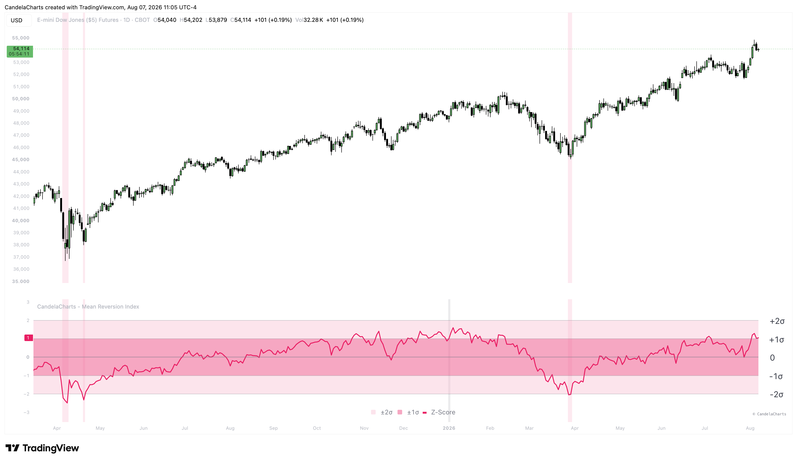

# Mean Reversion Index


The Mean Reversion Index is part of <a href="https://www.candelacharts.com/indicators" class="button secondary medium" data-icon="chart-kanban">CandelaCharts</a>Indicators, for the TradingView platform, available in the Investing and Institutional plans.


> Spot overextended rallies and deep oversold Buy Zones by tracking how far price has stretched from its long-term baseline, framed by automatic time cycles.

<figure><figcaption></figcaption></figure>

### Introduction

Assets routinely surge too far ahead of their long-term trend during euphoric rallies and collapse too far below it during panics—only to snap back toward fair value once momentum exhausts. Without a normalized yardstick, comparing how stretched one market is against another—or against its own multi-year history—becomes guesswork.

The **CandelaCharts – Mean Reversion Index** standardizes price distance from its long-term moving baseline into a clear Z-Score oscillator framed by shaded **±1σ** and **±2σ** zones. Whenever price plunges into extreme oversold territory below **-2σ**, the indicator illuminates a dedicated **Buy Zone**—which you can also project directly onto your main price chart.

Designed for **mean-reversion traders, swing traders, and long-term investors**, it combines clean statistical zones, 12 customizable themes, and automatic timeframe-scaled **Time Cycles** dividers.


**TL;DR:** Moves inside **-1σ to +1σ** reflect normal trend noise; pushes above **+2σ** signal stretched overbought risk; and drops below **-2σ** activate the highlighted **Buy Zone** for potential bottoming and mean-reversion setups.


### How It Works

**CandelaCharts – Mean Reversion Index** measures how far current price sits above or below its rolling baseline (`Length`) relative to the asset's historical range of stretch over your chosen lookback (`Lookback (Bars)`), with optional `Smoothing` to calm short-term chatter.

Shaded horizontal zones mark **±1σ** (typical fluctuation) and **±2σ** (statistical extremes) around a solid **0** midline, while **Time Cycles** automatically place subtle vertical period dividers tuned to your active chart timeframe.

#### Reading the Indicator

The Z-Score line moves across shaded standard-deviation bands labeled on the right edge (`-2σ`, `-1σ`, `0`, `+1σ`, `+2σ`) and summarized in a bottom-center inline legend:

| Zone / Element           | Visual Appearance                              | What It Means for Your Trading                                                     |
| ------------------------ | ---------------------------------------------- | ---------------------------------------------------------------------------------- |
| **Above +2σ**            | Line above upper shaded band                   | Statistically overextended to the upside; elevated pullback or mean-reversion risk |
| **+1σ to +2σ**           | Light outer shaded band                        | Strong upside momentum stretching beyond routine range                             |
| **-1σ to +1σ**           | Darker inner shaded band around `0`            | Normal trading range around the baseline mean                                      |
| **-1σ to -2σ**           | Light outer shaded band                        | Developing downside stretch approaching oversold territory                         |
| **Below -2σ (Buy Zone)** | Highlighted pane + optional main-chart shading | Extreme oversold stretch; potential macro bottom or bounce setup                   |
| **Time Cycles**          | Subtle vertical background dividers            | Marks automatic calendar cycles scaled to your chart timeframe                     |

### Features

* **Normalized Z-Score Oscillator:** Measures price extension in standard-deviation units (`σ`) so overbought and oversold zones remain consistent across any asset or timeframe.
* **Shaded ±1σ & ±2σ Volatility Bands:** Visually separates normal price noise (`±1σ`) from statistically significant extremes (`±2σ`) with a clean bottom-center legend.
* **Automated Buy Zone Highlighting:** Illuminates the oscillator background below **-2σ**, with an optional `Show Buy Zones` toggle to shade those exact zones behind your price candles.
* **Automatic Time Cycles:** Draws subtle calendar dividers (daily, weekly, monthly, yearly, or 5-year cycles) scaled automatically to your active chart timeframe.
* **12 Preset Themes & Custom Colors:** Choose from 12 built-in color palettes or create your own light/dark theme under `Custom`.

### How To Use

#### 1. Identifying Overbought (+2σ) & Oversold (-2σ) Extremes

Use the outer **±2σ** boundaries to avoid chasing late moves:

* **Above +2σ:** Price has stretched unusually far above its baseline. Tighten trailing stops, take partial profits, or look for confirmation before adding new longs.
* **Below -2σ:** The **Buy Zone** activates, indicating deep downside stretch where sellers may be reaching exhaustion.

#### 2. Timing Mean-Reversion Entries Back Toward Zero

Wait for confirmation rather than stepping in front of a falling knife:

* Monitor the oscillator as it dips below **-2σ** (or rises above **+2σ**), then watch for the line to **hook back across the ±2σ boundary toward 0**.
* That curl back toward the midline signals that price extension is stalling and mean reversion is beginning.

#### 3. Using Main-Chart Buy Zones & Time Cycles

* Enable **Show Buy Zones** to highlight **-2σ** oversold windows directly behind price bars—making it easy to see where deep historical discounts lined up with multi-year bottoms.
* Keep **Time Cycles** enabled to stay oriented within daily, monthly, yearly, or 5-year calendar rhythms without manually drawing vertical lines.

### Alerts

This indicator does not currently include built-in alerts.

### FAQs

#### 1. What do the ±1σ and ±2σ shaded bands represent?

The inner **±1σ** band captures routine price movement around the baseline, while the **±2σ** band marks statistically unusual stretches—above `+2σ` for overbought euphoria and below `-2σ` for oversold Buy Zones.

#### 2. What does the Show Buy Zones toggle add?

By default, the indicator shades the oscillator pane whenever readings fall below `-2σ`. Enabling **Show Buy Zones** projects that same highlight directly onto your main price chart behind the candles.

#### 3. How do Time Cycles adapt when I switch timeframes?

**Time Cycles** automatically selects an appropriate calendar spacing based on your chart timeframe—showing daily dividers on fast intraday charts, weekly or monthly dividers on mid-range intraday charts, yearly dividers on Daily charts, and 5-year dividers on Weekly or Monthly charts.

#### 4. When should I adjust Length, Lookback, or Smoothing?

Lower `Length` or `Lookback (Bars)` if you want the baseline and extreme bands to adapt faster for short-term swing trading; keep longer settings for broad multi-year cycle positioning. Increase `Smoothing` slightly if you want a cleaner curve on noisy assets.

#### 5. Can I customize the indicator colors?

Yes. Under **Themes**, pick any of the 12 built-in palettes (such as `Blue`, `Teal`, `Purple`, or `Red`) or choose `Custom` to define your own light and dark colors.
