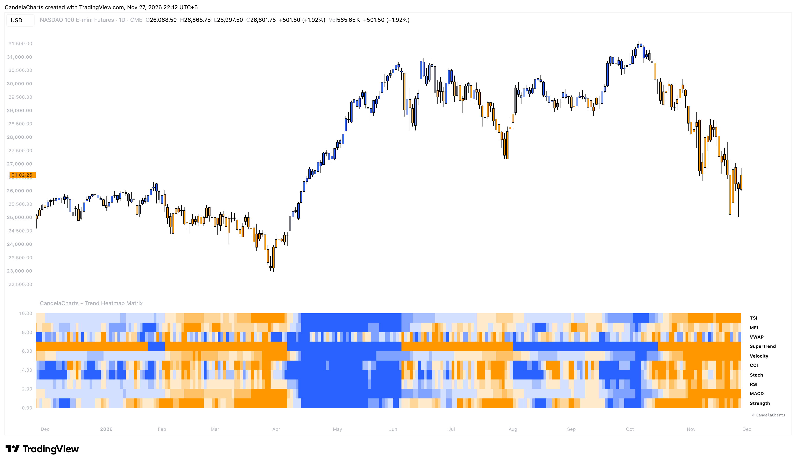

# Trend Heatmap Matrix


The Trend Heatmap Matrix is part of <a href="https://www.candelacharts.com/algorithms" class="button secondary medium" data-icon="chart-kanban">CandelaCharts</a>Algorithms, available with the Professional plan.


> Track 10 momentum, trend, and volume factors across 11 timeframes in one unified heatmap and multi-timeframe conviction dashboard.

<figure><figcaption></figcaption></figure>

### Introduction

Relying on a single oscillator or moving average often traps traders on the wrong side of momentum—while stacking ten separate indicators across your chart quickly turns your workspace unreadable. Knowing whether price action has broad cross-indicator support across multiple timeframes usually means flipping between tabs and tools.

The **CandelaCharts – Trend Heatmap Matrix** consolidates **10 distinct technical factors**—**Strength**, **MACD**, **RSI**, **Stochastic**, **CCI**, **Velocity**, **Supertrend**, **VWAP**, **MFI**, and **TSI**—into one stacked visual heatmap. Every row changes color and opacity dynamically to reflect both direction and conviction, while an optional **11-timeframe dashboard** tracks consensus from `5m` all the way to `1M`.

Built for **scalpers, day traders, swing traders, and investors**, it adapts automatically via four **Trading Profiles** and optionally colors your main chart candles by overall matrix bias.


**TL;DR:** Aligned rows in your bullish color signal unified upside momentum (**STRONG LONG**), aligned rows in your bearish color signal unified downside pressure (**STRONG SHORT**), and mixed rows warn of choppy or divided market conviction.


### How It Works

**CandelaCharts – Trend Heatmap Matrix** evaluates ten independent trend, momentum, volatility, and volume components simultaneously and stacks each active component as a labeled horizontal band. Selecting a **Trading Profile** (`Scalping`, `Day Trade`, `Swing`, or `Investment`) tunes every underlying component together to fit your preferred holding horizon.

You can toggle individual components on or off, assign custom timeframes to any individual row, and view real-time bullish vs. bearish alignment across **11 timeframes (`5m` through `1M`)** in the on-chart **Dashboard**. By default, `Allow Repainting?` stays off so historical multi-timeframe readings remain non-repainting.

#### Reading the Indicator

Each active row in the lower pane shades according to your selected **Theme** (defaulting to **Blue** for bullish and **Orange** for bearish), while `Dynamic Intensity?` adjusts opacity based on trend strength:

| Element                       | Visual Appearance                                        | What It Means for Your Trading                                                                     |
| ----------------------------- | -------------------------------------------------------- | -------------------------------------------------------------------------------------------------- |
| **Heatmap Rows (10 Factors)** | Bullish (`Blue`) vs. Bearish (`Orange`) horizontal bands | Shows which specific momentum, trend, or volume factors agree at every bar                         |
| **Dynamic Intensity**         | Solid vivid fill vs. faint translucent fill              | Solid rows indicate strong conviction; faint rows indicate weak or borderline readings             |
| **Main-Chart Bar Coloring**   | Candles painted by consensus bias (`Color bars?`)        | Reflects overall matrix bias (`Strong Long`, `Lean Long`, `Neutral`, `Lean Short`, `Strong Short`) |
| **MTF Dashboard**             | 11-row table (`5m` to `1M`) with highlighted active TF   | Displays `Active Factors`, `Bull / Bear / Neutral` counts, `Conviction %`, and `Trading Bias`      |

### Features

* **10-Factor Consensus Matrix:** Combines **Strength**, **MACD**, **RSI**, **Stochastic**, **CCI**, **Velocity**, **Supertrend**, **VWAP**, **MFI**, and **TSI** into one compact heatmap—each individually toggleable.
* **Four Master Trading Profiles:** Switch between **Scalping**, **Day Trade**, **Swing**, and **Investment** to recalibrate all 10 factors to your trading horizon in one click.
* **11-Timeframe Conviction Dashboard:** Summarizes live alignment across `5m`, `15m`, `30m`, `1H`, `2H`, `4H`, `8H`, `1D`, `3D`, `1W`, and `1M` with `Conviction %` and color-coded `Trading Bias` badges.
* **Dynamic Intensity Shading:** Automatically scales each row's opacity by factor strength so high-conviction trends stand out visually from weak chop.
* **Per-Factor Timeframe Overrides & Bar Coloring:** Override the timeframe of any individual component and optionally paint main chart candles with overall matrix bias.
* **12 Themes & Consensus Alerts:** Includes 12 preset color palettes plus `Custom`, non-repainting multi-timeframe controls, and built-in full-consensus **Long** and **Short** alerts.

### How To Use

#### 1. Matching Trading Profile to Your Holding Period

Start by choosing the **Trading Profile** that fits your style:

* **Scalping / Day Trade:** Keeps components responsive for fast intraday momentum shifts and session breakouts.
* **Swing / Investment:** Smooths out short-term noise to track multi-day and multi-week institutional trend alignment.

#### 2. Reading Multi-Timeframe Alignment in the Dashboard

Use the **Dashboard** (`Show` enabled by default) to confirm that your execution timeframe aligns with higher timeframes:

* Look at the highlighted row for your current chart alongside higher rows (`1H`, `4H`, `1D`, `1W`, `1M`).
* High **Conviction %** (`STRONG LONG` or `STRONG SHORT`) across multiple adjacent timeframes signals strong structural alignment; `NEUTRAL` or conflicting biases warn of range-bound chop.

#### 3. Filtering Breakouts & Tuning Components

* **Confirming Breakouts:** Before chasing a breakout candle, check that most heatmap rows are solid rather than faded or split—indicating momentum, trend, and volume agree.
* **Customizing Your Matrix:** Uncheck any factor under **Components** that does not fit your asset (for example, turning off volume-based components on instruments without reliable volume) so conviction scores reflect only the factors you trust.

### Alerts

**CandelaCharts – Trend Heatmap Matrix** includes two built-in TradingView alert conditions:

1. **Long:** Fires when all enabled components align bullish on a directional consensus flip.
2. **Short:** Fires when all enabled components align bearish on a directional consensus flip.

### FAQs

#### 1. What do the four Trading Profiles change?

Selecting **Scalping**, **Day Trade**, **Swing**, or **Investment** automatically adjusts the lookback and sensitivity parameters across all 10 underlying factors so you do not have to tune ten indicators manually.

#### 2. What do the Trading Bias labels in the Dashboard mean?

The Dashboard scores how many enabled factors are bullish versus bearish on each timeframe, labeling alignment from **STRONG LONG** and **LEAN LONG** through **NEUTRAL** to **LEAN SHORT** and **STRONG SHORT** alongside an exact **Conviction %**.

#### 3. What does Dynamic Intensity? do?

When `Dynamic Intensity?` is enabled (default), each heatmap row adjusts its transparency based on how strong that factor's reading is—making high-conviction trends bright and solid while fading weak, borderline readings.

#### 4. Should I leave Allow Repainting? turned off?

Yes. Keeping `Allow Repainting?` disabled (default) ensures historical higher-timeframe readings use confirmed closes without lookahead bias, while the current live bar updates dynamically.

#### 5. Can I disable specific factors or give them different timeframes?

Yes. Under **Components**, every single factor has its own enable/disable checkbox and optional timeframe override so you can build a custom multi-timeframe consensus board.
