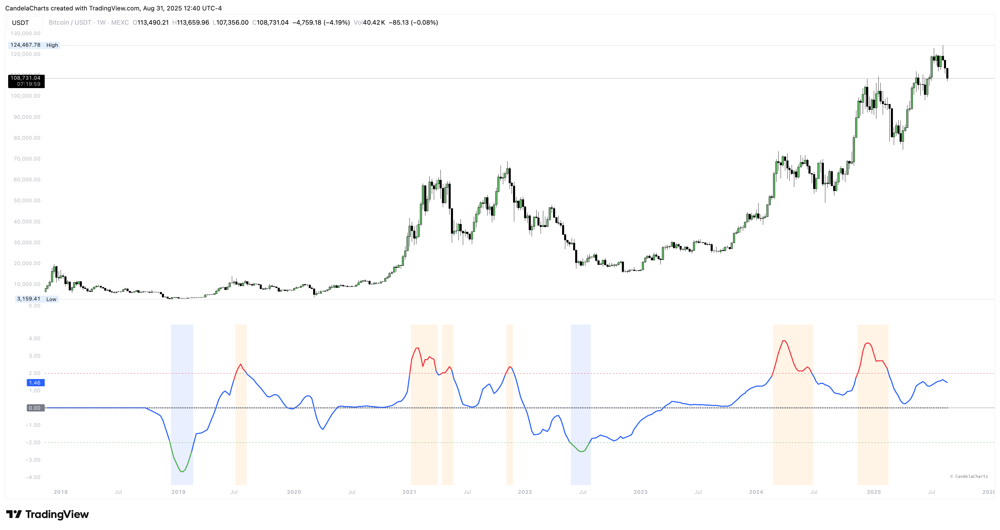

# Vertex Oscillator


The Vertex Oscillator is part of <a href="https://www.candelacharts.com/indicators" class="button secondary medium" data-icon="chart-kanban">CandelaCharts</a>Indicators, for the TradingView platform, available in the Investing and Institutional plans.


> Identify deep accumulation zones and overheated market euphoria by reading volume-aware momentum extremes on a standardized scale.

<figure><figcaption></figcaption></figure>

### Introduction

Price momentum alone can be deceptive. A sharp price spike on thin volume rarely carries the same weight as a high-volume surge, and ordinary oscillators often stay pinned or give premature reversal signals during volatile market cycles.

The **CandelaCharts – Vertex Oscillator** blends price deviation with relative volume context and adaptive volatility scaling into one clean, standardized oscillator. By automatically adjusting to quiet consolidations and high-volatility expansions alike, it highlights when an asset is deeply **Undervalued** (potential accumulation) versus stretched into **Euphoria** (potential distribution).

Built for **swing traders, position traders, and crypto/equity investors**, it turns chaotic market swings into clear color-coded zones and real-time extreme alerts.


**TL;DR:** Readings dropping to **-2 or below** (**Green** line with **Accumulation** zone shading) flag potential undervaluation; readings rising to **+2 or above** (**Red** line with **Euphoria** zone shading) warn of overheated conditions.


### How It Works

**CandelaCharts – Vertex Oscillator** tracks how far price has stretched from its rolling baseline while accounting for whether trading volume confirms the move, normalizing readings around a neutral **0** midline so extremes remain comparable across assets and timeframes.

When momentum remains balanced, the line plots in **Blue** around zero. As downside stretch reaches deep undervaluation, the line turns **Green** and shades the Accumulation background; as upside stretch reaches euphoria, the line turns **Red** and shades the Euphoria background.

#### Reading the Indicator

The oscillator moves around a dotted gray **0** midline between dashed **Undervalued (-2)** and **Euphoria (+2)** boundaries:

| Zone / Reading          | Line Color | Zone Shading          | How to Read It                                                                             |
| ----------------------- | ---------- | --------------------- | ------------------------------------------------------------------------------------------ |
| **>= +2 (Euphoria)**    | Red        | Subtle Orange shading | Market is overheated and stretched to the upside; heightened pullback or distribution risk |
| **Between -2 and +2**   | Blue       | None (Neutral)        | Balanced momentum around the **0** midline without extreme stretch                         |
| **<= -2 (Undervalued)** | Green      | Subtle Blue shading   | Market is deeply compressed to the downside; potential accumulation window                 |

All line colors, zone shading colors, `Lookback`, and `Smoothing` lengths are customizable in settings.

### Features

* **Volume-Aware Momentum:** Incorporates relative volume activity alongside price stretch so high-participation extremes stand out clearly.
* **Adaptive Volatility Scaling:** Adjusts smoothly to changing market volatility so quiet periods and explosive cycles remain readable on one scale.
* **Color-Coded Accumulation & Euphoria Zones:** Immediately highlights **Undervalued** (`<= -2`) and **Euphoria** (`>= +2`) stretches with distinct line colors and background fills.
* **Customizable Sensitivity & Styling:** Adjust `Source`, `Lookback`, `Smoothing`, line width, and bullish/bearish zone colors to fit your chart layout.
* **Two Built-In Extreme Alerts:** Sends real-time notifications whenever the oscillator enters deep accumulation or euphoria.

### How To Use

#### 1. Identifying Deep Accumulation Zones (<= -2)

Watch for the oscillator turning **Green** and entering the shaded **Accumulation** zone at or below **-2**:

* This indicates heavy downside stretch relative to recent price and volume norms—often appearing during capitulation sell-offs or late-stage corrections.
* Rather than buying blindly on the very first touch, look for the green line to stabilize or curl back up toward **0** alongside key price support before scaling in.

#### 2. Spotting Overheated Euphoria (>= +2)

When the oscillator turns **Red** above **+2**:

* Upside momentum has pushed into statistical euphoria, where chasing breakouts carries elevated reversal risk.
* Use **Euphoria** readings as a cue to lock in partial profits, tighten trailing stops, or wait for momentum to cool back toward neutral before adding exposure.

#### 3. Reading Neutral Resets & Momentum Divergences

* **Neutral Line (0):** Returns toward zero mark healthy momentum resets inside ongoing trends without extreme stretch.
* **Divergences:** If price prints a lower low while the Vertex Oscillator forms a higher low inside or near the **-2** zone (or a higher high in price with a lower high near **+2**), momentum exhaustion is often building ahead of a turn.

### Alerts

**CandelaCharts – Vertex Oscillator** includes two built-in TradingView alert conditions:

1. **Deep Accumulation:** Fires when the oscillator crosses below the **-2** Undervalued threshold.
2. **Euphoria Triggered:** Fires when the oscillator crosses above the **+2** Euphoria threshold.

### FAQs

#### 1. What do the Undervalued (-2) and Euphoria (+2) zones represent?

The **-2** boundary marks statistically stretched downside conditions where selling pressure may be nearing exhaustion (accumulation). The **+2** boundary marks stretched upside conditions where market optimism has run hot (euphoria).

#### 2. How does volume context help compared to a standard oscillator?

Standard oscillators treat every price move equally regardless of participation. By factoring in relative volume alongside price deviation, **Vertex Oscillator** helps separate meaningful conviction moves from thin, low-volume drift.

#### 3. How should I adjust Lookback and Smoothing?

Shorter `Lookback` and lower `Smoothing` make the oscillator react faster to short-term swings, while longer settings filter out minor noise to highlight major multi-week or multi-month cycle extremes.

#### 4. Should I buy immediately as soon as the line drops below -2?

Treat **-2** as an alert zone rather than an automatic trigger. In strong downtrends, the oscillator can remain below **-2** across multiple candles—waiting for price stabilization or an upward curl back toward **0** helps improve entry timing.

#### 5. Which assets and timeframes work best?

Because readings adapt automatically to each asset's volatility, **Vertex Oscillator** works across crypto, equities, indices, and commodities on intraday, Daily, and Weekly charts (provided the ticker has volume data).
