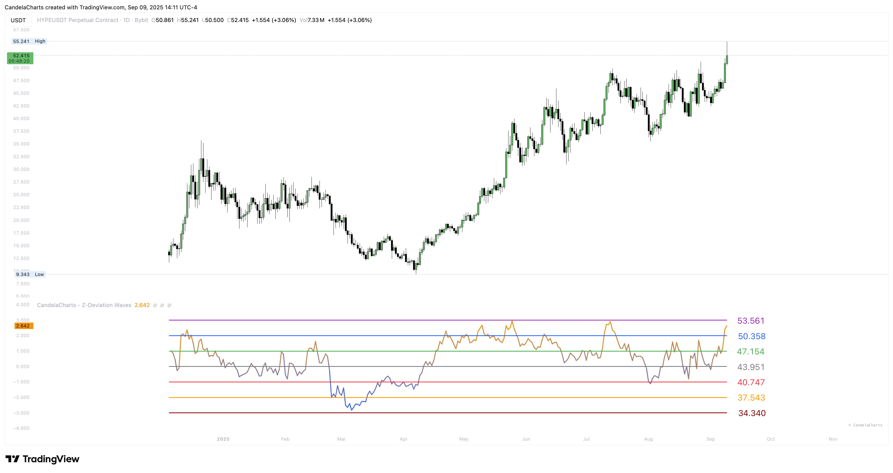

# Z-Deviation Waves


Available on: <a href="https://www.tradingview.com/scripts/marketplace/CandelaCharts/" class="button secondary small" data-icon="chart-fft">TradingView</a>


> Measure statistical price stretch across standard-deviation waves, convert sigma bands into live price levels, and spot high-probability divergences.

<figure><figcaption></figcaption></figure>

### Introduction

Price movements often look random until you measure how far an asset has stretched away from its statistical mean. Without a consistent volatility gauge, it is difficult to tell whether a pullback is routine noise or an unusual extreme ripe for mean reversion.

The **CandelaCharts – Z-Deviation Waves** plots price stretch as a smooth color-graded wave across **-3σ to +3σ** standard-deviation bands. Beyond the oscillator itself, it can translate every statistical band directly into live chart prices, project an adaptive **Dynamic Channel** onto your main price chart, and highlight confirmed **Bullish** and **Bearish Divergences**.

Built for **swing traders, mean-reversion traders, and systematic investors**, it unifies statistical stretch, dynamic support/resistance prices, and divergence timing in one toolkit.


**TL;DR:** Readings inside **-1σ to +1σ** reflect normal fluctuation; moves to **±2σ** flag statistically stretched markets; and reaches into **±3σ** mark rare extremes. Switch **Label Mode** to **Dynamic Price** to read the exact live price at each sigma level.


### How It Works

**CandelaCharts – Z-Deviation Waves** standardizes your chosen price source against its rolling mean and volatility over your `Period` window, optionally smoothed with `Smoothing (Z)`. You can view horizontal grid labels as live converted prices (**Dynamic Price**, default), statistical standard deviations (**Sigma (σ)**), or a normalized fixed scale (**Mapped Price**).

Optional modules let you turn on **Divergences** (marking regular bullish and bearish swings, with a **High-Prob** filter requiring at least one extreme anchor), project a multi-tier **Dynamic Channel** directly onto your main price chart, and display a corner **Price Levels** table showing live `-1σ`, `-2σ`, and `-3σ` support equivalents.

#### Reading the Indicator

The wave oscillates across seven horizontal reference bands from **-3σ** to **+3σ**, styled in either **Rainbow** mode (cool-to-warm spectrum) or **Minimal** mode (clean custom monochrome):

| Band / Element              | Visual Appearance (Rainbow)                    | How to Read It                                                                               |
| --------------------------- | ---------------------------------------------- | -------------------------------------------------------------------------------------------- |
| **+2σ to +3σ**              | Blue to Purple upper bands                     | Statistically overextended upside; watch for exhaustion or profit-taking                     |
| **0σ to +1σ**               | Gray midline to Green band                     | Normal bullish fluctuation around the rolling mean                                           |
| **-1σ to 0σ**               | Red band to Gray midline                       | Routine pullback or bearish fluctuation inside normal variance                               |
| **-2σ to -3σ**              | Orange to Dark Red lower bands                 | Deeply stretched downside; high-attention mean-reversion / support zone                      |
| **Bull / Bear Labels**      | Green `Bull` / Red `Bear` tags (`Divergences`) | Confirmed regular bullish or bearish divergence between price and wave                       |
| **Dynamic Channel Overlay** | Main-chart trend center + 3 upper/lower tiers  | Projects dynamic volatility bands directly onto price, fading cleanly as price nears a level |
| **Price Levels Table**      | Corner panel (`Show Panel`)                    | Displays live downside price equivalents for `-1σ`, `-2σ`, and `-3σ`                         |

### Features

* **Three Label Modes:** Instantly switch horizontal level labels between **Dynamic Price** (live price at each sigma level), **Sigma (σ)** (`-3σ` to `+3σ`), and **Mapped Price**.
* **Rainbow & Minimal Themes:** Use the full color spectrum to distinguish every tier at a glance, or switch to **Minimal** for a clean custom-colored layout.
* **Built-In Divergence Detection:** Automatically plots confirmed regular **Bull** and **Bear** divergence tags on the wave, with an `Only show High-Prob` filter that focuses on divergences anchored in extreme zones.
* **Optional Main-Chart Dynamic Channel:** Enable `Show Channel` to overlay a trend-colored center line and three upper/lower adaptive channel tiers directly on price—with proximity fading to keep candles clear.
* **Downside Price Levels Panel:** Toggle `Show Panel` to keep live `-1σ`, `-2σ`, and `-3σ` price levels visible in any chart corner.

### How To Use

#### 1. Gauging Market Stretch Across ±1σ, ±2σ, and ±3σ

Use the horizontal sigma tiers as an objective stretch gauge:

* **±1σ:** Routine trend breathing room—pullbacks to `-1σ` in an uptrend or bounces to `+1σ` in a downtrend often act as normal continuation zones.
* **±2σ:** Statistically meaningful stretch where breakouts frequently pause, consolidate, or begin reverting toward `0σ`.
* **±3σ:** Rare statistical extreme—avoid chasing moves already extended near `+3σ` or panic-selling into `-3σ`.

#### 2. Turning Statistical Levels into Live Price Targets

* Keep **Label Mode** on **Dynamic Price** to read the exact asset prices corresponding to each sigma line right on the oscillator axis.
* Enable **Show Panel** when scaling into pullbacks so `-1σ`, `-2σ`, and `-3σ` target prices stay pinned in the corner of your chart.
* Enable **Show Channel** to visualize adaptive upper and lower volatility boundaries directly behind your price bars.

#### 3. Timing Reversals with High-Probability Divergences

Turn **Divergences** on (with **Only show High-Prob** enabled) to spot momentum exhaustion:

* A **Bull** tag appears when price makes a lower low while the Z-Deviation wave forms a higher low with extreme anchor context—signaling fading selling pressure.
* A **Bear** tag appears when price prints a higher high while the wave makes a lower high—warning of upside exhaustion.

### Alerts

This indicator does not currently include built-in alerts.

### FAQs

#### 1. What is the difference between Dynamic Price, Sigma (σ), and Mapped Price?

**Dynamic Price** (default) converts every `-3σ` to `+3σ` horizontal line into the asset's corresponding live price so you can read exact support and resistance levels. **Sigma (σ)** displays pure statistical `-3σ` through `+3σ` labels, while **Mapped Price** maps the wave onto a fixed reference grid for legacy visual consistency.

#### 2. What does Show Channel add to my main chart?

Enabling **Show Channel** overlays a trend-colored baseline (`Green` rising / `Red` falling) along with three upper and three lower adaptive bands directly on your price candles. Lines automatically fade as price approaches them to avoid cluttering candles.

#### 3. What does the Only show High-Prob divergence option do?

It filters out routine mid-range divergences so **Bull** and **Bear** tags only appear when at least one of the divergence pivots occurs in a statistically stretched zone.

#### 4. When should I use Rainbow vs. Minimal Color Mode?

**Rainbow** gives each sigma level and wave direction immediate color contrast, making it easy to tell `-2σ` from `-3σ` at a glance. **Minimal** uses clean customizable colors for traders who prefer a low-contrast, monochrome chart aesthetic.

#### 5. How do Period and Smoothing (Z) affect the wave?

Shorter `Period` values make the bands adapt faster to recent volatility for active trading, while longer `Period` values anchor deviations to a broader structural trend. Raising `Smoothing (Z)` smooths out jagged bar-to-bar noise.
