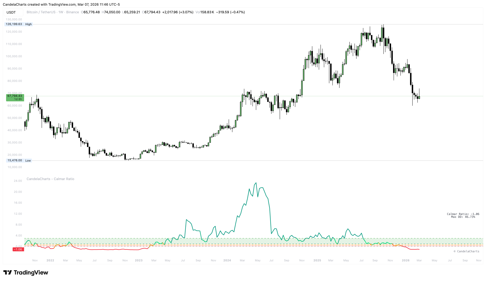

# Calmar Ratio

> Measure trend efficiency against real capital pain by comparing an asset's time-adjusted Compound Annual Growth Rate (CAGR) to its Maximum Drawdown.

<figure><figcaption></figcaption></figure>

### Introduction

Volatility alone does not always capture how painful an asset is to hold. Two markets can share similar daily standard deviation, yet one grinds steadily higher while the other suffers a devastating peak-to-trough collapse before recovering. For investors focused on capital preservation, **maximum drawdown** is the risk that actually tests conviction.

The **CandelaCharts – Calmar Ratio** measures an asset's annualized growth rate relative to its worst peak-to-trough decline over the same calendar lookback. Instead of treating upside and downside swings equally, it asks a direct question: how much compound annual return are you earning for every percent of maximum drawdown endured?

Designed for **position traders and long-term investors**, the indicator operates on **Daily (`1D`) and higher timeframes** and pairs exact calendar-time CAGR math with an optional background drawdown heatmap and live stats badge.


**TL;DR:** A Calmar Ratio above **1.0** signals strong return relative to drawdown pain, while **3.0+** marks exceptional efficiency. Readings below **0.5** warn that returns are weak compared to the drawdown required to hold the trend.


### How It Works

On **Daily (`1D`) or higher** timeframes, **CandelaCharts – Calmar Ratio** evaluates an asset's annualized growth relative to the worst peak-to-trough drawdown experienced within your `Lookback (Days)` window (default `252` days). By scaling growth using elapsed calendar time and comparing it directly against recent drawdown depth, it shows whether returns justify the capital pain required to hold them. Below `1D`, the indicator pauses and displays a prompt to switch to `1D` or higher.


**General Formula:** Calmar Ratio = Compound Annual Growth Rate (CAGR) / Maximum Drawdown


#### Reading the Indicator

When **Risk Visuals** is enabled, a subtle background heatmap shades the pane by drawdown severity without altering the vertical scale, and exports `Max Drawdown (%)` to the Data Window.

The indicator plots four horizontal reference levels (`0.0` Gray, `0.5` Orange, `1.0` Teal, `3.0` Green) with translucent zone fills between `0.0–0.5` (Red), `0.5–1.0` (Orange), and `1.0–3.0` (Green), plus a continuous **Red → Orange → Lime → Teal** line gradient:

| Calmar Ratio | Tier Classification      | Line Color Gradient | Shaded Zone          | Interpretation                                         |
| ------------ | ------------------------ | ------------------- | -------------------- | ------------------------------------------------------ |
| `<= 0.0`     | Negative / Underperforms | Red                 | Below `0.0`          | Negative or flat growth over the lookback window       |
| `0.0 – 0.5`  | Weak                     | Red → Orange        | Red (`0.0 – 0.5`)    | Unfavorable pain-to-gain ratio                         |
| `0.5 – 1.0`  | Moderate                 | Orange → Lime       | Orange (`0.5 – 1.0`) | Positive efficiency, but drawdowns remain significant  |
| `1.0 – 3.0`  | Strong                   | Lime → Teal         | Green (`1.0 – 3.0`)  | Healthy compounding outpacing historical drawdown      |
| `>= 3.0`     | Exceptional              | Teal                | Above `3.0`          | Elite trend efficiency with minimal capital impairment |

A live readout badge on the right displays both the current **Calmar Ratio** and **Max DD (%)**, with a hover tooltip showing the exact tier label.

### Features

* **Calendar-Time CAGR:** Accounts for actual elapsed calendar time rather than fixed bar counts for reliable annualization across `1D`, `1W`, and `1M` charts.
* **True Window Drawdown Tracking:** Computes peak-to-trough maximum drawdown strictly inside your rolling lookback window so stale historical crashes roll off naturally.
* **Color-Coded Zones & Gradient Line:** Instant visual tiering across **Weak** (`< 0.5`), **Moderate** (`0.5–1.0`), **Strong** (`1.0–3.0`), and **Exceptional** (`>= 3.0`) performance bands.
* **Optional Background Risk Heatmap:** Enable `Risk Visuals` to visualize drawdown intensity directly behind the oscillator and inspect exact `Max DD (%)` in the Data Window.
* **Flexible Smoothing Options:** Choose from `None`, `SMA`, `EMA`, `WMA`, `HMA`, or `ALMA` to match your preferred signal responsiveness.

### How To Use

#### 1. Evaluating Return vs. Capital Pain (1.0+ Strong)

Use the **1.0** teal level as a clear benchmark for trend quality:

* **Above 1.0 (Strong):** Compound growth exceeds the worst drawdown suffered during the lookback window—ideal for trend continuation and long-term holding.
* **Below 0.5 (Weak):** Drawdown pain is heavily outweighing annualized gains. Expect choppier paths or wait for the ratio to climb back above **0.5** and **1.0**.

#### 2. Monitoring Trend Health & Drawdown Sensitivity

Watch how the Calmar Ratio behaves during pullbacks:

* In a healthy, resilient uptrend, Calmar rises or holds steady above **1.0** even during routine consolidations.
* If a modest price pullback causes Calmar to plunge sharply, it reveals that prior CAGR was fragile or driven by an uncharacteristically shallow window—a cue to tighten risk management.

#### 3. Reading the Optional Risk Heatmap

Toggle **Risk Visuals** on when you want to see both halves of the ratio at once:

* Compare the rising or falling **Calmar Ratio** line against the background **Drawdown Heatmap** shading and the **Max DD** readout on the right.
* Notice how as an older crash exits your `Lookback (Days)` window, `Max DD` drops and Calmar expands—highlighting structural regime recovery.

### Alerts

This indicator does not currently include built-in alerts.

### FAQs

#### 1. Why does Calmar Ratio require Daily (1D) or higher timeframes?

Calmar Ratio measures **Compound Annual Growth Rate (CAGR)** against maximum drawdown. Below the daily timeframe, short intraday bursts extrapolate into extreme, distorted annualized numbers and exceed practical lookback bar limits. Switching to `1D`, `1W`, or `1M` keeps CAGR mathematically meaningful.

#### 2. What is considered a strong Calmar Ratio?

In asset and fund evaluation, readings below **0.5** are considered weak, **0.5 – 1.0** moderate, **1.0 – 3.0** **strong**, and above **3.0** **exceptional** (often seen during smooth multi-quarter bull runs with minimal pullbacks).

#### 3. Why use calendar days instead of bar counts for CAGR?

Traditional markets trade roughly `252` days a year, whereas crypto trades `365` days, and weekly or monthly charts have different bar counts. Using actual elapsed calendar time ensures annualized growth is scaled accurately regardless of market schedule or chart timeframe (`1D`, `1W`, or `1M`).

#### 4. What does the Risk Visuals toggle add?

Turning on **Risk Visuals** shades the background of the indicator pane according to the current `Max DD` severity (using your chosen risk color) without distorting the Calmar scale, and reveals the **Max Drawdown (%)** series inside TradingView's Data Window.

#### 5. Should I turn on Smoothing?

By default, `Smoothing Type` is set to **None** so you see the exact unsmoothed Calmar Ratio. If you want to emphasize broader multi-month shifts and reduce step-changes when old peaks roll out of the lookback window, try **EMA** or **HMA** with a short length such as `7`.
