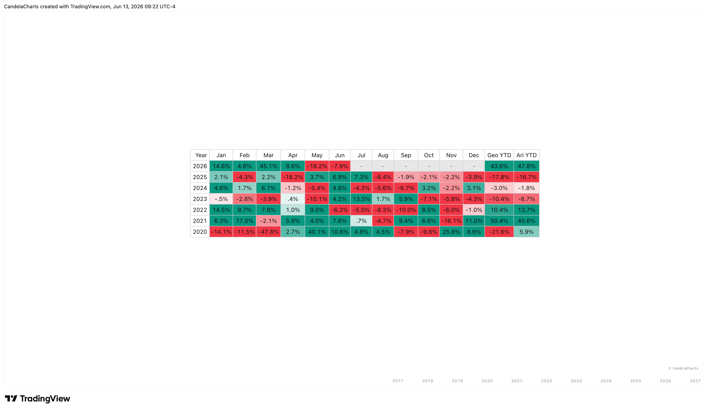

# Monthly Return Heatmap

> Visualize multi-year monthly seasonality, annual compounding, and year-by-year return distributions directly on your chart.

Available on:<a href="https://www.tradingview.com/" class="button secondary medium" data-icon="display-chart-up">TradingView</a>

<figure><figcaption></figcaption></figure>

### Introduction

Market seasonality rarely shows up clearly on a standard candlestick chart. Looking at raw price bars alone makes it difficult to spot whether an asset consistently struggles in specific late-summer months, rallies reliably into year-end, or delivered most of its annual gains during a single quarter.

The **CandelaCharts – Monthly Returns Heatmap** organizes historical monthly percentage returns into an intuitive, color-coded visual layout. In its default **Heatmap Table** view, you can scan up to **30 years** of month-by-month performance alongside both **Geometric YTD** and **Arithmetic YTD** totals; in **Bar Chart** mode, you can isolate any single target year as a clean 12-month bar breakdown.

Designed for **macro researchers, seasonal traders, and long-term investors**, the indicator operates exclusively on the **Monthly (`1M`) timeframe**—displaying an on-chart prompt if opened on any lower timeframe.


**TL;DR:** Switch your chart to **1M (Monthly)** to view up to **30 years** of color-graded monthly returns with automatic **Geo YTD** and **Ari YTD** summaries, or switch to **Bar Chart** mode to inspect any individual year in detail.


### How It Works

When your chart is set to the **Monthly (`1M`)** timeframe, **CandelaCharts – Monthly Returns Heatmap** tracks monthly percentage performance across `1` to `30` years (default `7` years) and summarizes each year with both compounded (**Geo YTD**) and additive (**Ari YTD**) totals. You can view the entire multi-year history as a color-coded **Heatmap Table** or isolate any individual year as a **Bar Chart**. On timeframes below `1M`, the indicator displays a reminder banner to switch to `1M`.

#### Reading the Indicator

Switch `UI Mode` between **Heatmap Table** (`1–30` years across `Jan–Dec` with `Geo YTD` and `Ari YTD`) and **Bar Chart** (a 12-month bar breakdown for any `Target Year`, defaulting to `2024`). Cells and bars shade dynamically from your chart background toward your chosen **Bullish** (`Teal` default) or **Bearish** (`Red` default) color according to return magnitude:

| Element                       | Negative Full Saturation    | Neutral / Missing           | Positive Full Saturation     | Display Notes                   |
| ----------------------------- | --------------------------- | --------------------------- | ---------------------------- | ------------------------------- |
| **Monthly Table Cells**       | `-4.0%` or lower (Bearish)  | `0.0%` / `-` (Neutral Gray) | `+4.0%` or higher (Bullish)  | Formatted to 1 decimal          |
| **Geo YTD & Ari YTD Columns** | `-12.0%` or lower (Bearish) | `0.0%` / `-` (Neutral Gray) | `+12.0%` or higher (Bullish) | Summarizes full or partial year |
| **Bar Chart Columns**         | `-4.0%` or lower (Bearish)  | `0.0%` Zero Line            | `+4.0%` or higher (Bullish)  | Formatted to 2 decimals         |

### Features

* **Up to 30 Years of Monthly History:** Scan between `1` and `30` years of historical monthly performance side by side (default `7` years).
* **Geometric & Arithmetic YTD Columns:** Automatically tracks both true compounded (`Geo YTD`) and additive (`Ari YTD`) annual performance for every row.
* **Dual Visualization Modes:** Toggle between a multi-year **Heatmap Table** and a focused single-year **Bar Chart** view.
* **Magnitude-Based Gradient Shading:** Instantly separates mild `-0.5%` / `+0.5%` drift from strong `-4%+` / `+4%+` monthly expansions using customizable bullish and bearish colors.
* **Safe Timeframe Guard:** Displays a clean on-chart reminder if you accidentally load the indicator below the `1M` timeframe rather than throwing a runtime error.

### How To Use

#### 1. Switching to 1M & Reading Multi-Year Seasonality

1. Set your TradingView chart timeframe to **1M (Monthly)**.
2. Adjust `Years to Display` (between `1` and `30`) to match how much historical data your ticker has available.
3. Scan vertically down each month column (`Jan` through `Dec`) to spot recurring seasonal tendencies—such as consistently red months or clusters of strong bullish teal shading.

#### 2. Comparing Geometric vs. Arithmetic YTD

Use the two right-hand summary columns together to judge path volatility:

* In steady, low-volatility years, `Geo YTD` and `Ari YTD` remain close together.
* In volatile, whipsaw years with large up-and-down monthly swings, `Geo YTD` drops noticeably below `Ari YTD` due to compounding drag—revealing how volatility eroded cumulative returns.

#### 3. Drilling Into a Single Year with Bar Chart Mode

When you want to study one specific year closely (such as a bull-market peak, recession year, or halving cycle):

1. Change `UI Mode` from **Heatmap Table** to **Bar Chart**.
2. Set `Target Year` to the calendar year you want to inspect (for example, `2024` or `2020`).
3. Review the 12-month bar distribution above and below the zero line to see which exact months drove the year's performance.

### Alerts

This indicator does not currently include built-in alerts.

### FAQs

#### 1. Why must the chart be on the Monthly (1M) timeframe?

The indicator maps each bar directly to its calendar month, requiring the **Monthly (1M)** timeframe so every bar represents exactly one month. On lower timeframes, it displays a reminder banner until you switch the chart to `1M`.

#### 2. What is the difference between Geo YTD and Ari YTD?

**Geo YTD** (Geometric Year-to-Date) compounds each monthly return sequentially and matches the actual percentage gain or loss an investor experienced over that year. **Ari YTD** (Arithmetic Year-to-Date) simply adds the 12 monthly percentages together. Comparing the two highlights how volatility drag impacts compounding.

#### 3. How many years of history can I display?

You can configure `Years to Display` from **1 to 30 years** (default `7`). If a ticker has less trading history than your chosen setting (for example, a newer stock or crypto asset), earlier unavailable months and years automatically display `-`.

#### 4. Why do some cells show a dash (-)?

A dash (`-`) appears for future months in the current calendar year that have not occurred yet, or for historical months prior to the asset's first available bar on TradingView.

#### 5. Can I set TradingView alerts on this indicator?

No. **CandelaCharts – Monthly Returns Heatmap** is designed purely as a seasonal analysis table and single-year bar chart, so it does not include alert conditions.
