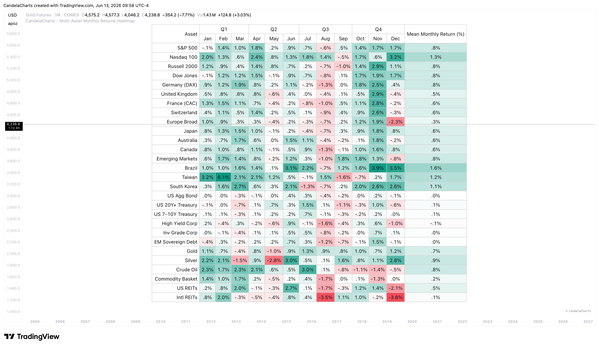

# Multi-Asset Monthly Returns Heatmap


The Multi-Asset Monthly Return Heatmap is part of <a href="https://www.candelacharts.com/indicators" class="button secondary medium" data-icon="chart-kanban">CandelaCharts</a>Indicators, for the TradingView platform, available in the Investing and Institutional plans.


> Compare historical monthly seasonality, return magnitudes, and volatility side-by-side across 28 customizable global assets in a single quarterly matrix.

<figure><figcaption></figcaption></figure>

### Introduction

Macro capital constantly rotates between equities, bonds, commodities, and real estate—and those rotations often follow distinct calendar rhythms. Checking seasonal tables one ticker at a time makes it slow and difficult to spot cross-market leadership or defensive windows across asset classes.

The **CandelaCharts – Multi-Asset Monthly Returns Heatmap** solves this by aggregating monthly returns across **28 customizable assets simultaneously** into one quarterly matrix (`Q1` through `Q4`, `Jan` to `Dec`) plus an overall summary column. Instead of showing just one statistic, you can switch instantly between **Mean**, **Median**, **Volatility**, **Max**, **Min**, and **Sum** modes.

Built for **macro traders, multi-asset allocators, and portfolio strategists**, the overlay requires the **Monthly (`1M`) timeframe** and automatically adjusts its color intensity bounds to fit each calculation mode.


**TL;DR:** Load on a **1M (Monthly)** chart to compare **28 customizable markets** across all 12 months using **Mean, Median, Volatility, Max, Min, or Sum**—with automatic quarterly grouping and dynamic heatmap scaling.


### How It Works

When your chart is set to the **Monthly (`1M`)** timeframe, **CandelaCharts – Multi-Asset Monthly Returns Heatmap** gathers monthly returns for **28 customizable assets** across all available chart history and organizes them by calendar month (`Jan`–`Dec`). Depending on your selected `Calc Mode` (**Mean**, **Median**, **Volatility**, **Max**, **Min**, or **Sum**), each cell summarizes that asset's historical behavior for that month, alongside an overall summary column on the right. Below `1M`, the table displays a prompt to switch to `1M`.

#### Reading the Indicator

The table groups `Jan–Dec` into quarters (`Q1`–`Q4`) across 28 customizable asset rows covering **US & Global Equities** (`16` slots), **Fixed Income & Credit** (`6` slots), and **Commodities & Real Estate** (`6` slots). Using customizable **Bullish** (default `Blue`) and **Bearish** (default `Red`) colors, the heatmap automatically recalibrates its full-intensity bounds whenever you switch `Calc Mode`:

| Calc Mode      | Negative Full Intensity    | Neutral Midpoint | Positive Full Intensity | Shading Logic                                                                    |
| -------------- | -------------------------- | ---------------- | ----------------------- | -------------------------------------------------------------------------------- |
| **Mean**       | `-4.0%` (Bearish)          | `0.0%`           | `+4.0%` (Bullish)       | Positive = Bullish gradient; Negative = Bearish gradient                         |
| **Median**     | `-4.0%` (Bearish)          | `0.0%`           | `+4.0%` (Bullish)       | Reduces distortion from extreme single-year crashes/rallies                      |
| **Max**        | `-25.0%` (Bearish)         | `0.0%`           | `+25.0%` (Bullish)      | Scaled wider to highlight best historical monthly outliers                       |
| **Min**        | `-25.0%` (Bearish)         | `0.0%`           | `+25.0%` (Bullish)      | Scaled wider to highlight worst historical monthly drawdowns                     |
| **Sum**        | `-50.0%` (Bearish)         | `0.0%`           | `+50.0%` (Bullish)      | Shows cumulative multi-decade contribution per month                             |
| **Volatility** | `8.0%` or higher (Bearish) | `4.0%`           | `0.0%` (Bullish)        | Low volatility (`0–4%`) shades Bullish; high volatility (`4–8%+`) shades Bearish |

Missing asset/month data displays cleanly as `-` in neutral gray.

### Features

* **28 Simultaneous Markets:** Track equities, fixed income, credit, commodities, and REITs in one unified matrix—with every asset label and ticker symbol fully customizable.
* **Quarterly Column Structure:** Organizes `Jan–Dec` under `Q1`, `Q2`, `Q3`, and `Q4` headers alongside an overall summary column on the right.
* **Six Statistical Calculation Modes:** Switch effortlessly between **Mean**, **Median**, **Volatility**, **Max**, **Min**, and **Sum** without changing layouts.
* **Mode-Aware Dynamic Color Scaling:** Automatically expands or tightens color bounds (`±4%`, `±25%`, `±50%`, or `0–8%` for Volatility) so outliers and calm regimes stay visually distinct.
* **Safe Timeframe Guard:** Shows an on-chart reminder when viewed below `1M` instead of rendering incomplete or misleading monthly buckets.

### How To Use

#### 1. Comparing Seasonal Leadership Across 28 Markets on 1M

1. Set your TradingView chart to **1M (Monthly)**.
2. Scan vertically down any calendar month or quarter (`Q1–Q4`) to see which asset classes historically outperform or lag during the same window (for example, equities vs. long-duration Treasuries vs. Gold).
3. Use the right-hand **Overall** column to compare each asset's broad historical monthly behavior at a glance.

#### 2. Separating True Seasonality from Outliers (Mean vs. Median vs. Volatility)

* Start in **Mean** mode to spot headline seasonal averages.
* Flip to **Median** mode to verify whether a strong or weak month is consistent across most years—or skewed by one extreme crisis or bubble year.
* Check **Volatility** mode to identify which months carry calm, steady carry (`0–4%`, Bullish shading) versus turbulent, high-risk swings (`4–8%+`, Bearish shading).

#### 3. Stress-Testing Tail Months with Max & Min Modes

* Switch to **Min** mode to uncover which months produced the deepest single-month drawdowns across your basket (helping anticipate tail-risk windows).
* Switch to **Max** mode to see which assets exhibit the strongest upside monthly tail expansions.

#### 4. Customizing the 28 Asset Slots

Replace any default name and ticker pair in the **Assets** input section to turn the matrix into a sector rotation board (e.g., `XLK`, `XLF`, `XLE`, `XLV`), a major FX board, or a 28-coin crypto seasonality dashboard.

### Alerts

This indicator does not currently include built-in alerts.

### FAQs

#### 1. Why does the chart need to be on the Monthly (1M) timeframe?

The indicator tracks one monthly return per bar across all 28 markets, requiring the **Monthly (1M)** timeframe so every bar represents an exact calendar month. On sub-monthly timeframes, a warning banner reminds you to switch to **1M**.

#### 2. What is the difference between Mean and Median mode?

**Mean** computes the arithmetic average of all historical returns for a given month, which can be pulled up or down by one unusually huge crash or rally. **Median** shows the middle historical outcome, giving a cleaner view of what a "typical" year looks like for that month.

#### 3. How does color shading work in Volatility mode?

Unlike return modes where positive is bullish and negative is bearish, **Volatility** (standard deviation) is always zero or positive. Lower monthly volatility (`0% – 4%`) blends from your **Bullish Color** toward neutral, while elevated volatility (`4% – 8%+`) blends from neutral toward your **Bearish Color**.

#### 4. Can I replace the default 28 assets with stocks, ETFs, or crypto?

Yes. Every row has an editable display name and TradingView ticker selector under the **Assets** inputs, so you can mix or replace all 28 rows with any symbols available on TradingView.

#### 5. Why might one asset show slightly different sample coverage than another?

The matrix accumulates monthly returns across the historical bars loaded on your active `1M` chart. Assets with shorter trading histories (such as newer ETFs or younger tickers) simply aggregate over the months they have been listed, while older benchmarks use the full chart history.
