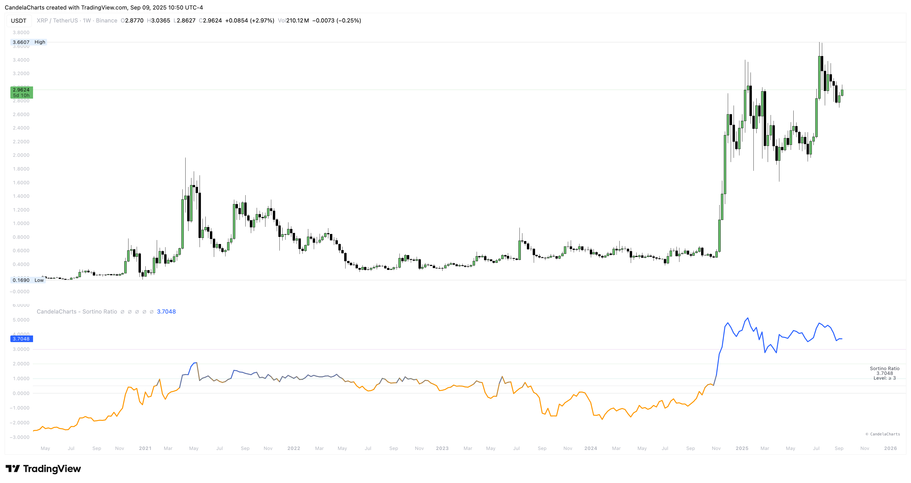

# Sortino Ratio


Available on:<a href="https://www.candelacharts.com/algorithms" class="button secondary small" data-icon="chart-scatter-bubble">CandelaCharts</a>


> Evaluate risk-adjusted performance by measuring excess return exclusively against downside volatility below your target hurdle.

<figure><figcaption></figcaption></figure>

### Introduction

Standard volatility metrics treat upside breakouts and painful drawdowns identically. When an asset surges sharply upward, total standard deviation expands even though that upside volatility is exactly what investors want. Penalizing upside variance can make strong, asymmetric trends look less efficient than they really are.

The **CandelaCharts – Sortino Ratio** isolates what actually matters to capital preservation: downside deviation below a Minimum Acceptable Return (MAR). By comparing average excess return per period strictly against negative deviations below your chosen hurdle, it provides a sharper picture of return quality during volatile uptrends and asymmetric market cycles.

Built for **swing traders, portfolio managers, and long-term investors**, the indicator supports both fixed benchmark thresholds and dynamic rolling percentile bands so you can judge performance in absolute terms and relative to an asset's own historical cycle.


**TL;DR:** Values above **1.0** indicate healthy risk-adjusted upside relative to downside risk, while **2.0+** reflects strong trend efficiency. Readings below **0.0** mean average returns are trailing your target hurdle.


### How It Works

On every bar, **CandelaCharts – Sortino Ratio** evaluates returns relative to your chosen Minimum Acceptable Return (MAR)—anchored to either a **Risk-Free** rate or a **Custom** target—and measures how strongly positive performance outweighs downside volatility below that threshold over your `Lookback Length`. You can switch between **Simple** and **Log** returns, optionally annualize the ratio, and frame readings using either fixed institutional levels or adaptive historical percentile bands.


**General Formula:** Sortino Ratio = (Average Return - Target Return) / Downside Volatility (Downside Deviation)


#### Reading the Indicator

You can visualize readings in **Fixed Levels** mode (default, with customizable horizontal guides at `0`, `0.5`, `1.0`, `2.0`, and `3.0` plus optional zone fills) or **Percentile Bands** mode (rolling `P50`, `P75`, and `P90`, plus optional `P25` and `P10`, over an expanding `Calibration Window` defaulting to `200` bars).

In **Fixed Levels** mode, the plotted line transitions smoothly from **Orange** through **Gray** to **Blue** across five customizable dotted guide levels (`Gray` at `0` and `0.5`, `Teal` at `1.0`, `Green` at `2.0`, and `Purple` at `3.0`):

| Sortino Ratio | Zone Label         | Line Color Gradient | Fixed Guide           | Interpretation                                            |
| ------------- | ------------------ | ------------------- | --------------------- | --------------------------------------------------------- |
| `< 0.0`       | Below Target (MAR) | Orange              | Dotted Gray (`0.0`)   | Average return trails the target hurdle                   |
| `0.0 – 0.5`   | Poor               | Orange              | Dotted Gray (`0.5`)   | Weak compensation for downside swings                     |
| `0.5 – 1.0`   | Marginal           | Orange → Gray       | Dotted Teal (`1.0`)   | Positive excess return, but modest efficiency             |
| `1.0 – 2.0`   | Good (Investable)  | Gray → Blue         | Dotted Green (`2.0`)  | Solid excess return per unit of downside risk             |
| `2.0 – 3.0`   | Very Good          | Blue                | Dotted Purple (`3.0`) | Strong directional trend with limited downside volatility |
| `>= 3.0`      | Exceptional        | Blue                | —                     | Rare asymmetric outperformance                            |

In **Percentile Bands** mode, the line blends from **Orange** (`<= P25`) through **Gray** (`P50`) to **Blue** (`>= P75`), and the right-side readout badge classifies the current reading into live quantile buckets from **Top 10% (>= P90)** down to **Bottom 10% (< P10)**.

### Features

* **Downside-Only Risk Penalty:** Penalizes returns strictly below your Minimum Acceptable Return (MAR), ignoring beneficial upside volatility spikes.
* **Flexible MAR Target Engine:** Anchor MAR to a compounded annual **Risk-Free Rate** or switch to a **Custom** per-period hurdle to match your own strategy benchmark.
* **Simple & Log Return Models:** Choose arithmetic simple returns for straightforward equity tracking or logarithmic returns for high-volatility and multi-year compounding analysis.
* **Dual Display Modes:** Switch between classic **Fixed Levels** (`0 / 0.5 / 1 / 2 / 3` with optional shaded bands) and adaptive **Percentile Bands** (`P10` through `P90`).
* **Clean Early-History Readout & Live Badge:** Provides continuous readings from early chart history without long blank startup periods and displays the live Sortino value alongside its current Fixed Level or Percentile bucket.

### How To Use

#### 1. Downside-Aware Regime Gating & Sizing

Use **Fixed Levels** mode to gate directional exposure based on downside quality:

* **Favorable Regimes (Sortino >= 1.0):** Upside returns are comfortably outweighing downside swings. Maintain normal or scaled-up pro-trend exposure while readings hold above **1.0 – 2.0**.
* **Cautionary Zones (0.0 – 1.0):** Downside volatility is eroding return efficiency. Stay selective and keep risk tight.
* **Defensive / Risk-Off (Sortino < 0.0):** Returns are failing to clear the hurdle rate. Reduce risk or wait for the ratio to cross back above **0.0** and **0.5**.

#### 2. Contextualizing Cycles with Percentile Bands

Because high-beta assets (such as crypto or growth equities) naturally operate in wider Sortino ranges than defensive assets, switch `Display Mode` to **Percentile Bands** to judge performance relative to an asset's own history:

1. Set `Calibration Window` to at least twice your `Lookback Length` (for example, `252`–`500` bars when `Lookback Length = 126`).
2. Look for **Top 25% (>= P75)** and **Top 10% (>= P90)** readings to identify sustained leadership regimes.
3. Watch for drops below **P50** and into **<= P25** as early signs that downside volatility is starting to dominate the cycle.

#### 3. Setting a Custom Strategy Hurdle (MAR)

If you want to test whether an asset beats a specific return target rather than a risk-free rate:

1. Set `Target (MAR) Basis` to **Custom**.
2. Enter your per-bar hurdle in `Custom Target` as a decimal (for example, `0.0005` for `0.05%` per bar).
3. Observe how quickly the Sortino Ratio reacts—higher hurdles demand greater upside efficiency to stay above **1.0**.

### Alerts

This indicator does not currently include built-in alerts.

### FAQs

#### 1. What is considered a "good" Sortino Ratio?

Readings below **0.0** mean the asset is underperforming your target hurdle, **0.0 – 0.5** is poor, and **0.5 – 1.0** is marginal. A Sortino Ratio between **1.0 – 2.0** is generally considered **good (investable)**, **2.0 – 3.0** is **very good**, and **3.0+** is **exceptional**.

#### 2. How does the Sortino Ratio differ from standard total-volatility ratios?

Total-volatility ratios penalize all variance—both sharp rallies and sharp sell-offs—equally. The Sortino Ratio only includes deviations below your Minimum Acceptable Return (MAR) in the denominator, so strong upward price expansion does not artificially depress the score.

#### 3. Should I use Risk-Free or Custom for Target (MAR) Basis?

**Risk-Free** is ideal for general asset evaluation and comparing against Treasury or cash yields (entered as a decimal, such as `0.045` for `4.5%`). Use **Custom** when you have a specific per-bar return hurdle (for example, `0.001` for `0.1%` per bar) that a position must clear.

#### 4. When should I use Fixed Levels vs. Percentile Bands?

Use **Fixed Levels** for universal institutional benchmarks (`1.0`, `2.0`, `3.0`) and cross-asset comparisons. Switch to **Percentile Bands** when analyzing assets with unusually high or low baseline volatility and you want to know whether current downside-adjusted efficiency sits in the top or bottom quartile of that specific asset's recent history.

#### 5. Should I choose Simple or Log returns, and what Lookback Length works best?

**Simple** returns (default) are intuitive for steady stocks and single-period comparisons, while **Log** returns handle large percentage swings and multi-year compounding more symmetrically. For daily charts, `126` bars (\~6 months) is a balanced default; aim for a window long enough to capture meaningful downside bars (roughly `90–252` on daily, `52` on weekly, or `36` on monthly charts).
