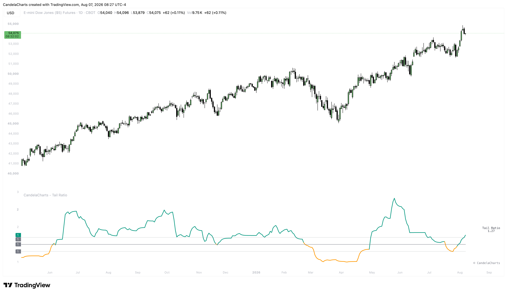

# Tail Ratio

> Gauge hidden skewness and tail risk in real time by comparing an asset's extreme upside returns against its extreme downside returns.

<figure><figcaption></figcaption></figure>

### Introduction

Price can grind higher for weeks while quiet structural risk builds underneath the surface. Traditional averages and standard-deviation metrics smooth away the extremes—even though market regimes are frequently defined by their outliers: violent downside flushes versus explosive upside expansions.

The **CandelaCharts – Tail Ratio** directly measures the balance between right-tail (positive extreme) and left-tail (negative extreme) returns. By taking the ratio of an upper return percentile (default **90th percentile**) to the absolute magnitude of a lower return percentile (default **10th percentile**), it tells you immediately whether extreme moves are skewed in favor of bulls or bears.

Designed for **swing traders, momentum traders, and risk-focused investors**, the oscillator exposes asymmetric tail risk early—helping confirm healthy positive-skew trends or spot left-tail deterioration before major breakdowns occur.


**TL;DR:** A Tail Ratio above **1.0** (Teal) signals a **Right-tailed (Positive Skew)** regime where extreme gains outsize extreme losses. Readings below **1.0** (Orange) warn of a **Left-tailed (Negative Skew)** regime where downside shocks dominate.


### How It Works

On every bar, **CandelaCharts – Tail Ratio** compares the magnitude of an asset's extreme upside moves against its extreme downside moves over your `Lookback Length` (default `60` bars). Using configurable upper (`90th` default) and lower (`10th` default) return percentiles with built-in outlier protection and optional EMA smoothing (default `7`), it highlights whether return asymmetry favors bullish expansion or downside tail risk.


**General Formula:** Tail Ratio = Upper Tail Return (e.g., 90th Percentile) / Lower Tail Return (e.g., 10th Percentile)


#### Reading the Indicator

The plotted line switches color automatically at the **1.0** baseline (**Teal** when `> 1.0`, **Orange** when `<= 1.0`), framed by three optional reference guides (`Lower Guide` at `0.80`, `Mid` at `1.00`, and `Upper Guide` at `1.20`):

| Tail Ratio    | Regime Classification        | Line Color | Guide Reference                | Interpretation                                      |
| ------------- | ---------------------------- | ---------- | ------------------------------ | --------------------------------------------------- |
| `< 0.80`      | Left-tailed (Negative Skew)  | Orange     | Below Lower Guide (`0.80`)     | Downside tail shocks clearly outweigh upside spikes |
| `0.80 – 1.00` | Mild Negative Skew           | Orange     | Lower (`0.80`) to Mid (`1.00`) | Slight left-tail tilt; caution on aggressive longs  |
| `1.00`        | Symmetric (Normal)           | —          | Solid Gray Mid (`1.00`)        | Upper and lower extreme returns are balanced        |
| `1.00 – 1.20` | Mild Positive Skew           | Teal       | Mid (`1.00`) to Upper (`1.20`) | Balanced to mildly constructive upside asymmetry    |
| `> 1.20`      | Right-tailed (Positive Skew) | Teal       | Above Upper Guide (`1.20`)     | Extreme positive bars outpace negative bars         |

A live readout badge on the right displays the rounded **Tail Ratio** value, with a hover tooltip summarizing the active regime (`Left-tailed`, `Symmetric`, or `Right-tailed`).

### Features

* **Percentile Tail Comparison:** Compares upper (default `90th`) and lower (default `10th`) return extremes over a rolling window.
* **Regime Color Coding & Guides:** Instantly separates **Right-tailed** (`> 1.0`, Teal) from **Left-tailed** (`<= 1.0`, Orange) environments with customizable `Lower` (`0.80`), `Mid` (`1.00`), and `Upper` (`1.20`) reference guides.
* **Built-In Outlier Protection:** Guards against near-zero volatility spikes and keeps extreme readings bounded so the scale remains readable.
* **EMA Noise Filtering:** Smooths raw quantile shifts with a toggleable EMA filter (default length `7`) to spotlight structural skew shifts.
* **Simple & Log Return Support:** Switch between arithmetic percentage returns (default) and logarithmic returns to fit your asset's volatility profile.

### How To Use

#### 1. Confirming Positive-Skew Uptrends (> 1.0 / > 1.20)

Use the Tail Ratio to validate whether an uptrend has constructive upside asymmetry:

* When price is trending higher and the **Tail Ratio** holds **> 1.0** (and especially above the **1.20 Upper Guide**), extreme bullish bars are larger than extreme bearish bars—confirming healthy upside momentum.
* Staying aligned with **Teal (`> 1.0`)** regimes helps filter out choppy, distribution-heavy rallies.

#### 2. Catching Hidden Left-Tail Risk Early (< 1.0 / < 0.80)

Watch for divergences between rising price and a falling Tail Ratio:

* If price continues making marginal new highs while the **Tail Ratio** drops below **1.0** into **Orange** (or breaks below **0.80**), downside tail bars are quietly growing larger than upside bursts.
* Treat sustained **Left-tailed (Negative Skew)** regimes as an early warning to tighten stops, trim leverage, or avoid aggressive breakout longs.

#### 3. Adjusting Percentiles & Lookback for Market Volatility

Tailor sensitivity to your trading horizon:

* **Faster / Swing Sensitivity:** Keep `Lookback Length = 60` with `90 / 10` percentiles to react quickly to changing return asymmetry.
* **Stricter Extreme Tails:** Adjust percentiles to `95 / 5` and increase `Lookback Length` to `100–252` on daily charts to focus strictly on rare tail events over longer cycles.

### Alerts

This indicator does not currently include built-in alerts.

### FAQs

#### 1. What does a Tail Ratio above or below 1.0 mean?

A value of **1.0** means the asset's extreme upside moves and extreme downside moves are equal in size (symmetric). Above **1.0** indicates **positive skew** (larger upside tails than downside tails), while below **1.0** indicates **negative skew** (larger downside tails than upside tails).

#### 2. Why does the indicator default to the 90th and 10th percentiles instead of 95th and 5th?

Over a `60`-bar lookback window, the **90th and 10th percentiles** provide enough tail observations (`6` bars on each side) to remain statistically responsive without jumping erratically on a single outlier bar. If you increase `Lookback Length` to `120–252`, switching to `95.0` and `5.0` works very well.

#### 3. Why is the Tail Ratio clamped at 5.0?

During one-sided low-volatility trends where negative bars are tiny, an unbounded reading can momentarily shoot above `10` or `20` and flatten the rest of the chart. Keeping the oscillator bounded up to **5.0** preserves readability around the critical **0.80 – 1.20** zone.

#### 4. Should I keep EMA Smoothing enabled?

Keeping **Smoothing** enabled (default `7`) filters out single-bar quantile jumps caused by one candle entering or leaving the rolling window. Disable it only if you want to inspect exact unsmoothed percentile ratios on each bar.

#### 5. When should I switch from Simple to Log returns?

**Simple** returns (default) are ideal for everyday equity and FX analysis. Switch **Use Log Returns** on for high-volatility assets like cryptocurrencies or long multi-month horizons where percentage gains and losses behave asymmetrically.
