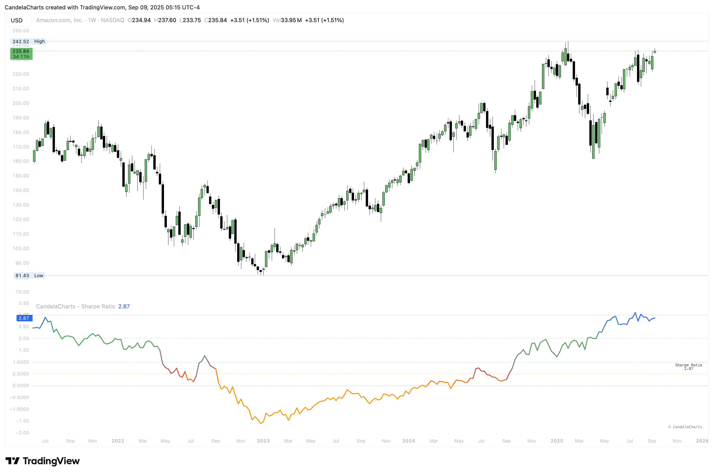

# Sharpe Ratio

> Quantify risk-adjusted performance in real time by measuring excess return per unit of total volatility across any asset or timeframe.

<figure><figcaption></figcaption></figure>

### Introduction

Raw returns never tell the full story. An asset that gains **+40%** with violent, gut-wrenching drawdowns demands far more risk than an asset that compounds **+20%** with smooth, controlled volatility. Without normalizing returns against the risk taken to achieve them, it is impossible to tell whether strong performance reflects genuine edge or simple volatility exposure.

The **CandelaCharts – Sharpe Ratio** solves this by plotting a rolling, real-time oscillator that evaluates how efficiently an asset is rewarding you for its total volatility. By comparing per-period returns against a customizable risk-free hurdle and dividing by rolling standard deviation, it transforms noisy price action into an institutional-grade measure of return quality.

Designed for **swing traders, position traders, and long-term investors**, the indicator makes it effortless to screen for high-efficiency trends, compare risk-adjusted strength across asset classes, and detect when trend quality is quietly deteriorating.


**TL;DR:** Values above **1.0** signal investable, risk-adjusted momentum, while values above **2.0** reflect strong directional efficiency. Readings below **0.0** indicate that the asset is underperforming the risk-free benchmark on a risk-adjusted basis.


### How It Works

#### Calculation

On every bar, the indicator runs a three-step statistical pipeline:

1. **Return Conversion:** Converts the selected price source into bar-by-bar **logarithmic returns** (default) or **simple percentage returns**.
2. **Rolling Excess Return & Volatility:** Computes the rolling mean return and rolling population standard deviation over your `Lookback` window, then subtracts the per-period risk-free hurdle from the mean return and divides by the standard deviation.
3. **Annualization & Smoothing:** Optionally scales the raw ratio to an annual equivalent using the square root of `Periods` and applies optional EMA smoothing to filter high-frequency noise.

#### Mathematical Formula

**1. Per-Period Return**

```
Log Return    = ln(Price / Previous Price)
Simple Return = (Price / Previous Price) - 1
```

**2. Per-Period Risk-Free Hurdle**

```
Risk-Free Rate (per period) = (Annual Risk-Free Rate % / 100) / Periods
```

**3. Raw & Annualized Sharpe Ratio**

```
Raw Sharpe        = (Mean Return - Risk-Free Rate) / Standard Deviation
Annualized Sharpe = Raw Sharpe * sqrt(Periods)
```

Mean return and standard deviation are calculated over the `Lookback` window (default `126`, with `Periods` defaulting to `252`), using cumulative-sum windowing that ramps smoothly from bar 1 without cold-start `na` gaps. When `EMA smoothing` is greater than `1`, an EMA of that length is applied to the final output.

#### Visual Guide

The plotted oscillator uses a continuous piecewise color gradient paired with five horizontal institutional reference lines:

| Sharpe Ratio | Zone Label              | Line Color Gradient | Guide Line            | Interpretation                                           |
| ------------ | ----------------------- | ------------------- | --------------------- | -------------------------------------------------------- |
| `< 0.0`      | Underperforms Risk-Free | Orange              | Dotted Gray (`0.0`)   | Negative excess return; risk is not being compensated    |
| `0.0 – 0.5`  | Poor                    | Orange → Red        | Dashed Orange (`0.5`) | Weak return relative to volatility                       |
| `0.5 – 1.0`  | Suboptimal / Marginal   | Red → Gray          | Dashed Teal (`1.0`)   | Positive excess return, but noisy or inefficient         |
| `1.0 – 2.0`  | Good (Investable)       | Gray → Green        | Dashed Green (`2.0`)  | Healthy, institutional-grade risk-adjusted trend         |
| `2.0 – 3.0`  | Very Good               | Green → Blue        | Dashed Purple (`3.0`) | Strong directional efficiency with controlled volatility |
| `>= 3.0`     | Exceptional             | Blue                | —                     | Rare parabolic efficiency; watch for mean reversion      |

### Features

* **Dual Return Models:** Switch seamlessly between **Log returns** (symmetric for compounding and volatile assets) and **Simple percentage returns**.
* **Custom Risk-Free Hurdle:** Enter any annual risk-free rate (such as current Treasury yields, e.g., `4.5%`)—automatically scaled to the exact per-period hurdle.
* **Flexible Annualization:** Toggle annualization on or off and calibrate `Periods` to match equities (`252`), 24/7 crypto (`365`), weekly (`52`), or monthly (`12`) bars.
* **EMA Noise Filtering:** Apply optional post-calculation EMA smoothing (`EMA smoothing > 1`) to isolate sustained regime shifts from short-term volatility spikes.
* **Continuous Gradient & Benchmark Guides:** Instantly evaluate trend quality with piecewise gradient coloring (`Orange → Red → Gray → Green → Blue`) across five institutional thresholds (`0`, `0.5`, `1.0`, `2.0`, `3.0`).
* **Live Readout & Clean UI:** Displays a right-anchored value badge with the latest Sharpe Ratio alongside customizable typography (`Default` or `Monospace`, `Tiny` to `Auto`) and a brand watermark toggle.

### How To Use

#### 1. Regime Gating & Position Sizing

Use the Sharpe Ratio as an objective quality gate before deploying capital:

* **Pro-Risk Regimes (Sharpe >= 1.0):** Trend returns are cleanly outpacing volatility. Favor trend-following setups and maintain normal or scaled-up position sizing while the ratio holds steadily between **1.0** and **2.5**.
* **Marginal Regimes (0.0 – 1.0):** Excess returns are positive but choppy. Tighten risk, be more selective with entries, or trim exposure.
* **Risk-Off / Unfavorable (Sharpe < 0.0):** Volatility is uncompensated and the asset is trailing the risk-free rate. Reduce exposure, hedge, or wait for the ratio to reclaim **0.0** and **0.5** before re-entering aggressively.

#### 2. Cross-Asset Capital Allocation

Because the Sharpe Ratio normalizes returns by volatility, it creates an apples-to-apples scoreboard across completely different assets:

1. Apply identical `Lookback`, `Periods`, `Use log returns`, and `Risk-free rate` settings across your watchlist candidates (e.g., `SPY` vs. `QQQ` vs. `GLD`, or `BTC` vs. `ETH` vs. `SOL` on `1D` with `Periods = 365`).
2. Rank assets by their current reading and trajectory.
3. Rotate capital toward leaders holding **Sharpe >= 1.0–2.0** rather than chasing lower-Sharpe laggards experiencing wide, erratic swings.

#### 3. Spotting Exhaustion & Volatility Shocks

* **Unsustainable Extremes (>= 3.0):** Sustained readings above **3.0** indicate unusually smooth, low-volatility appreciation. While strong, these regimes rarely persist indefinitely—use them as a cue to tighten trailing stops or watch for volatility mean reversion.
* **Early Trend Deterioration:** A sharp rollover from **> 2.0** down through **1.0** often signals that volatility is expanding faster than price appreciation, warning of regime fatigue even before major price support breaks.

### Alerts

This indicator does not currently include built-in alerts.

### FAQs

#### 1. What is considered a "good" Sharpe Ratio?

In institutional finance, a Sharpe Ratio below **0.0** means the asset is underperforming the risk-free rate, **0.0 – 0.5** is poor, and **0.5 – 1.0** is mediocre or noisy. A reading of **1.0 – 2.0** is generally considered **good (investable)**, **2.0 – 3.0** is **very good**, and **3.0+** is **exceptional**—though sustained readings above **3.0** are rare and often precede volatility expansion.

#### 2. Should I use Log Returns or Simple Returns?

**Log returns** (the default) are preferred for multi-period compounding, longer lookbacks, and high-volatility assets like crypto or growth equities because gains and losses are treated symmetrically (for example, a +25% gain and a -20% drop have equal logarithmic magnitude). **Simple returns** are useful over shorter horizons or when comparing directly against arithmetic return benchmarks.

#### 3. What should I enter for the Risk-Free Rate and Periods?

Set `Risk-free rate` to an annualized benchmark yield (for example, `4.5` for a `4.5%` Treasury bill rate), or keep it at `0.0` if you want a pure return-to-volatility efficiency score. Match `Periods` to the number of bars in one calendar year for your chart:

* **Equities / Traditional Markets (`1D`):** `252`
* **Crypto 24/7 (`1D`):** `365`
* **Weekly (`1W`):** `52`
* **Monthly (`1M`):** `12`

#### 4. Why does the Sharpe Ratio drop even when price is still rising?

The Sharpe Ratio divides excess return by **total volatility** (standard deviation). If an asset continues making higher highs while experiencing wide intraday swings, sharp pullbacks, or parabolic upside spikes, standard deviation increases faster than the average return—compressing the ratio downward. A falling Sharpe Ratio during an uptrend is often an early sign that the move is becoming bumpier and less efficient.

#### 5. Can I use the Sharpe Ratio on intraday timeframes?

Yes, mathematically the calculation works on any timeframe, but intraday bars carry far more microstructure noise and overnight/session gaps. For intraday charts, either disable `Annualize Sharpe` to read the unscaled per-bar ratio directly, or update `Periods` to match the number of intraday bars per year (e.g., `252 × bars per session`) and increase `EMA smoothing` (e.g., `10–20`) to smooth out session noise.
