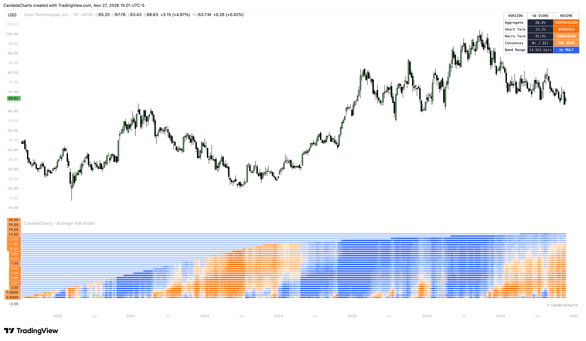

# Bollinger %B Model


Available on: <a href="https://www.candelacharts.com/algorithms" class="button secondary small" data-icon="chart-scatter-bubble">CandelaCharts</a>


> Visualize multi-horizon price extension across 30 stacked Bollinger Band lookbacks in one unified heatmap ribbon and consensus dashboard.

<figure><figcaption></figcaption></figure>

### Introduction

Evaluating whether an asset is overextended on a single Bollinger Band length leaves you vulnerable to blind spots. Price can appear deeply overbought on a fast short-term band while remaining compressed near the bottom of its broader macro band structure, or vice versa.

The **CandelaCharts – Bollinger %B Model** eliminates single-period guesswork by plotting **30 distinct Bollinger %B horizons simultaneously** as a stacked color-graded heatmap ribbon—from fast tactical bands at the bottom row (`Band 01`) up to long-term macro bands at the top row (`Band 30`). At a single glance, you can see whether short-term swings align with or diverge from multi-month trend expansion.

Designed for **swing traders, trend followers, and multi-horizon investors**, it turns 30 band calculations into a clean visual heatmap, a structured **Dashboard**, and automated consensus alignment alerts.


**TL;DR:** Bright **Teal** rows (upper gradient tiers on the default theme) show price pushing toward upper bands across those horizons (**Expansion**), neutral mid-tones signal balance around moving averages, and **Red** rows (lower gradient tiers) show price compressed near lower bands (**Compression** / oversold stretch).


### How It Works

**CandelaCharts – Bollinger %B Model** computes normalized **Bollinger %B** on a `0%` to `100%` scale across 30 customizable lookback horizons simultaneously, encoding each horizon onto a smooth **10-tier color heatmap** stacked vertically in a dedicated sub-pane.

Shorter horizons appear near the lower rows of the ribbon while longer macro horizons sit toward the top. Alongside the heatmap, an on-chart **Dashboard** summarizes **Aggregate**, **Short Term**, **Macro Term**, **Consensus** direction, and active **Band Range** in real time.

#### Reading the Indicator

Use the 10-tier heatmap colors (default **Teal - Red** theme) and dashboard badges to read multi-horizon positioning:

| Visual / Dashboard Field          | Default Color / Badges                                                                     | How to Read It                                                                              |
| --------------------------------- | ------------------------------------------------------------------------------------------ | ------------------------------------------------------------------------------------------- |
| **Upper Heatmap Tiers (70–100%)** | Shades of Teal                                                                             | Price is pressing against or expanding along upper Bollinger Bands across those horizons    |
| **Middle Heatmap Tiers (40–60%)** | Neutral muted transition tones                                                             | Price sits near the middle baseline across those horizons (equilibrium or consolidation)    |
| **Lower Heatmap Tiers (0–30%)**   | Shades of Red                                                                              | Price is compressed along lower Bollinger Bands across those horizons (oversold / discount) |
| **Aggregate**                     | `EXPANSION`, `ABOVE MEAN`, `BELOW MEAN`, `COMPRESSION`                                     | Overall %B regime blended across all 30 bands                                               |
| **Short Term**                    | `OVERBOUGHT`, `BULLISH`, `BEARISH`, `OVERSOLD`                                             | Fast-horizon positioning (`Band 01`–`Band 10` tier)                                         |
| **Macro Term**                    | `STRONG TREND`, `UPTREND`, `DOWNTREND`, `DEEP TREND`                                       | Long-horizon positioning (`Band 21`–`Band 30` tier)                                         |
| **Consensus**                     | Bull/Bear horizon count + `STRONG BULL`, `MOD BULL`, `BALANCED`, `MOD BEAR`, `STRONG BEAR` | How many of the 30 bands lean bullish versus bearish simultaneously                         |
| **Band Range**                    | Shortest–Longest span & StDev badge                                                        | Quick reference for your active horizon span and standard deviation multiplier              |

Choose from **5 curated color themes** (`Teal - Red`, `Blue - Orange`, `Black - Cafee`, `Teal - Navy`, `Green - Red`) or switch to `Custom` to style all 10 gradient tiers individually.

### Features

* **30-Horizon Stacked Heatmap:** Replaces dozens of separate oscillators with one clean vertical term-structure ribbon from short-term tactical bands (`Band 01`) to macro horizons (`Band 30`).
* **10-Tier Gradient Clarity:** Smoothly maps `0–100%` Bollinger %B compression, equilibrium, and expansion across 10 distinct color steps.
* **Term-Structure Consensus Dashboard:** Instantly separates **Short Term** exhaustion from **Macro Term** trend health and displays the exact bullish/bearish band split.
* **Flexible Themes & Full Band Customization:** Adjust `Source`, `Standard Deviation`, `Model Line Width`, all 30 individual band lengths, and 5 built-in palettes plus `Custom`.
* **Multi-Horizon Alignment Alerts:** Built-in alerts trigger when broad horizon consensus aligns strongly to the upside or downside.

### How To Use

#### 1. Confirming High-Conviction Trend Expansion

Watch for both **Short Term** and **Macro Term** rows lighting up together in aligned upper colors while the dashboard reads **STRONG BULL** (or aligned lower colors with **STRONG BEAR**):

* Full vertical color uniformity shows price is expanding synchronously across fast, intermediate, and macro timeframes rather than stalling against higher-timeframe resistance.

#### 2. Spotting Pullback Entries Inside Strong Macro Trends

Look for **color splits** between the bottom rows and top rows of the ribbon:

* When upper **Macro Term** bands stay healthy (**Teal** / `UPTREND` or `STRONG TREND`) while fast lower **Short Term** rows dip into oversold compression (**Red** / `OVERSOLD`), the pullback is resetting short-term froth inside an intact broader uptrend—often offering cleaner dip entries than chasing uniform extremes.

#### 3. Detecting Broad Exhaustion vs. Inflections

When nearly all 30 horizons sit pinned at maximum upper or lower extremes for an extended run, look at the **Short Term** rows first—a color shift from deep extreme back toward neutral often marks the earliest turn in momentum before macro bands roll over.

### Alerts

**CandelaCharts – Bollinger %B Model** includes two built-in TradingView alert conditions plus dynamic `alert()` calls on bar close:

1. **Bullish %B Model Alignment:** Fires when an overwhelming majority of horizons align in bullish upper-band expansion.
2. **Bearish %B Model Alignment:** Fires when an overwhelming majority of horizons align in bearish lower-band compression.

### FAQs

#### 1. What does Bollinger %B measure compared to standard Bollinger Bands?

Standard Bollinger Bands draw upper and lower price envelopes on your chart. **Bollinger %B** measures where current price sits relative to those envelopes on a standardized `0–100%` scale—near `100%` at the upper band, `50%` at the middle moving average, and `0%` at the lower band.

#### 2. Why stack 30 horizons instead of watching just one band?

A single lookback only shows one timeframe slice and can give false overbought/oversold signals against a dominant higher-timeframe trend. Stacking 30 bands reveals whether a move is a brief short-term blip or backed by broad multi-horizon consensus.

#### 3. Can I change the band periods or standard deviation?

Yes. Every individual band length (`Band 01` through `Band 30`), price `Source`, and `Standard Deviation` multiplier is adjustable in settings.

#### 4. Which assets and timeframes work best?

Because %B normalizes price inside each asset's own volatility envelope, the model works across **equities, indexes, crypto, FX, and commodities** on intraday, **Daily**, and **Weekly** charts.

#### 5. Which color theme is easiest to read?

The default **Teal - Red** palette clearly separates upper-band bullish expansion (**Teal**) from lower-band oversold compression (**Red**), while **Blue - Orange** and **Green - Red** offer high-contrast alternatives for dark or light chart backgrounds.
