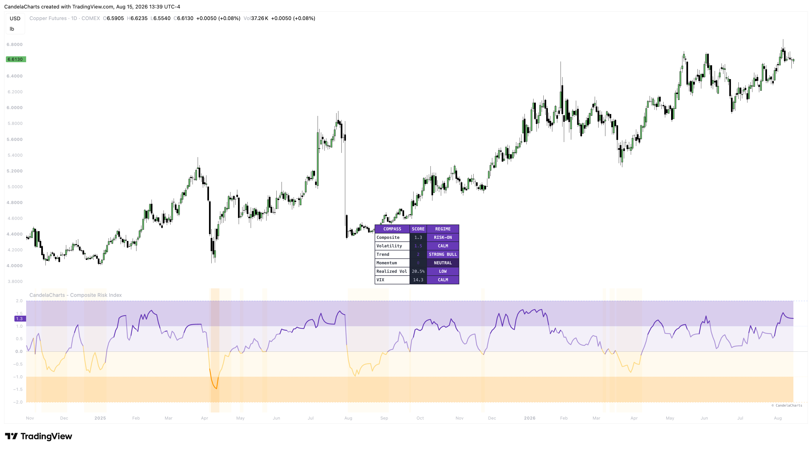

# Composite Risk Index


The Composite Risk Index is available on the <a href="https://www.candelacharts.com/algorithms" class="button secondary medium" data-icon="chart-kanban">CandelaCharts</a> platform as part of Algorithms, in the Professional plan, and on the<a href="https://www.tradingview.com/u/CandelaCharts/" class="button secondary medium" data-icon="display-chart-up">TradingView</a> platform as part of<a href="https://www.candelacharts.com/indicators" class="button secondary medium" data-icon="chart-kanban">CandelaCharts</a> Indicators, in the Investing and Institutional plans.


> Synthesize volatility, trend, and momentum into one macro risk compass to dynamically adjust exposure and highlight high-conviction dip zones.

<figure><figcaption></figcaption></figure>

### Introduction

Single indicators frequently contradict one another during market transitions: momentum may flash oversold while structural trend has already broken, or price may look calm even as implied volatility spikes beneath the surface. Relying on one signal in isolation leaves gaps in risk management.

The **CandelaCharts – Composite Risk Index** solves this by fusing **Volatility**, **Trend**, and **Momentum** into a single smoothed **Regime Score** ranging from **-2.0 (Crisis)** to **+2.0 (Risk-On)**, automatically pairing realized price volatility with an optional external volatility gauge matched to your chart's asset class.

Built for **cross-asset investors, portfolio managers, and swing traders**, it delivers a unified risk posture, dip-zone background highlights, and a live 3-pillar **Compass Dashboard** alongside real-time regime shift alerts.


**TL;DR:** Positive **Teal** zones (**RISK-ON** / **NEUTRAL**) support constructive positioning, while negative **Navy** zones (**RISK-OFF** / **CRISIS**) signal defensive risk management—with **Crisis** extremes shading major historical fear and accumulation windows.


### How It Works

**CandelaCharts – Composite Risk Index** evaluates three core market dimensions simultaneously—**Volatility** (realized volatility plus optional external implied volatility across 12 built-in asset-class presets), **Trend** structure, and **Momentum**—standardizing and smoothing them into a single oscillator around **0**.

The pane displays four shaded regime bands across the `-2.0` to `+2.0` scale and optionally highlights `RISK-OFF` pullbacks (**Show Trend Dips**) or deep `CRISIS` washouts (**Show Extreme Dips**) directly on the background, while a multi-row **Compass Dashboard** breaks down every underlying pillar in real time.

#### Reading the Indicator

The oscillator moves across four shaded risk regimes from **+2.0** down to **-2.0**:

| Regime / Dashboard Row        | Default Color / Badges                 | Meaning                                                                                                                                                                                       |
| ----------------------------- | -------------------------------------- | --------------------------------------------------------------------------------------------------------------------------------------------------------------------------------------------- |
| **RISK-ON**                   | Vibrant Teal band                      | Constructive volatility, positive trend, and supportive momentum; favors risk-on exposure                                                                                                     |
| **NEUTRAL**                   | Soft Teal band                         | Balanced or transitional market conditions near `0`; normal risk sizing                                                                                                                       |
| **RISK-OFF**                  | Light Navy band                        | Weakening trend/momentum or rising volatility; tighten stops and trim beta                                                                                                                    |
| **CRISIS**                    | Dark Navy band                         | Severe cross-pillar stress and extreme fear; defensive posture or contrarian dip watch                                                                                                        |
| **Trend Dips / Extreme Dips** | Optional Navy background highlights    | Flags `RISK-OFF` pullbacks (`Show Trend Dips`) or deep `CRISIS` capitulations (`Show Extreme Dips`)                                                                                           |
| **Compass Dashboard**         | 7-row `COMPASS / SCORE / REGIME` table | Live breakdown of `Composite`, `Volatility` (`CALM`–`CRISIS`), `Trend` (`STRONG BULL`–`STRONG BEAR`), `Momentum` (`OVERBOUGHT`–`OVERSOLD`), `Realized Vol`, and external vol (`VIX` / `DVOL`) |

Asset-class selection (`Auto`, `Equities`, `Crypto`, `Gold`, `Oil`, `Euro`, `Treasuries`, and specialized volatility presets), `Smooth`, dip highlights, and all regime colors are customizable in settings.

### Features

* **Tri-Pillar Quantitative Model:** Blends **Volatility**, **Trend**, and **Momentum** into one clean `Regime Score` so you never have to reconcile conflicting panels manually.
* **Automatic Asset-Class & External Volatility Adaptation:** Recognizes equities, crypto, commodities, FX, and rates automatically (with 12 selectable `Asset Class` presets and custom external volatility overrides).
* **Live Compass Dashboard:** Breaks down exact scores and readable regime badges for `Composite`, `Volatility`, `Trend`, `Momentum`, `Realized Vol`, and external implied volatility (`VIX` or `DVOL`).
* **Built-In Dip Zone Highlighting:** Toggle `Show Extreme Dips` (enabled by default) or `Show Trend Dips` to shade high-fear accumulation windows directly on your chart.
* **Threshold & Regime-Shift Alerts:** Includes four fixed regime entry/exit alert conditions plus live bar-close `alert()` notifications whenever the overall regime changes.

### How To Use

#### 1. Sizing Portfolio Exposure by Regime

Align position size and beta directly with the active shaded band:

* **RISK-ON:** Trend structure and volatility alignment support fuller exposure and letting winners run.
* **NEUTRAL:** Keep standard position sizing and stay selective as conditions transition.
* **RISK-OFF:** Reduce leverage, tighten trailing stops, and respect elevated downside risk.
* **CRISIS:** Protect capital against heightened tail volatility while monitoring for peak-fear stabilization.

#### 2. Hunting High-Fear Accumulation Zones

When `Show Extreme Dips` highlights a **CRISIS** washout, check the **Compass Dashboard**:

* Even when `Composite` sits deep in **CRISIS**, watch for the `Volatility` or `Momentum` rows to stop deteriorating and curl higher—indicating panic is exhausting itself for staged long-term accumulation.

#### 3. Diagnosing Divergence Between Pillars

Use the dashboard rows to spot early internal cracks before the composite headline flips:

* For example, if `Composite` is still holding **RISK-ON** while `Momentum` weakens to `NEGATIVE` and `Volatility` rises to `ELEVATED`, internal conditions are tightening beneath the surface.

### Alerts

**CandelaCharts – Composite Risk Index** provides both fixed threshold alerts and dynamic regime-shift notifications:

1. **Crisis Entry:** Fires when the Composite Score crosses down into the **CRISIS** regime.
2. **Crisis Exit:** Fires when the Composite Score recovers back out of the **CRISIS** regime.
3. **Risk-On Entry:** Fires when the Composite Score crosses upward into the **RISK-ON** regime.
4. **Risk-On Exit:** Fires when the Composite Score falls back out of the **RISK-ON** regime.

In addition, selecting **Any alert() function call** under the Composite Risk Index in TradingView sends a real-time bar-close notification on **any regime transition** (including shifts between `RISK-ON`, `NEUTRAL`, `RISK-OFF`, and `CRISIS`) complete with ticker symbol and current score.

### FAQs

#### 1. Do I need to configure external volatility tickers manually for crypto versus stocks?

No. When `Asset Class` is set to **Auto** (the default), the indicator detects whether you are viewing crypto or traditional markets and applies the appropriate volatility scaling and external volatility feed automatically, or you can lock in any of the 12 presets manually.

#### 2. Why might `Show Extreme Dips` be better than buying every `RISK-OFF` pullback?

`Show Extreme Dips` (enabled by default) isolates deep **CRISIS** capitulations where fear is statistically stretched, whereas `Show Trend Dips` (off by default) highlights milder **RISK-OFF** pullbacks that occur more frequently during corrective trends.

#### 3. What is shown when external volatility data is disabled?

If you turn off `Use External` (or inspect an asset without an external volatility proxy), the **Volatility** pillar adapts cleanly using multi-horizon **Realized Volatility** alone.

#### 4. Which chart timeframes give the clearest readings?

**Daily (`1D`)** and **Weekly** charts provide the cleanest macro and swing regime signals while filtering intraday noise.

#### 5. Can I adjust how reactive the Composite Score is?

Yes. Adjusting `Smooth` in settings controls how quickly the Regime Score responds—lower smoothing reacts faster to sharp sell-offs, while higher smoothing emphasizes broader structural shifts.
