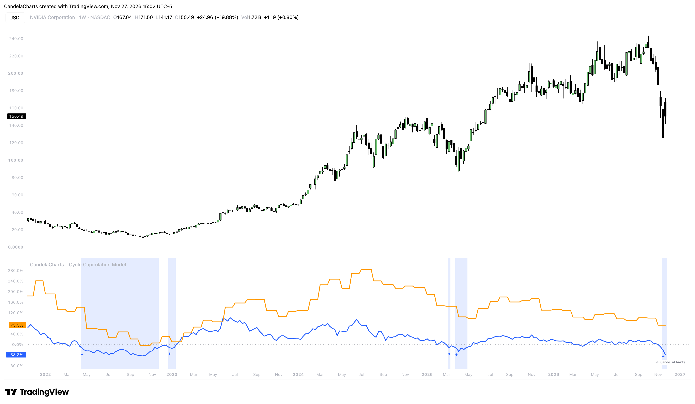

# Cycle Capitulation Model


Available on: <a href="https://www.candelacharts.com/algorithms" class="button secondary small" data-icon="chart-scatter-bubble">CandelaCharts</a>


> Spot tactical sell-off exhaustion and rare generational market bottoms by monitoring dual fixed-horizon trend deviations and capitulation regimes.

<figure><figcaption></figcaption></figure>

### Introduction

Major market bottoms unfold on two very different clocks: sharp cyclical corrections that wash out short-term sellers within a few months, and rare secular bear-market capitulations that push prices far below multi-year fair-value trends. Most chart oscillators reset too quickly during sustained downturns, making routine bounces look identical to once-in-a-decade washouts.

The **CandelaCharts – Cycle Capitulation Model** isolates both horizons in one clean sub-pane using fixed higher-timeframe moving average deviations that read identically whether you view a **5-minute, Daily, or Weekly** chart. **Condition 1 (Blue)** flags acute **Tactical Mean Reversion** dips, **Condition 2 (Orange)** flags deep **Generational Cheapness**, and when both trigger together, **Red** background shading marks rare **Dual Capitulation** regimes.

Built for **long-term investors, macro allocators, and cycle-focused traders**, it pairs non-repainting closed-candle discipline with interactive tooltip badges and three cycle alerts.


**TL;DR:** **Blue (`✦`)** marks tactical sell-off exhaustion below the medium-term trend baseline, **Orange (`❖`)** marks deep multi-year structural cheapness, and **Red shading** highlights historic **Dual Capitulation** windows when both conditions are active at once.


### How It Works

**CandelaCharts – Cycle Capitulation Model** measures percentage price deviation against two fixed higher-timeframe trend baselines—one tuned to medium-term cyclical corrections (**Condition 1**) and one tuned to multi-year macro business cycles (**Condition 2**)—with matching dashed threshold lines for each curve.

By default, **Confirmed HTF Bars** ensures values update only on completed higher-timeframe closes so historical signals never repaint, while **Dataset Start SMA** lets younger assets or newer listings draw cleanly from available early history instead of staying blank.

#### Reading the Indicator

The `%` oscillator tracks both deviation curves relative to their negative trigger thresholds:

| Visual Element                                | Default Color                                     | Condition / Meaning                                                                                    |
| --------------------------------------------- | ------------------------------------------------- | ------------------------------------------------------------------------------------------------------ |
| **Tactical Mean Reversion Line & `✦` Marker** | Blue curve, dashed blue threshold & `✦` badge     | **Condition 1:** Price has stretched deeply below its medium-term trend baseline; tactical bounce zone |
| **Generational Cheapness Line & `❖` Marker**  | Orange curve, dashed orange threshold & `❖` badge | **Condition 2:** Price sits at severe multi-year structural discount; rare macro value zone            |
| **Condition 1 Active Shading**                | Translucent Blue background                       | Active tactical mean-reversion window (`Condition 1` breached)                                         |
| **Condition 2 Active Shading**                | Translucent Orange background                     | Active generational cheapness window (`Condition 2` breached)                                          |
| **Dual Capitulation Shading**                 | Translucent Red background                        | Both **Condition 1** and **Condition 2** active simultaneously; historic secular washout regime        |

Hovering over any `✦` or `❖` marker displays an explanatory tooltip summarizing the active deviation reading, trigger threshold, and historical cycle outlook.

### Features

* **Dual Cyclical & Generational Lens:** Separates ordinary **Tactical Mean Reversion** pullbacks (`✦`) from deep **Generational Cheapness** (`❖`) and combined **Dual Capitulation** crises.
* **Timeframe-Invariant Fixed Horizons:** Both curves evaluate fixed daily and monthly trend anchors so readings remain identical across intraday, Daily, and Weekly charts.
* **Non-Repainting Closed-Candle Discipline:** `Confirmed HTF Bars` (on by default) locks updates strictly to completed higher-timeframe bars to eliminate intrabar lookahead distortion.
* **Young-Dataset Support:** `Dataset Start SMA` allows assets with shorter trading histories to compute averages from inception until full windows mature.
* **Interactive Signal Badges & Threshold Controls:** Toggle `Show signal markers (✦ / ❖)`, `Regime Shading`, custom thresholds, colors, and three built-in cycle alerts.

### How To Use

#### 1. Timing Tactical Oversold Bounces (`✦` / Blue)

Watch for the **Blue** line dropping below its dashed threshold and printing a `✦` marker with translucent **Blue** shading:

* This flags acute cyclical selling pressure where fear has pushed price meaningfully below its intermediate trend.
* Long-term investors and swing traders can use **Condition 1** periods to prepare staged accumulation watches alongside price stabilization.

#### 2. Identifying Generational Value (`❖` / Orange)

When the **Orange** curve breaks below its dashed threshold and prints a `❖` marker:

* The asset has entered deep multi-year **Generational Cheapness**, an infrequent event typically reserved for major bear markets or macro recessions.
* Dollar-cost averaging or building long-horizon core allocations during **Condition 2** zones historically captures steep structural discounts.

#### 3. Recognizing Secular Dual Capitulations (Red Background)

When both curves sit below their respective thresholds at the same time and **Regime Shading** turns **Red**:

* Both tactical panic and long-term structural undervaluation have aligned—historically marking rare generational washouts across major equity indexes and macro assets.
* Plan staggered entries rather than going all-in on day one, as deep macro bottoms can remain inside red regimes across multiple waves of volatility.

### Alerts

**CandelaCharts – Cycle Capitulation Model** includes three built-in TradingView alert conditions:

1. **Condition 1 Triggered:** Fires when price crosses below the tactical medium-term deviation threshold (`✦` entry).
2. **Condition 2 Triggered:** Fires when price crosses below the generational long-term deviation threshold (`❖` entry).
3. **C1 + C2 Active:** Fires when both conditions become active simultaneously, signaling entry into the **Dual Capitulation** regime.

### FAQs

#### 1. Why do the lines stay constant when I switch chart timeframes?

Both curves are anchored to fixed higher-timeframe daily and monthly baselines rather than your current chart interval, ensuring a **15-minute**, **Daily**, and **Weekly** chart all display the exact same macro readings.

#### 2. Does this indicator repaint historical signals?

No, when **Confirmed HTF Bars** is enabled (the default), readings update strictly on completed higher-timeframe closes so past signals never shift retroactively.

#### 3. Why is the `✦` or `❖` symbol plotted on the first bar of an active zone?

Each marker highlights the entry bar where the condition first activates (or where an already-active regime begins on the loaded chart history), keeping the sub-pane uncluttered while providing full details on hover.

#### 4. What does `Dataset Start SMA` do on newer crypto or IPO charts?

When enabled (default), newer assets with less historical price data begin computing their long-term baseline immediately from their earliest available bars rather than remaining blank until years of data accumulate.

#### 5. Can I adjust the trigger thresholds for higher-beta assets like crypto?

Yes. Both the **Condition 1** and **Condition 2** percentage thresholds are customizable in settings—making it easy to widen thresholds for volatile individual stocks or crypto assets while keeping stricter defaults for broad equity indexes.
