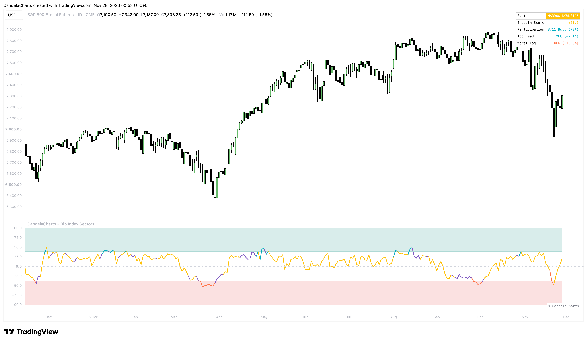

# Dip Index Sectors


The Dip Index Sectors is part of <a href="https://www.candelacharts.com/algorithms" class="button secondary medium" data-icon="chart-kanban">CandelaCharts</a>Algorithms, available with the Professional plan.


> Track cross-sectional participation across 11 market sectors to separate broad-based rallies and sell-offs from narrow, fragile moves.

<figure><figcaption></figcaption></figure>

### Introduction

Index price action alone cannot tell you whether a market move is supported by broad institutional rotation or carried by only two or three heavyweight sectors. A rally led by narrow concentration is vulnerable to sharp air pockets, while broad multi-sector participation often signals durable trend expansion.

The **CandelaCharts – Dip Index Sectors** model measures internal breadth balance across **11 customizable equity sectors** and plots a unified cross-sectional oscillator around a zero equilibrium line. Built-in confirmation smoothing filters out fleeting single-bar noise, classifying market internals into clear **Broad**, **Narrow**, and **Mixed** regimes.

Designed for **macro investors, swing traders, and sector rotators**, it surfaces live sector leadership, laggards, and participation ratios in a clean on-chart dashboard alongside built-in diffusion and regime alerts.


**TL;DR:** **Cyan (`BROAD UPSIDE`)** confirms widespread multi-sector strength, **Orange-Red (`BROAD DOWNSIDE`)** warns of broad selling pressure, **Amber (`NARROW UPSIDE` / `NARROW DOWNSIDE`)** flags concentrated moves lacking broad confirmation, and **Purple (`MIXED`)** signals balanced rotation.


### How It Works

**CandelaCharts – Dip Index Sectors** monitors 11 equity sector feeds in parallel, evaluating how widely sector breadth aligns above or below neutral equilibrium. Readings settle around a dashed **0** Mean Line with shaded Top and Bottom zones marking confirmed broad upside and broad downside thresholds.

To prevent rapid back-and-forth flickering at regime borders, state changes require confirmed closed-bar transitions. When fewer than the minimum valid sector feeds are available, the model pauses in `INSUFFICIENT` state instead of displaying skewed breadth.

#### Reading the Indicator

The oscillator classifies sector participation into five active regimes plus an insufficient-data fallback:

| Regime / Visual     | Color                                   | What It Means                                                                      |
| ------------------- | --------------------------------------- | ---------------------------------------------------------------------------------- |
| **BROAD UPSIDE**    | Cyan / Teal line & top zone shading     | Widespread bullish participation across sectors supporting durable upside          |
| **NARROW UPSIDE**   | Amber / Yellow line                     | Positive breadth concentrated in a smaller subset of leading sectors               |
| **MIXED**           | Purple line around dashed `0` Mean Line | Balanced or indecisive sector rotation without clear directional dominance         |
| **NARROW DOWNSIDE** | Amber / Yellow line                     | Selling pressure concentrated in select sectors without full market-wide contagion |
| **BROAD DOWNSIDE**  | Orange-Red line & bottom zone shading   | Broad multi-sector weakness signaling widespread risk-off pressure                 |
| **INSUFFICIENT**    | Gray line                               | Active valid sector feeds fell below minimum coverage requirements                 |

The optional on-chart **Panel** displays five live rows: `State`, `Breadth Score`, `Participation` (bullish vs. bearish sector counts and share), `Top Lead` (strongest sector and relative edge), and `Worst Lag` (weakest sector and relative drag).

### Features

* **11-Sector Breadth Engine:** Evaluates cross-sectional participation across Materials, Communication, Energy, Financials, Industrials, Technology, Consumer Staples, Real Estate, Utilities, Health Care, and Consumer Discretionary—with every ticker customizable.
* **Broad vs. Narrow Regime Clarity:** Clearly distinguishes healthy **Broad** moves from fragile **Narrow** leadership moves before headline indexes turn.
* **Confirmed State Transitions:** Built-in hysteresis and closed-bar state confirmation prevent false regime flips at threshold boundaries.
* **Live Leadership & Participation Panel:** Displays the active regime badge, `Breadth Score`, bull/bear sector split, `Top Lead`, and `Worst Lag` directly on your price chart.
* **Five Built-In Regime Alerts:** Real-time alerts for breadth diffusion, confirmed broad upside/downside regimes, leader threshold crossings, and coverage drops.

### How To Use

#### 1. Confirming Rally Quality (`BROAD` vs. `NARROW`)

Compare headline equity index breakouts against the **State** in the dashboard and oscillator pane:

* When price breaks higher alongside **BROAD UPSIDE** (Cyan), participation is deep and confirms healthy trend breadth.
* When price rallies while the oscillator stalls in **NARROW UPSIDE** (Amber), gains rely on limited sector leadership—watch closely for either breadth diffusion upward or heightened pullback vulnerability.

#### 2. Catching Breadth Diffusion Inflections

* **Broadening Expansion:** Watching `NARROW UPSIDE` transition into confirmed `BROAD UPSIDE` highlights moments when lagging sectors begin participating and confirm the move.
* **Systemic Contagion:** Watching `NARROW DOWNSIDE` cross into `BROAD DOWNSIDE` (Orange-Red) signals localized sector weakness spreading across the broader market.

#### 3. Tracking Sector Rotation via `Top Lead` & `Worst Lag`

Use the on-chart panel's **Participation**, **Top Lead**, and **Worst Lag** rows to spot cyclical vs. defensive rotation—identifying whether offensive growth sectors or defensive groups are driving current breadth.

### Alerts

**CandelaCharts – Dip Index Sectors** includes five built-in TradingView alert conditions:

1. **Confirmed breadth diffusion:** Fires when narrow directional breadth expands into a confirmed broad regime.
2. **Confirmed broad upside:** Fires when sector participation confirms entry into the **BROAD UPSIDE** regime.
3. **Confirmed broad downside:** Fires when sector participation confirms entry into the **BROAD DOWNSIDE** regime.
4. **Leader count threshold crossed:** Fires when the number of bullish leading sectors crosses above its minimum leadership threshold.
5. **Breadth coverage lost:** Fires when active sector feeds drop into the **INSUFFICIENT** state.

### FAQs

#### 1. How is Dip Index Sectors different from the standard Dip Index?

The standard **Dip Index** measures the overall percentage of assets trading above trend within one chosen index or crypto basket. **Dip Index Sectors** measures cross-sectional balance and dispersion across **11 individual equity sectors**, showing whether moves are broad or concentrated and highlighting the top leader and worst laggard.

#### 2. What does `NARROW UPSIDE` or `NARROW DOWNSIDE` tell me?

A **Narrow** reading means directional momentum exists, but only a limited pocket of sectors is driving it. Narrow rallies often need broader sector catch-up to stay healthy, while narrow sell-offs show weakness has not yet spilled into the full market.

#### 3. Can I customize the 11 sector tickers?

Yes. Each of the 11 sector inputs in settings accepts any TradingView symbol, allowing you to swap benchmarks or track an alternative sector universe while keeping the same breadth engine.

#### 4. Why does the panel sometimes show `INSUFFICIENT`?

If you load a historical period or custom symbol mix where fewer than the minimum number of valid sector feeds have trading data on that bar, the indicator switches to `INSUFFICIENT` (Gray) rather than reporting distorted breadth.

#### 5. Which chart timeframes should I use?

**Daily (`1D`)** and **Weekly** charts provide the cleanest sector-rotation reads and align best with cross-sector institutional flows.
