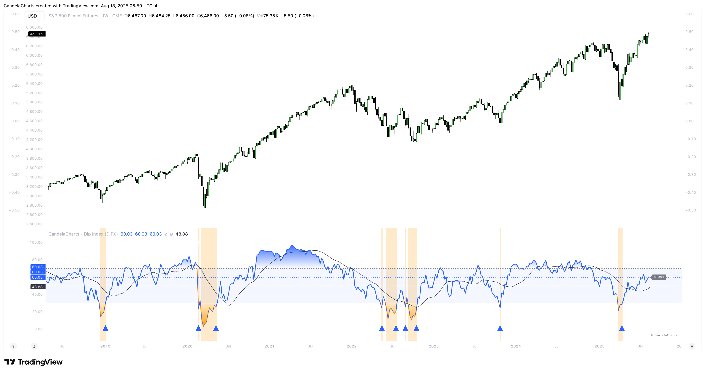

# Dip Index


The Dip Index is available on the <a href="https://www.candelacharts.com/algorithms" class="button secondary medium" data-icon="chart-kanban">CandelaCharts</a> platform as part of Algorithms, in the Professional plan, and on the<a href="https://www.tradingview.com/u/CandelaCharts/" class="button secondary medium" data-icon="display-chart-up">TradingView</a> platform as part of<a href="https://www.candelacharts.com/indicators" class="button secondary medium" data-icon="chart-kanban">CandelaCharts</a> Indicators, in the Investing and Institutional plans.


> Measure internal market participation on a 0–100% breadth scale to spot broad capitulation dips, fragile rallies, and exhaustion zones.

<figure><figcaption></figcaption></figure>

### Introduction

Headline index prices frequently mask what is happening beneath the surface. A major benchmark can push to fresh highs on the back of a handful of mega-cap leaders while the majority of underlying assets quietly weaken, or fall sharply into a washed-out extreme where nearly everything is oversold at once.

The **CandelaCharts – Dip Index** translates internal market participation into a clean **0% to 100%** oscillator across **Stocks** and **Crypto**. By tracking how broadly assets are participating above or below their trend baselines—and pairing that reading with optional exit signals, on-chart range-low detection, and macro recession shading—it reveals whether strength is genuinely broad or running on fumes.

Built for **swing traders, position traders, and long-term investors**, it turns market-wide breadth into clear **Overbought** and **Oversold** zones that help time dip accumulation and risk reduction.


**TL;DR:** Readings falling into the **Oversold** zone (**Orange** by default) highlight washed-out breadth and potential accumulation windows, while readings pushing into the **Overbought** zone (**Blue** by default) signal stretched upside participation where pullback risk rises.


### How It Works

**CandelaCharts – Dip Index** evaluates internal market breadth for your selected equity index, sector group, or aggregate crypto basket on **Daily (`1D`) and higher** timeframes. Plotting it on intraday timeframes below `1D` displays a reminder banner because breadth data is anchored to daily and higher sessions.

Readings oscillate around a neutral **50%** midline between customizable **Overbought** and **Oversold** thresholds, with smooth gradient fills inside extreme zones, optional chart background overlays, an optional moving average trendline, and an on-chart status panel.

#### Reading the Indicator

The oscillator moves between `0%` and `100%` around a neutral **50%** reference line:

| Element / Reading              | Default Visual                                                                            | Meaning                                                                               |
| ------------------------------ | ----------------------------------------------------------------------------------------- | ------------------------------------------------------------------------------------- |
| **Above Overbought Threshold** | Blue line, gradient fill & optional zone tint                                             | Broad upside stretch; participation is crowded and pullback risk increases            |
| **50% Neutral Midline**        | Gray horizontal reference line                                                            | Equilibrium between advancing and declining market breadth                            |
| **Below Oversold Threshold**   | Orange line, gradient fill & optional zone tint                                           | Broad selling exhaustion; historically strong zone to watch for dip reversals         |
| **Exit Signals (`▲` / `▼`)**   | Upward / downward triangles at `0%` or `100%`                                             | Optional reversal markers when breadth exits Oversold (`▲`) or Overbought (`▼`)       |
| **Show Smart Money**           | On-chart `Range Low` line & upward triangles                                              | Optional range-low tracking and spring reversal markers directly on price candles     |
| **Recession Shading**          | Subtle pane/chart background highlight                                                    | Optional **Predictive** or **Actual** macro recession context overlay                 |
| **Status Panel**               | Top-right 6-row table (`Market`, `Assets`, `Timeframe`, `MA Length`, `Status`, `Value %`) | Live snapshot of the selected market basket, trend horizon, and current breadth state |

All plot styles (`Line`, `Stepline`, `Stepline Diamond`, `Cross`, `Circle`), 8 preset themes plus `Custom` colors, moving average smoothing (`SMA`, `EMA`, `RMA`, `WMA`, `VWMA`), and overlays are configurable in settings.

### Features

* **Stocks & Crypto Market Coverage:** Switch seamlessly between **Crypto** aggregate market breadth and **28 Stock index and sector breadth groups** (including major US benchmarks, style indexes, and all 11 equity sectors).
* **Customizable Extreme Zones & Overlays:** Shade **Overbought** and **Oversold** regimes directly in the oscillator pane or mirror them onto the main price chart with `OB/OS Overlay`.
* **Optional Exit & Smart Money Signals:** Toggle triangle exit markers when breadth leaves extreme zones, or enable `Show Smart Money` to plot on-chart `Range Low` levels and volume-confirmed spring reversals.
* **Macro Recession Context:** Optionally overlay **Predictive** or **Actual** recession regimes to distinguish routine bull-market pullbacks from deeper macro downturns.
* **Flexible Display & Live Panel:** Choose from 5 plot modes, 8 curated color themes, an optional smoothed breadth moving average, and an on-chart summary panel.

### How To Use

#### 1. Timing High-Probability Market Dips

Watch for the Dip Index dropping into the **Oversold** zone (**Orange** shading by default):

* This signals widespread internal selling where most assets in the basket have pulled back together—conditions that often precede durable rebounds.
* Instead of buying on the first dip into extreme territory, wait for the line to curl upward or print an upward `▲` exit triangle (if `Signals` is enabled) to confirm participation is recovering.

#### 2. Spotting Breadth Divergences & Exhaustion

Compare headline index price swings against the Dip Index trajectory:

* **Bullish Divergence:** Price makes a lower low while the Dip Index forms a higher low in or near Oversold territory, showing fewer assets are breaking down beneath the surface.
* **Bearish Divergence:** Price pushes to a higher high while the Dip Index stalls at a lower high or exits the **Overbought** zone (`▼`), warning that leadership is narrowing and upside momentum is fading.

#### 3. Adding Macro & Smart Money Confirmation

* Toggle `Show Smart Money` when hunting major swing bottoms to pair washed-out breadth readings with on-chart `Range Low` spring reversals directly on your price candles.
* Use `Recession` shading to gauge macro context: Oversold dips outside recession regimes often resolve faster, while Oversold readings during recession regimes call for patience and staged scaling.

### Alerts

**CandelaCharts – Dip Index** does not include built-in alert conditions for overbought or oversold zone crossings.

However, when `Show Smart Money` is enabled, it triggers a dynamic `Spring Detected` bar-close alert whenever a range-low spring reversal prints—subscribe to it in TradingView by choosing **Any alert() function call** under the Dip Index condition.

### FAQs

#### 1. Why does the indicator display a warning on intraday charts?

Market breadth feeds update cleanly on daily and higher sessions. To ensure accurate readings without misleading intraday gaps, use **Dip Index** on **Daily (`1D`)**, **Weekly**, or **Monthly** charts.

#### 2. What is the difference between Stocks and Crypto mode?

In **Stocks** mode, you can target 28 specific equity benchmarks, style groups, or individual sectors under `Assets`. In **Crypto** mode, the indicator tracks aggregate cryptocurrency market breadth automatically across the broader digital asset market.

#### 3. Should I trade every time the line enters Overbought?

No. During powerful bull trends, market breadth can stay elevated or oscillate near Overbought territory for extended periods as leadership rotates. Treat Overbought exits (`▼`) and bearish divergences with price as cautionary signals rather than automatic short triggers.

#### 4. What does the Predictive vs. Actual option under Recession do?

**Actual** highlights officially recorded historical recession periods for macro backtesting, while **Predictive** highlights real-time yield-curve inversion regimes on the chart. Both options are visual context overlays only.

#### 5. Which plot mode and moving average settings work best?

**Line** or **Stepline** gives the cleanest view of daily breadth shifts, while enabling the optional **Moving Average** overlay helps smooth noisy day-to-day breadth swings so intermediate trends stand out clearly.
