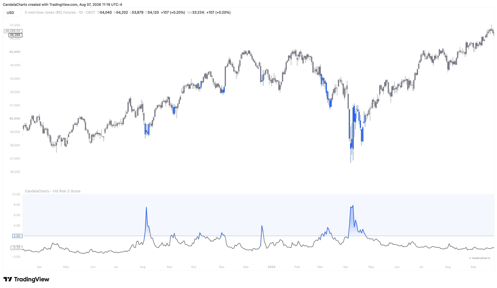

# VIX Risk Z-score


Available on: <a href="https://www.tradingview.com/scripts/marketplace/CandelaCharts/" class="button secondary small" data-icon="chart-fft">TradingView</a><a href="https://www.candelacharts.com/algorithms" class="button secondary small" data-icon="chart-scatter-bubble">CandelaCharts</a>


> Standardize implied volatility spikes into a rolling Z-score oscillator and color-coded chart candles to spot extreme market panic and complacency.

<figure><figcaption></figcaption></figure>

### Introduction

Looking at raw VIX levels without context can easily mislead you: a reading that feels terrifying during a quiet bull year may be completely ordinary during a high-volatility cycle. What matters most for timing sentiment extremes is how far implied volatility has stretched relative to its own recent baseline.

The **CandelaCharts – VIX Risk Z-score** normalizes implied volatility into a clean rolling Z-score oscillator (`VIX Z-Score`) and paints the **price candles on your main chart** directly with the active volatility regime color. That dual view lets you spot extreme panic spikes and complacent volatility compression without ever taking your eyes off price action.

Built for **index traders, swing traders, and long-term dip buyers**, it highlights statistically extreme fear and calm across shifting market environments.


**TL;DR:** **Blue** candles and upper-zone fills signal extreme implied-volatility panic (`>= OB Thresh (Z)`), **Orange** candles and lower-zone fills mark deep complacency (`<= OS Thresh (Z)`), and **Gray** candles represent normal neutral conditions.


### How It Works

**CandelaCharts – VIX Risk Z-score** tracks implied market volatility (`VIX`) relative to its recent statistical distribution, plotting the resulting Z-score in a dedicated oscillator pane bounded by dashed horizontal thresholds (`OB Thresh (Z)` above zero and `OS Thresh (Z)` below zero).

Simultaneously, it overlays matching color-coded candles (`Price Candles`) directly onto your main price chart so every extreme fear surge or low-volatility compression stands out right on the bars where you execute trades.

#### Reading the Indicator

The oscillator and main-chart price candles shift across three intuitive states:

| Reading / State                              | Default Color | Oscillator Visual                        | Main Chart Visual    | Meaning                                                                                      |
| -------------------------------------------- | ------------- | ---------------------------------------- | -------------------- | -------------------------------------------------------------------------------------------- |
| **Extreme Fear (`>= OB Thresh (Z)`)**        | Blue          | Blue line with top gradient shading      | Blue price candles   | Volatility has surged well above its recent norm; panic spike / potential capitulation watch |
| **Neutral Range**                            | Gray          | Gray line between thresholds             | Gray price candles   | Normal volatility backdrop without extreme fear or complacency                               |
| **Extreme Complacency (`<= OS Thresh (Z)`)** | Orange        | Orange line with bottom gradient shading | Orange price candles | Volatility is compressed well below its recent norm; calm trend or fragile complacency       |

The `VIX Length`, `OB Thresh (Z)`, `OS Thresh (Z)`, and all three regime colors (`Extreme Fear`, `Extreme Complacency`, `Neutral`) are customizable in settings.

### Features

* **Adaptive Rolling Z-Score Scale:** Automatically adjusts to changing volatility environments so extremes stay meaningful in both quiet and turbulent years.
* **Synchronized Candle Coloring:** Paints main-chart price candles directly with the active VIX Z-score regime color for instant visual alignment between price and fear extremes.
* **Dynamic Gradient Zone Shading:** Highlights upside panic stretches (`OB Thresh (Z)`) and downside complacency stretches (`OS Thresh (Z)`) with clean directional fills.
* **Custom Sensitivity & Color Control:** Tune the rolling lookback (`VIX Length`), upper/lower Z-score thresholds, and regime colors to match your strategy and chart theme.

### How To Use

#### 1. Identifying Panic Extremes & Capitulation Windows

Watch for the oscillator rising above **OB Thresh (Z)** and turning your main-chart price candles **Blue**:

* **Blue candles** indicate sudden statistical fear spikes where options hedging demand has surged far beyond recent norms—conditions that frequently cluster near short-term washouts and relief-bounce zones.
* Look for price stabilization or the Z-score rolling back down out of the extreme zone alongside key chart support before scaling into long dip positions.

#### 2. Monitoring Low-Volatility Complacency

When the oscillator drops below **OS Thresh (Z)** and price candles turn **Orange**:

* Market volatility is unusually compressed and hedging demand is muted.
* Strong uptrends often grind calmly higher during low-volatility streaks, yet prolonged **Orange** compression warns that protective hedging is cheap and the market can react sharply to unexpected shocks.

#### 3. Avoiding Chop with Neutral Candles

While candles remain **Gray**, implied volatility sits comfortably within normal statistical bounds—allowing you to rely cleanly on price structure, trend, and breadth tools without fighting extreme volatility distortion.

### Alerts

This indicator does not currently include built-in alerts.

### FAQs

#### 1. What does a Z-score tell me compared to the raw VIX price?

A raw VIX number does not show whether volatility is unusual compared to recent months. A Z-score measures how far VIX has deviated from its rolling average relative to its recent variability, making fear and complacency spikes comparable across different market cycles.

#### 2. Why does this indicator color extreme fear Blue instead of Red?

By default, **CandelaCharts – VIX Risk Z-score** uses **Blue** for upper extreme fear spikes (`OB Thresh (Z)`), **Orange** for lower extreme complacency (`OS Thresh (Z)`), and **Gray** for neutral bars. All three colors can be changed freely in settings.

#### 3. Should I buy every time price candles turn Blue?

No. During sustained bear-market sell-offs, volatility can stay elevated across multiple sessions and produce clusters of Blue candles. Waiting for the Z-score to peak and turn back down alongside price stabilization helps avoid catching early falling knives.

#### 4. Which assets and timeframes work best?

Because the model tracks US equity implied volatility (`VIX`), it pairs best with US equity indexes (`SPY`, `QQQ`, `SPX`, `NDX`) and macro-sensitive assets on **Daily (`1D`)** charts, though lower timeframes also inherit daily VIX readings cleanly.

#### 5. Can I adjust how sensitive the extreme thresholds are?

Yes. Lowering `OB Thresh (Z)` or raising `OS Thresh (Z)` flags milder volatility shifts more frequently, while widening the thresholds isolates only the rarest panic and complacency extremes.
