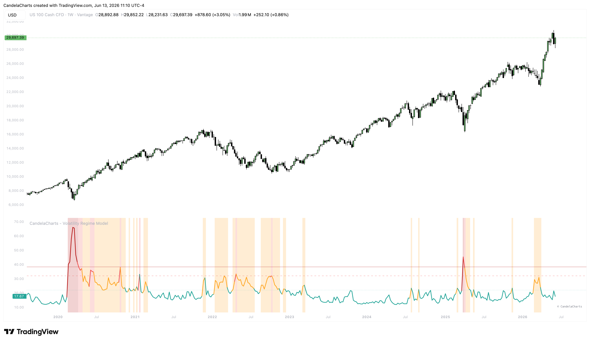

# Volatility Regime Model


The Volatility Regime Model is available on the <a href="https://www.candelacharts.com/algorithms" class="button secondary medium" data-icon="chart-kanban">CandelaCharts</a> platform as part of Algorithms, in the Professional plan, and on the<a href="https://www.tradingview.com/u/CandelaCharts/" class="button secondary medium" data-icon="display-chart-up">TradingView</a> platform as part of<a href="https://www.candelacharts.com/indicators" class="button secondary medium" data-icon="chart-kanban">CandelaCharts</a> Indicators, in the Investing and Institutional plans.


> Classify market volatility regimes, measure stress persistence, and cross-check bonds and credit to know when to fade spikes versus play defense.

<figure><figcaption></figcaption></figure>

### Introduction

Raw volatility spikes look identical on the surface until you know whether stress is isolated or spreading across financial markets. Fading a brief spike during calm credit conditions can offer a strong mean-reversion edge, whereas fading a persistent volatility cluster confirmed by bond and credit stress can be catastrophic.

The **CandelaCharts – Volatility Regime Model** tracks implied equity market volatility across four distinct risk regimes while measuring how long elevated stress persists and whether **Treasury bond volatility (`MOVE Index`)** and **corporate credit spreads** are confirming systemic stress.

Built for **macro traders, equity investors, and options/volatility participants**, it distills complex cross-asset risk signals into an actionable **Trading Bias** directly on your chart.


**TL;DR:** **Blue (`Low Vol`)** favors steady carry, **Orange (`Mid Vol`)** signals early fragile spikes (**Fade Noise** if unconfirmed and brief, **Edge Decaying** as stress drags on), and **Red / Dark Red (`High Vol` / `Crisis Cluster`)** warns of systemic stress (**Defensive** when persistent or confirmed by bonds and credit).


### How It Works

**CandelaCharts – Volatility Regime Model** evaluates daily implied market volatility against tiered regime boundaries on **Daily (`1D`) and higher** timeframes. Viewing it on an intraday chart triggers a warning banner so readings are never misinterpreted outside daily closes.

Alongside the main volatility line and optional smoothing, the model tracks consecutive elevated sessions (**Persistence**) and checks whether bond volatility (`MOVE Index`) and high-yield credit (`Credit Spread`) are `Confirming` stress or remaining `Quiet`. Together, those inputs determine the live **Trading Bias** shown in the dashboard.

#### Reading the Indicator

The oscillator maps implied volatility across four color-coded regimes, optional background ribbons, and a five-row cross-asset dashboard:

| Regime / Dashboard Field       | Color / Values                                                                       | How to Read It                                                                            |
| ------------------------------ | ------------------------------------------------------------------------------------ | ----------------------------------------------------------------------------------------- |
| **Low Vol (Stable)**           | Blue line & subtle ribbon                                                            | Calm volatility backdrop; supports trend-following and carry (`Stable Carry`)             |
| **Mid Vol (Fragile)**          | Orange line & subtle ribbon                                                          | Elevated, unstable volatility; watch persistence and cross-asset confirmation closely     |
| **High Vol (Stress)**          | Light Red line & optional main-chart overlay                                         | Active market stress; heightened downside risk and wider swings                           |
| **Crisis Cluster**             | Dark Red line & optional main-chart overlay                                          | Extreme volatility clustering; systemic risk regime calling for strict capital protection |
| **Persistence**                | Bar count in elevated stress                                                         | Tracks how many consecutive sessions volatility has remained elevated                     |
| **MOVE Index & Credit Spread** | `Confirming` (Red) or `Quiet` (Green)                                                | Shows whether Treasury volatility and credit markets validate equity fear                 |
| **Trading Bias**               | `Stable Carry` / `Fade Noise (Edge)` / `Edge Decaying` / `Defensive (Respect Trend)` | Synthesizes regime level, persistence, and cross-asset checks into clear posture          |

Both **Show Regime Ribbon** (pane shading) and **Overlay High Vol Zones** (subtle red highlights over main price candles during High Vol and Crisis Cluster regimes) can be toggled in settings.

### Features

* **Four Clear Volatility Regimes:** Separates **Low Vol (Stable)**, **Mid Vol (Fragile)**, **High Vol (Stress)**, and **Crisis Cluster** with color-coded lines, threshold bands, and optional shading.
* **Persistence Tracking:** Counts consecutive sessions spent in elevated volatility so you can see immediately whether a spike is fleeting or turning structural.
* **Cross-Asset Bond & Credit Validation:** Automatically monitors both the **MOVE Index** and **Credit Spread** behavior to flag `Confirming` systemic contagion versus `Quiet` equity-only noise.
* **Actionable Trading Bias Engine:** Translates regime, duration, and cross-asset status into four explicit stances: `Stable Carry`, `Fade Noise (Edge)`, `Edge Decaying`, and `Defensive (Respect Trend)`.
* **Optional Smoothing & Chart Overlays:** Toggle volatility curve smoothing (`Smooth`), pane ribbons, and main-chart `High Vol` background highlights.

### How To Use

#### 1. Distinguishing Noise Spikes from Systemic Shifts

Look at **Trading Bias** whenever volatility jumps out of `Low Vol (Stable)` into `Mid Vol (Fragile)`:

* **Fade Noise (Edge):** Elevated volatility has just begun and both `MOVE Index` and `Credit Spread` remain `Quiet`. Historically, brief unconfirmed spikes carry a higher chance of mean-reverting back toward calm conditions.
* **Edge Decaying:** Volatility has stayed elevated long enough that fading the spike loses reliability—avoid adding aggressive mean-reversion risk.

#### 2. Respecting Defensive & Crisis Regimes

When **Trading Bias** switches to **Defensive (Respect Trend)**—or when `High Vol (Stress)` / `Crisis Cluster` appears alongside `Confirming` signals in **MOVE Index** or **Credit Spread**:

* Cross-asset markets are validating equity fear, meaning volatility expansion is more likely to persist.
* Prioritize capital preservation, trim leverage, tighten risk controls, and wait for stress persistence and cross-asset confirmations to subside before leaning aggressively long.

#### 3. Sizing Risk Around `Stable Carry`

When the oscillator holds inside **Low Vol (Stable)** (Blue) and the dashboard reads **Stable Carry**, volatility drag is muted—favorable conditions for holding core trend positions and steady portfolio exposure.

### Alerts

This indicator does not currently include built-in alerts.

### FAQs

#### 1. Why does this indicator require a Daily (1D) or higher timeframe?

The model uses daily volatility, persistence counts, and macro bond/credit benchmarks calibrated to daily session closes. Using **Daily (`1D`)** ensures every regime threshold and cross-asset check aligns properly.

#### 2. Why are MOVE Index and Credit Spread included?

Equity volatility alone can spike briefly on headline scares or positioning squeezes. Checking whether US Treasury volatility (`MOVE Index`) and corporate credit markets (`Credit Spread`) are **Confirming** helps separate isolated noise from genuine systemic risk.

#### 3. What is the difference between `Fade Noise (Edge)` and `Edge Decaying`?

**Fade Noise (Edge)** appears in the early stage of an elevated volatility move while bonds and credit remain quiet. As elevated volatility lingers session after session without cooling off, **Edge Decaying** warns that the quick-snapback window is closing and risk is shifting toward **Defensive**.

#### 4. Does Trading Bias give buy or sell entries on its own?

No—it is a risk-posture and position-sizing framework designed to align your aggressiveness, leverage, and stop discipline with the prevailing volatility backdrop.

#### 5. Can I apply this model when trading crypto or individual stocks?

Yes. Even when trading individual equities or macro-sensitive crypto assets on daily charts, broad equity volatility and credit confirmation serve as valuable liquidity and risk-appetite barometers.
