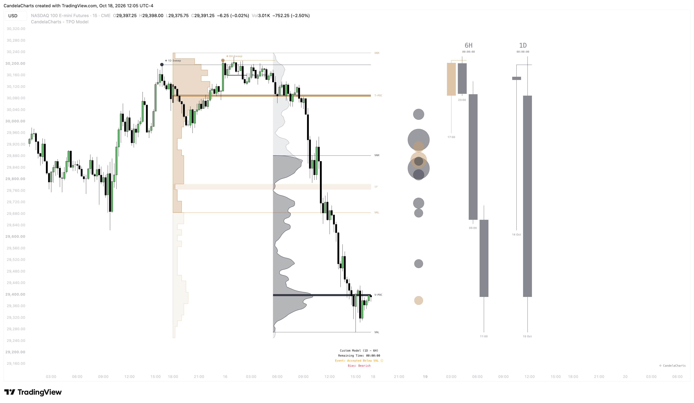

# TPO Model™ 🔜

The **CandelaCharts - TPO Model** is a market-profiling system for TradingView that reads each session as an auction. It builds a time-at-price (TPO) profile and an independent volume profile, then projects higher-timeframe candles, liquidity sweeps, and CISD/MSS structure directly onto your execution chart — no timeframe switching.

<figure><figcaption></figcaption></figure>

The model is built on the premise that value is discovered through acceptance and rejection. Rows where the auction spends time and volume define value; tails, single prints, and poor extremes mark where it was refused. Reading both against the previous session's levels shows whether the market is balancing, trending, or failing.

Whether you scalp the open on a 5-minute chart or track weekly balance on a 4-hour chart, the model adapts through Automatic Pairing or fully custom profile and HTF definitions. A lower intrabar resolution than the chart timeframe is required to build the profiles.
