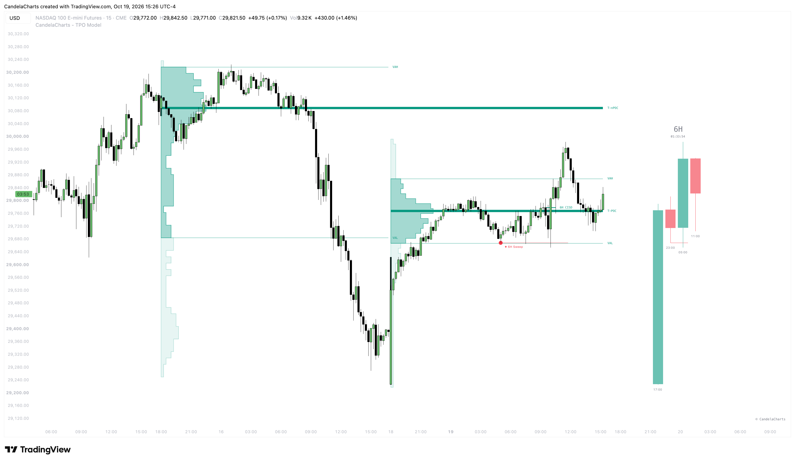
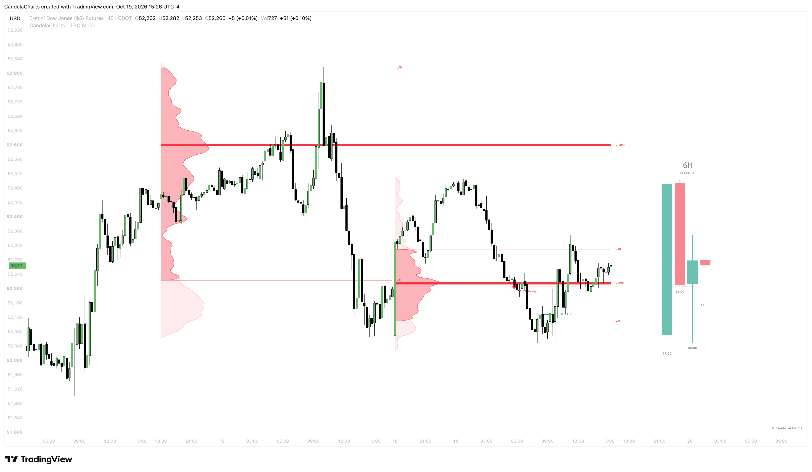
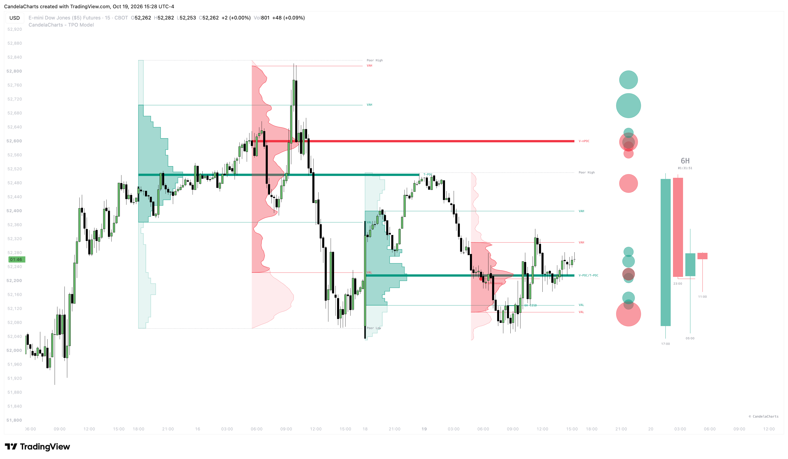
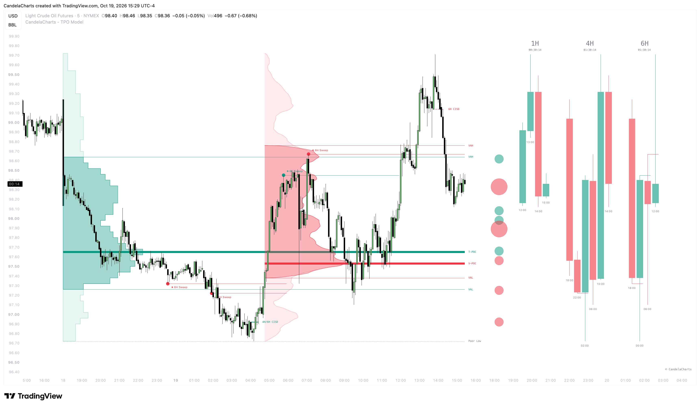
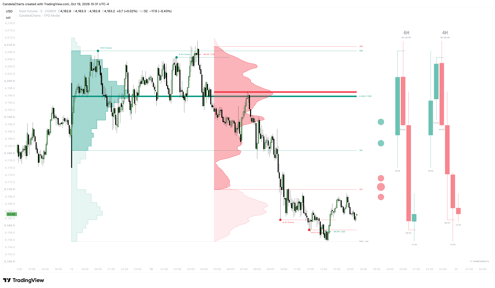
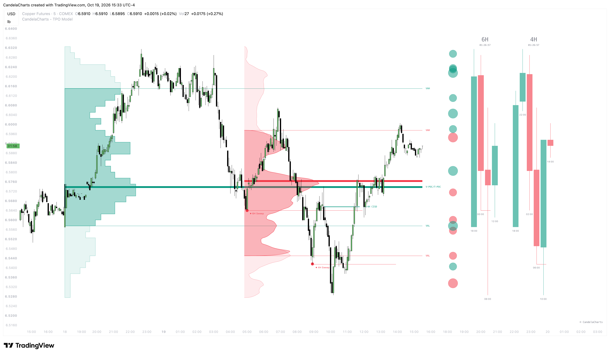

# Components

The TPO Model is built from several modular components that work together to break down the auction. Instead of treating the market as a flat series of candlesticks, it separates price action into time spent at price, actual traded volume, structural liquidity shifts, and real-time telemetry.

Each component handles a specific job on the chart, and you can run all of them together or strip things down to just the pieces you need.

### TPO Profile

The TPO (Time Price Opportunity) profile is the core of the model. It records how much time the market spent at each price level by stacking time blocks horizontally across the session. The resulting shape shows where buyers and sellers found balance and where price was quickly rejected.

<figure><figcaption></figcaption></figure>

The profile produces several key structural levels and zones:

* **Point of Control (T-POC)** — The price row with the highest number of TPOs. This is the fairest price of the session, where the market spent the most time negotiating.
* **Value Area (VAH & VAL)** — The price range containing roughly 70% of the session's time. The upper boundary is the Value Area High (VAH) and the lower is the Value Area Low (VAL). The engine expands outward from the POC row, comparing rows above and below until 70% of activity is captured.
* **Initial Range (ITR)** — The high and low established during the first hour of trading. The ITR defines the market's opening balance; whether price breaks out of this range or rotates inside it sets the tone for the rest of the day.
* **Buying and Selling Tails (BT / ST)** — Sharp, single-print runs at the session highs or lows (at least three consecutive rows). A tail shows that longer-term participants stepped in aggressively to reject an extreme price, leaving behind clear auction excess.
* **Single Prints (SP)** — Isolated single-row prints inside the body of the profile. These mark areas where price moved too fast to facilitate balanced two-way trade. They often act as magnets during range-bound days or as strong support and resistance when the market is trending.
* **Poor Highs and Lows** — Flat, blunt extremes where the outer row printed multiple TPOs instead of a clean, single-print tail. Because the market ran out of time rather than running out of buyers or sellers, these levels represent unfinished business and tend to be swept later.
* **Naked Points of Control (T-nPOC)** — Completed session POCs that have not yet been touched by subsequent price action. Because price found heavy agreement there in the past, these levels act as strong magnets when price revisits the area.

### Volume Profile

While the TPO profile measures time, the Volume Profile measures actual business. It tracks the total volume of contracts or shares traded at each price row during the same session.

<figure><figcaption></figcaption></figure>

* **Volume Point of Control (V-POC)** — The exact price row where the largest volume traded. This marks peak capital commitment rather than peak time.
* **Volume Value Area (V-VAH & V-VAL)** — The price band containing 70% of the total session volume.
* **Naked Volume POCs (V-nPOC)** — Untested volume nodes from past sessions that carry significant institutional memory.

**Reading Time vs. Volume**

Running both profiles side by side lets you compare time acceptance against capital commitment:

* **T-POC and V-POC aligned** — Time and volume agree on value. This confirms a balanced, well-facilitated market.
* **Price lingered with low volume** — Price spent time at a level, but institutional volume wasn't interested. This kind of consolidation is weak and prone to sharp breaks.
* **Brief time with heavy volume** — Price traded through a level quickly, but huge volume exchanged hands. This points to institutional absorption or aggressive re-accumulation.
* **V-POC migrating away from T-POC** — Capital is building value away from where price previously spent time, often signaling the start of a trend.

### Volume Bubbles

Volume Bubbles are bar-by-bar anomaly detectors. They flag individual candles whose volume stands out against the recent 50-bar baseline, highlighting aggressive effort that might not be obvious from candlestick shapes alone.

<figure><figcaption></figcaption></figure>

* **Relative Volume** — Compares a bar's raw volume to its 50-bar average. It highlights sudden bursts of market participation.
* **Concentrated Volume** — Normalizes volume by the bar's price range ($\frac{\text{Volume\}}{\text{Range\}}$). This uncovers stealth absorption—heavy volume traded inside a narrow, compressed bar where passive limit orders are soaking up aggressive market orders.
* **Sizing Tiers** — Bubbles scale across four tiers based on how extreme the anomaly is, so you can tell an ordinary volume bump apart from true institutional participation.

In practice, a large bubble appearing as price tests a Value Area edge or an old POC often signals absorption and a rejection back into value. A large bubble driving price through a boundary confirms real breakout participation.

### Projected Higher Timeframe (HTF) Canvas

The HTF Canvas solves the hassle of jumping between chart tabs. It projects developing and recent higher-timeframe candles right into the margin on the right side of your execution chart.

<figure><figcaption></figcaption></figure>

* **Model HTF** — The primary anchor group paired with your profile session (for example, 1-hour candles paired with a daily profile).
* **Secondary HTF Groups (HTF I, II, III)** — Extra macro layers (like 4-hour or daily candles) so you can keep multiple higher-timeframe horizons in view at the same time.
* **Live Candle Progression** — Renders developing wicks, bodies, and a real-time countdown to the macro candle close.

Watching higher-timeframe candles form alongside your intraday profile lets you track macro context—like whether a 4-hour candle is rejecting a key level—without losing your place on the 5-minute chart.

### Liquidity Sweeps

Liquidity Sweeps mark when the market raids resting orders above a high or below a low but fails to sustain price discovery.

<figure><figcaption></figcaption></figure>

* **Sweep Markers (`❖` / `✦`)** — Drawn when an HTF candle probes beyond a previous candle's high or low and closes back inside its range. Bullish sweeps at lows are marked with `❖`, and bearish sweeps at highs are marked with `✦`, followed by the timeframe that produced them.
* **Institutional Context** — Sweeps highlight where price ran into liquidity pools and was rejected, setting up the prerequisite condition for a structural shift.
* **Invalidation** — If price closes beyond the extreme swing point of the sweep candle, the sweep is invalidated and removed.

### Market Structure

Once a valid sweep occurs, this component tracks the change in delivery direction and maps the exact level required to confirm a reversal.

<figure><figcaption></figcaption></figure>

* **Delivery Leg** — The sequence of candles that drove price into the swept high or low. The model anchors its reversal levels to this leg.
* **Change in State of Delivery (CISD)** — Anchored to the open of the delivery candle. A close beyond this level confirms that the prior delivery move has ended and a reversal is underway.
* **Market Structure Shift (MSS)** — Anchored to the wick of the delivery candle rather than its body, offering a slightly more sensitive confirmation of structural change.
* **Pending vs. Confirmed** — The line is drawn dotted while the sweeping HTF candle is still open (a pending, provisional setup). Once the candle closes with the level broken, it locks in as a solid, confirmed structural level.
* **Confluence Merging** — When multiple higher timeframes trigger a structure shift at the same price level, the script combines them into a single line labeled with each timeframe involved (e.g., `1H / 4H CISD`).
