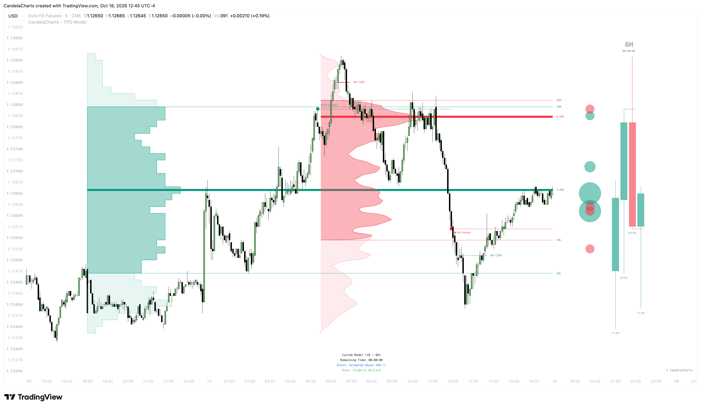

# Framework

The TPO Model is not a mechanical signal generator; it is a structured decision-making framework built around Auction Market Theory (AMT). Rather than guessing where price might go, the model analyzes where the market has found fair value, where it has rejected price, and how institutional capital is delivering orders in real time.

<figure><figcaption></figcaption></figure>

This page explains how the model's components work together in practice and provides a repeatable workflow for navigating each trading session.

### How the Components Interact

To get the most out of the model, you need to understand how its pieces communicate. Each component answers a distinct question, creating a continuous feedback loop from macro perspective to execution:

* **Projected HTF Canvas (Macro Context)** — Sets the higher-timeframe backdrop. It shows you the developing HTF candle, its open price, and a live countdown to its close right on your chart. You know instantly whether macro participants are driving direction or compressing.
* **TPO & Volume Profiles (Value & Location)** — Map out fair value for the session. The TPO profile shows where price spent time, while the Volume profile shows where real contracts transacted. Together, they establish the key battlegrounds: Value Area High (VAH), Value Area Low (VAL), Point of Control (POC), and untouched Naked POCs (nPOCs).
* **TPO Microstructure (Auction Evidence)** — Reveals how price behaved at the extremes. Clean single-print **Tails** confirm aggressive rejection, **Single Prints** highlight rapid displacement zones, and blunt **Poor Highs/Lows** expose unfinished business waiting to be swept.
* **Liquidity Sweeps & Market Structure (The Trigger)** — Translates auction location into concrete execution. When an HTF candle raids liquidity (`❖` / `✦`) and reverses through the delivery leg, it prints a **Change in State of Delivery (CISD)** or **Market Structure Shift (MSS)** to signal that the prior trend is exhausted.
* **Volume Bubbles (Order Flow Timing)** — Act as the timing trigger. By measuring relative and concentrated volume anomalies, bubbles reveal whether limit orders are absorbing price at a boundary (confirming a fade) or driving a breakout (confirming trend continuation).
* **Auction Dashboard (Real-Time Telemetry)** — Summarizes the active state at a glance. It confirms how much time remains in the profile session, tracks whether price is currently accepted, testing, or rejected relative to the prior Value Area, and calculates an objective quantitative bias.
* **Alert Engine (Continuous Monitoring)** — Keeps track of resting levels, virgin nPOC touches, and structural shifts in the background so you never miss an auction development.

### The Seven-Step Session Workflow

When you sit down at the chart, walk through this systematic sequence:

#### Step 1 — Establish Context & Horizon

Before looking for setups, align your timeframe perspective:

* **Session Pairing** — Ensure the profile timeframe matches your holding horizon (e.g., a daily profile for intraday trading, or a weekly profile for multi-day swing positions).
* **HTF Group** — Verify that the margin HTF candle is at or above your execution timeframe (e.g., 1-hour candles on a 5-minute chart).
* **Session Lifecycle** — Check the dashboard countdown. Avoid initiating new directional theses in the final minutes before a profile session closes and resets.


**Rule of thumb**: Never mix time horizons within a single thesis. A daily profile read on a 5-minute chart is completely different from a weekly profile analyzed on a 4-hour chart.


#### Step 2 — Map Key Auction Levels

Not all levels carry equal weight. Map the chart by order of institutional significance:

1. **Naked POCs (nPOCs)** — Untouched fair-value levels from prior sessions. Because heavy business occurred here without a retest, they act as primary magnets for price rebalancing.
2. **Prior Session POC** — The central fair-value reference of the previous auction; an ideal target and rotational pivot.
3. **Prior Session VAH & VAL** — The critical boundaries of fair value. How price interacts with these edges dictates whether the market is balancing or breaking out.
4. **Poor Highs & Poor Lows** — Blunt extremes lacking excess. They represent unfinished auctions and serve as high-probability targets for future liquidity sweeps.
5. **Single Print Imbalances** — Fast-transit zones from previous impulsive moves that often act as dynamic support/resistance or pullback targets.
6. **Initial Range (ITR)** — The high and low of the first hour of trading, framing the opening balance for the active session.

Confluence is king: a naked POC sitting directly at a previous VAL and a poor low is a vastly higher-conviction target than a standalone level.

#### Step 3 — Classify the Auction State

Every trading session falls into one of four primary auction conditions relative to the previous Value Area:

* **In Balance (Rotational Market)**
  * _What you see_: Price remains inside the previous Value Area, rotating between VAH and VAL.
  * _How to trade_: Expect two-way rotation. Look to fade tests of VAH and VAL back toward the POC.
  * _Invalidation_: Confirmed acceptance outside either boundary.
* **Acceptance Beyond Value (Imbalance / Trend Discovery)**
  * _What you see_: Price breaks outside the previous Value Area and prints two or more consecutive intrabar closes beyond VAH (bullish) or VAL (bearish).
  * _How to trade_: Value is migrating. Treat the broken boundary as dynamic support (VAH) or resistance (VAL) and trade in the direction of the breakout, targeting the next naked POC or poor extreme.
  * _Invalidation_: Price closes back inside the previous Value Area.
* **Failed Auction (Rejection at Extremes)**
  * _What you see_: Price probes beyond VAH or VAL but immediately encounters aggressive opposing orders, closing back inside the boundary.
  * _How to trade_: The market rejected higher/lower prices. This triggers the classic **80% Rule**, signaling a high-probability rotation across the entire Value Area to the opposite boundary.
  * _Invalidation_: A new push that confirms acceptance beyond the swept extreme.
* **Testing / Decision State**
  * _What you see_: Price is exploring the perimeter of the Value Area without yet printing two closes outside or rejecting back inside.
  * _How to trade_: Stand aside and wait for acceptance or rejection to declare itself.

The dashboard's **Event** row tracks these exact states automatically in real time.

#### Step 4 — Read the Microstructural Evidence

Once price reaches a key level, inspect the profile structure to see whether the auction found rejection or unfinished business:

* **Tails vs. Poor Extremes (Critical Distinction)**
  * A **Buying Tail (`BT`)** or **Selling Tail (`ST`)** prints single rows at the extreme, proving that other-timeframe traders aggressively rejected price (excess). Treat the tail as strong support/resistance.
  * A **Poor High** or **Poor Low** prints multiple TPOs at the boundary without excess. It tells you the auction was halted by the clock rather than by price rejection. This is unfinished business that is very likely to be swept.
  * _Never confuse them_: A tail is rejection; a poor extreme is a target.
* **Single Prints (`SP`)** — Mark rapid directional displacement where price moved too fast to facilitate two-way trade. During rotational days, expect single prints to fill; during strong trend days, expect them to act as strong pullback support or resistance.
* **TPO vs. Volume POC Alignment** — If the time POC and volume POC are aligned, fair value is firmly established. If volume POC is migrating away from time POC, capital commitment is pulling price in a new direction.

#### Step 5 — Identify the Execution Trigger

The structural engine coordinates higher-timeframe liquidity with execution timing:

1. **The Liquidity Sweep** — An HTF candle probes beyond a prior HTF candle's high or low and closes back inside, marked with `❖` (bullish) or `✦` (bearish).
2. **The Delivery Leg** — The model identifies the candle sequence that created the swept extreme.
3. **The Structure Shift (CISD / MSS)** — Price closes beyond the delivery level, signaling that the previous delivery move is finished.
   * _CISD_: Anchored to the delivery candle's open (conservative body break).
   * _MSS_: Anchored to the delivery candle's wick (sensitive extreme break).
4. **Pending vs. Confirmed** — A dotted line indicates the sweeping candle is still open (early warning). A solid line confirms the candle closed with the level broken (actionable confirmation).
5. **Invalidation** — If price breaches the extreme swing point of the sweep candle, the setup is invalidated and the line is removed. Always honor this invalidation.

#### Step 6 — Time the Entry with Volume Bubbles

Volume Bubbles provide the final microstructural timing layer:

* **Absorption at Boundaries** — When a large bubble (Tier 3 or 4) appears as price tests VAH or VAL and rejects back inside, it confirms that institutional limit orders absorbed aggressive flow. This provides high-confidence entry timing for mean-reversion trades.
* **Breakout Participation** — A large bubble accompanying a strong candle closing outside value confirms genuine capital expansion, validating trend continuation.
* **Thin Breaks (Low Volume)** — If price probes outside a Value Area boundary without any volume bubbles or participation surge, be cautious; low-volume breakouts frequently fail and snap back into value.

#### Step 7 — Validate with the Dashboard

Before pulling the trigger, check the dashboard for alignment:

* **Event Agreement** — Ensure the active event (`Accepted Above VAH`, `Rejected VAL`, etc.) supports your trade thesis.
* **Quantitative Bias** — Confirm the directional score (`Bullish`, `Bearish`, etc.) aligns with your position.
* **Conflicting Signals** — If the Event and Bias disagree (for example, price is testing VAH but the bias score remains neutral or bearish), treat the market as transitional. Reduce position size or wait for full alignment.
