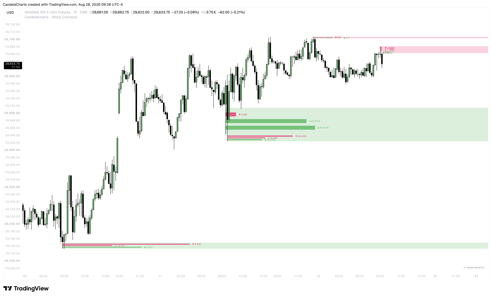

# Rejection Blocks

### What are Rejection Blocks? 

A **Rejection Block** is an advanced ICT (Inner Circle Trader) concept that focuses strictly on the extremes of price swings. While traditional Order Blocks focus on the entire body of a candle, Rejection Blocks are concerned exclusively with the **long wicks (tails)** of candles at major swing highs or swing lows.

<figure><figcaption></figcaption></figure>

When price forms a significant swing point with a long wick, it indicates that liquidity was aggressively swept above or below the candle body, and the market rejected those prices. The Rejection Block itself is drawn using the wick of that pivot candle.

* **Bullish Rejection Block:** Forms at a swing low. It is defined by the lower wick (from the candle's lowest point up to its open/close body). It signals strong institutional buying interest below the candle body.
* **Bearish Rejection Block:** Forms at a swing high. It is defined by the upper wick (from the candle's highest point down to its open/close body). It signals strong institutional selling interest above the candle body.

### How to Use Rejection Blocks 

Rejection Blocks act as high-probability zones for price reversals, as institutional algorithms often return to these wicks to mitigate remaining orders before continuing the trend.

#### **1. Pinpointing Reversals**

When price approaches a previously formed Rejection Block, do not expect it to easily slice through. Instead, watch for price to pierce into the wick (the Rejection Block zone) and immediately stall or reverse. This provides a highly accurate, low-risk entry for reversal trades.

#### **2. Liquidity Sweeps**

Retail traders often place their stop losses just above or below the bodies of swing highs and lows. Institutions will intentionally drive price into the Rejection Block (the wick area) to trigger these stops, gather liquidity, and immediately reverse price. Entering a trade inside the Rejection Block allows you to align yourself with this institutional trap.

#### **3. Consequent Encroachment (CE)**

The 50% mark of the Rejection Block (the exact midpoint of the wick) is the most sensitive level. In strong trending environments, price will often tap exactly the 50% CE level of the Rejection Block and aggressively reverse without ever violating the extreme of the wick.


Rejection Blocks are incredibly powerful when combined with **Time and Price** theory. A Rejection Block formed during the London or New York open carries significantly more weight than one formed during low-volume overnight sessions. Use the **Show Mean** setting in the indicator to easily visualize the critical 50% CE level of these blocks.

