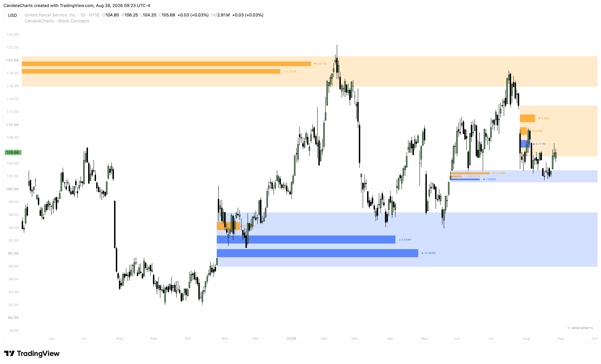

# Suspension Blocks

### What are Suspension Blocks? 

**Suspension Blocks** are highly specific price zones where institutional order flow temporarily stalls—or "suspends"—market momentum before initiating a significant, aggressive repricing move.

<figure><figcaption></figcaption></figure>

Unlike standard Order Blocks that simply highlight the last down-close candle before an up-move (or vice versa), a Suspension Block identifies the exact cluster where price was forcibly held in suspension to accumulate massive institutional volume. Once price breaks away from this zone, the sheer volume of orders left behind makes the Suspension Block an incredibly rigid barrier for future price action.

### How to Use Suspension Blocks 

Suspension Blocks act as brick walls in the market. When price returns to a Suspension Block, you can expect an aggressive defense of that level by institutional algorithms.

#### **1. Trend Continuation Entries**

The most reliable way to trade Suspension Blocks is as continuation entries during a macro trend. When the market breaks away from a Suspension Block and later retraces back to it, the institutional entities that built their positions there will step in to defend their average price, causing a sharp continuation in the original direction.

#### **2. Determining Market Bias**

Suspension Blocks are excellent barometers for overall market strength.

* If a Bullish Suspension Block holds, the market remains firmly in a bullish state.
* If price cleanly slices through and closes below a Bullish Suspension Block, it indicates a major shift in market structure and institutional intent, often signaling an impending trend reversal.

#### **3. Stop Loss Placement**

Because Suspension Blocks are fiercely defended, they provide excellent structural points for stop-loss placement. If you enter a trade near a Suspension Block, placing your stop loss just outside the block provides a logical, statistically sound invalidation point. If the block fails, the trade idea is completely invalidated and it is safest to exit.


Use the **Alignment** settings (such as _Precise_ or _Accurate_) in the indicator options to perfectly calibrate how Suspension Blocks are drawn on your specific asset. Not all assets react to accumulation zones identically, and adjusting the alignment ensures the block highlights the true institutional defense line for the pair you are trading.

