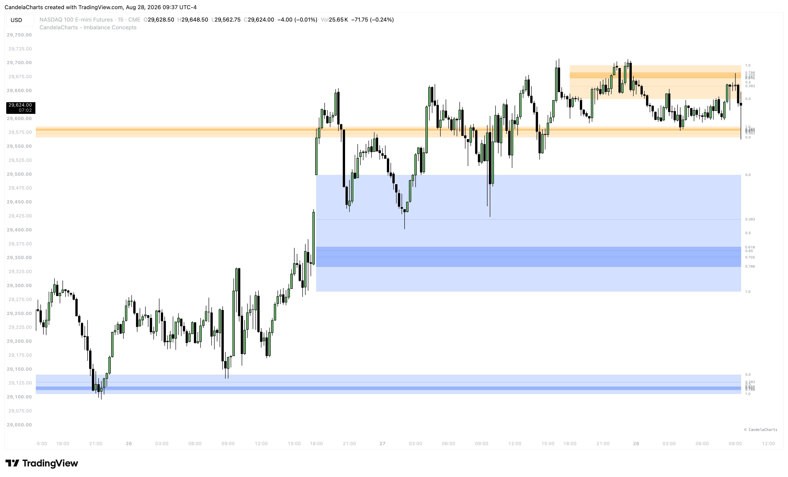

# Intraday Gaps

### What are Intraday Gaps?

**Intraday Gaps (IG)** are price inefficiencies that occur within a single trading day on lower timeframes (e.g., 1m, 5m, 15m charts). Unlike opening or weekend gaps that occur between major trading sessions, Intraday Gaps happen while the market is actively open and trading.

<figure><figcaption></figcaption></figure>

These gaps are typically caused by:

* **High-Impact News Events:** Sudden influxes of volume (like CPI, FOMC, or NFP releases) that cause price to jump rapidly, leaving behind unchecked price levels.
* **Low Liquidity Periods:** Fast moves during the lunch hour or algorithmic sweeps that create localized imbalances.
* **Session Transitions:** Rapid repricing when moving from the morning session to the afternoon session.

In the context of ICT principles, an Intraday Gap represents a momentary lack of liquidity where buy and sell orders were not paired efficiently. This creates a "void" that market algorithms will naturally seek to revisit and rebalance later in the session.

### How to Use Intraday Gaps

Intraday Gaps are highly actionable because they often get filled within the same trading session. Traders can use them in the following ways:

#### **1. Draw on Liquidity (DOL) Targets**

When an Intraday Gap forms and price moves away from it, the gap acts as a magnetic target. If you are already in a trade, an unfilled Intraday Gap in your direction is an excellent Take Profit (TP) target. The algorithm will often retrace to "repair" this gap before the session closes.

#### **2. High-Probability Entry Zones (OTE)**

Once price retraces into an Intraday Gap, it serves as a high-probability zone for a continuation trade.

* **Bullish Scenario:** If price surges up leaving a gap below, wait for a retracement down into the gap to go Long.
* **Bearish Scenario:** If price drops sharply leaving a gap above, wait for a retracement up into the gap to go Short.
* **Consequent Encroachment (CE):** The 50% midpoint of the Intraday Gap is often the most sensitive level. Look for price to reject precisely off this CE level for a highly accurate entry.

#### **3. Breakaway Gaps**

If an Intraday Gap forms during a strong trend and price fails to retrace to fill it, it becomes a "Breakaway Gap." This signals immense institutional momentum. You can use the edge of the gap as a trailing stop-loss level, knowing that if price violates the gap, the trend might be exhausting.


Combine Intraday Gaps with **Order Blocks** or **Breaker Blocks**. When an Intraday Gap aligns directly with an Order Block (creating a Fair Value Gap inside the block), it creates a high-confluence entry zone that significantly increases the probability of a successful trade.

