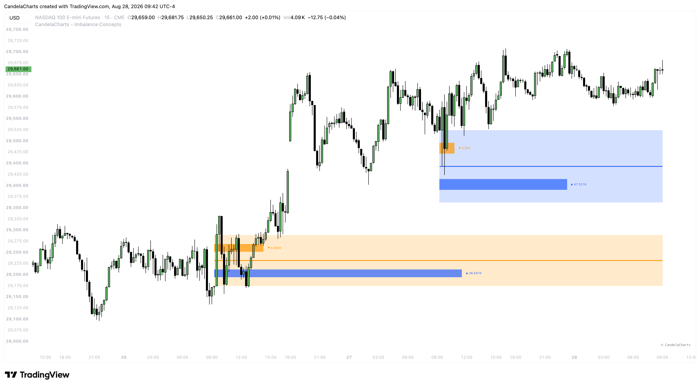

# RTH Gaps

### What are RTH Gaps?

**Regular Trading Hours Gaps (RTH)** refer to the price differences between the previous day's official RTH Close (e.g., 4:00 PM EST for US Equities) and the current day's RTH Open (9:30 AM EST).

<figure><figcaption></figcaption></figure>

Even though futures and many assets trade electronically overnight (ETH - Electronic Trading Hours), the RTH Gap specifically measures the disconnect between where the "cash session" ended and where it begins the next day.

These gaps represent the accumulation of overnight sentiment, news, and institutional positioning that occurred while the traditional retail market was closed. Because the RTH open brings the highest influx of daily volume, these gaps are heavily defended and targeted by market algorithms.

### How to Use RTH Gaps

RTH Gaps are among the most significant structural levels on an intraday chart. They dictate the daily bias and provide major liquidity pools for algorithmic trading. Here is how you can effectively use them:

#### **1. The "Gap Fill" Strategy**

The market abhors a vacuum. Statistically, a large percentage of RTH Gaps are filled either entirely or partially on the same trading day.

* If the market opens with a large gap up, there is a high probability that price will pull back to retest the previous day's 4:00 PM Close to "fill the gap."
* Traders can look for short-term reversal setups near the New York open (9:30 AM EST) to trade price back into the RTH Gap.

#### **2. Support and Resistance Levels**

The upper and lower boundaries of the RTH Gap act as major structural support and resistance levels.

* **Gap Top / Gap Bottom:** If price dips into an unfilled RTH Gap, the edges of the gap (and the previous day's close) often act as a trampoline, rejecting price back in the direction of the open.
* **Consequent Encroachment (CE):** The 50% midpoint of the RTH gap is a critical pivot. If price loses the 50% level, it will usually proceed to fill the entire remainder of the gap.

#### **3. Determining Daily Trend Strength (Breakaway Gaps)**

If the market opens with an RTH Gap and aggressively trends away from it without looking back, this is a **Breakaway Gap**. It signifies extreme institutional conviction.

* **Rule of Thumb:** If the first hour of trading (9:30 AM - 10:30 AM EST) fails to enter the RTH gap and instead consolidates or expands away, expect a strong, one-sided trend day. Do not attempt to fade a breakaway gap.


Always keep the RTH Gap boundaries marked on your chart, even if you are trading overnight futures (like ES or NQ). Algorithms constantly reference the cash market (SPX/NDX) RTH levels. A seemingly random reversal in the futures market is often just price perfectly tagging an unfilled RTH gap from the underlying cash index.

