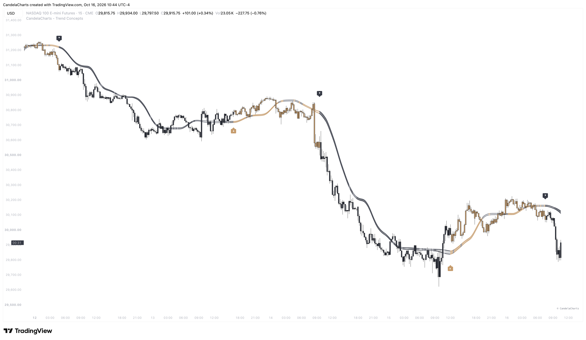
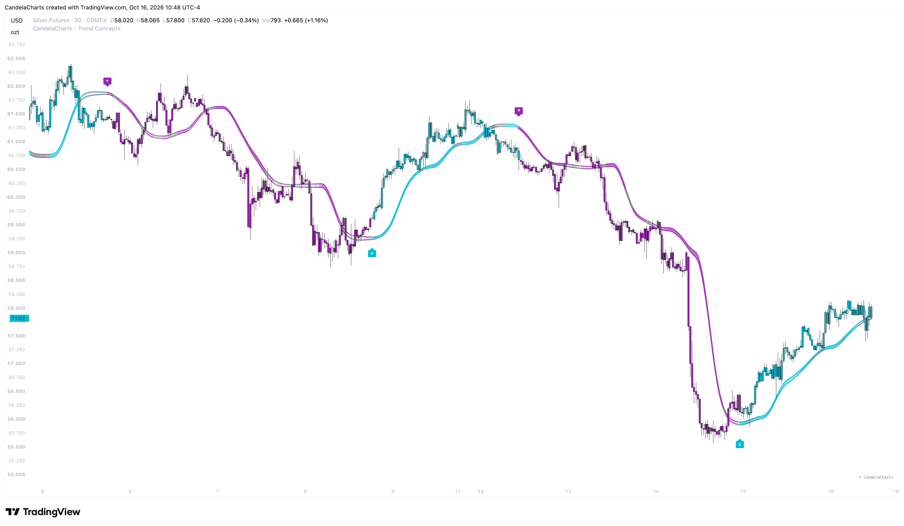
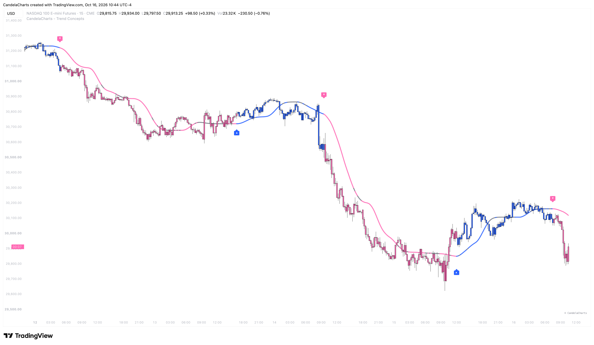
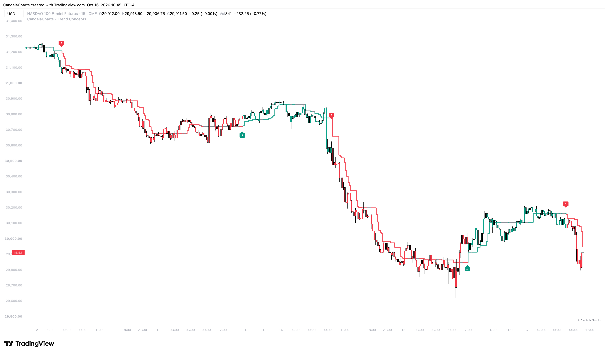

# Bias Magnet

<figure><figcaption></figcaption></figure>

**Bias Magnet** is an adaptive baseline component that tracks trend direction using advanced half-trend logic. It provides a clean, responsive anchor line that hugs price without whipsawing during normal pullbacks, making it the primary foundation for identifying trend direction, market transitions, and institutional momentum.

### How It Works

Bias Magnet calculates:

* **Adaptive High/Low Bounds:** Evaluates highest highs and lowest lows over a dynamically tuned lookback period to establish reference levels.
* **Price & Moving Average Interaction:** Updates the baseline position when price decisively breaks beyond the average, stepping up in bull trends and stepping down in bear trends.
* **Consolidation Filter:** Integrates with the script's flat-range detection regime, freezing baseline steps and shifting to neutral grey during sideways consolidation to prevent false breakout signals.
* **Volume-Weighted Momentum (MFI):** Analyzes Money Flow Index across a smoothed window with a deadband to measure whether volume backs the directional move.
* **Dynamic Envelope & Transparency:** Modulates the opacity of the channel envelope based on MFI alignment—darker, more saturated fills when volume confirms the trend, and fading towards a hairline when money flow dries up.

The indicator updates in real time and confirms trend flips on bar close, plotting directional markers directly on the active baseline and driving the indicator's core alert engine.

#### Key Features

### Three Baseline Drawing Styles

Bias Magnet lets you customize how the anchor line is displayed on your chart:

* **Channel (Default):** Wraps a dual-smoothed curved baseline inside a volatility-adaptive envelope (ATR-based tube) with a dynamic gradient fill.

<figure><figcaption></figcaption></figure>

* **Curved:** A smooth, flowing weighted moving average line that eliminates stepping artifacts while following price cleanly.

<figure><figcaption></figcaption></figure>

* **Stairs:** The classic half-trend stepline style that locks flat between price displacement levels, clearly demarcating structural support and resistance shelves.

<figure><figcaption></figcaption></figure>

### Consolidation Awareness & Flat-Range Shield

Unlike standard trend baselines that constantly flip back and forth in choppy markets:

* During clean trends, the baseline takes the theme's **Bull (green)** or **Bear (red)** color.
* When the market enters a detected flat range, the baseline automatically adopts the **Neutral Range Grey**.
* Steps are paused while consolidating, keeping you from getting chopped up in range-bound environments.

### Volume-Backed Dynamic Channel Fill

In **Channel** mode, the shaded zone between the upper and lower bands acts as an institutional volume gauge:

* **Rich, saturated fill:** High Money Flow Index confirms aggressive institutional volume driving in the trend's direction.
* **Faint, translucent fill:** Volume is thin or diverging from price, alerting you that trend strength is waning.

**Bias Magnet** eliminates the guesswork of trend analysis by combining price structure, volatility envelopes, and volume flow into a single, intuitive baseline.
