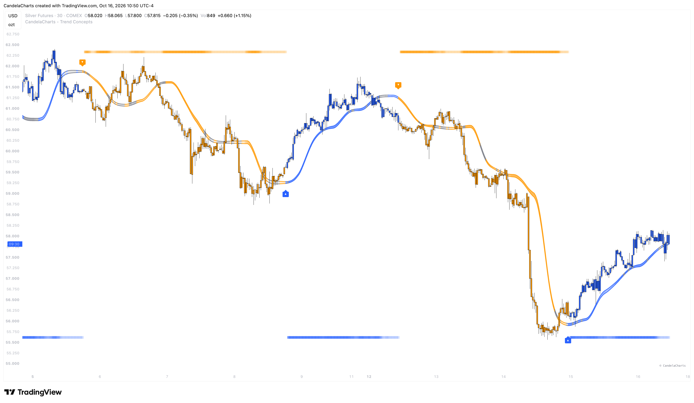

# Polarity Bars

<figure><figcaption></figcaption></figure>

**Polarity Bars** appear as discrete markers (`◼`) pinned to the top and bottom chart edges while a trend is active:

* **Bull Rail (Bottom Edge):** Prints along the bottom of the chart when positive volume-weighted momentum confirms an active bull trend.
* **Bear Rail (Top Edge):** Prints along the top of the chart when negative volume-weighted momentum confirms an active bear trend.
* **Intensity Scaling:** The opacity of the markers dynamically scales with momentum strength, while a deadband filter keeps weak, noisy churn from lighting up the rails.

