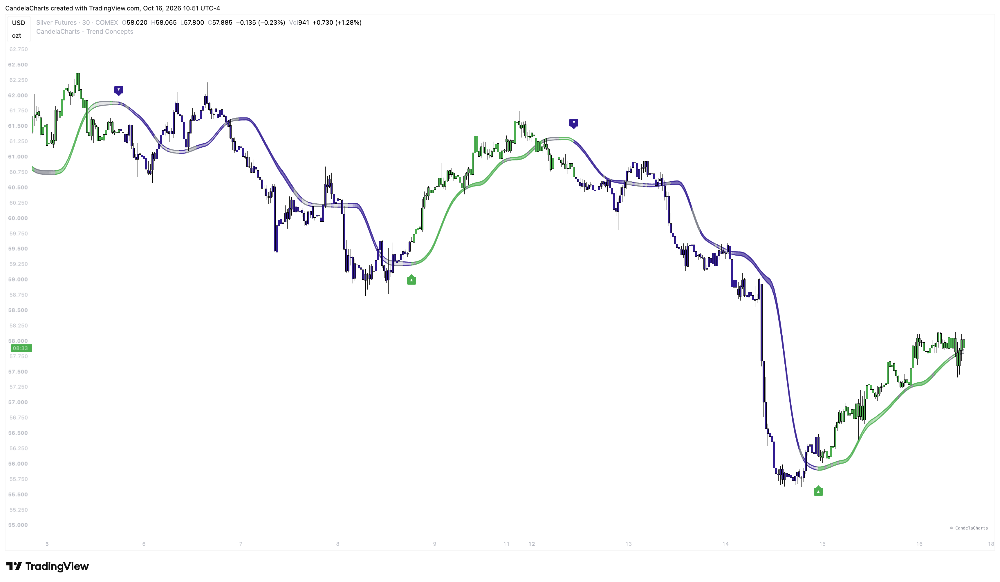

# Signals

Trend Concepts provides various signals across its four components to help you identify trading opportunities. Each component generates specific signals that can be used independently or combined for higher confidence setups.

### Bias Magnet Signals

<figure><figcaption></figcaption></figure>

#### Flip Signals

* **▲ (Up Arrow)**: Bullish flip—trend changed from bearish to bullish. The baseline crosses above price and confirms.
* **▼ (Down Arrow)**: Bearish flip—trend changed from bullish to bearish. The baseline crosses below price and confirms.

