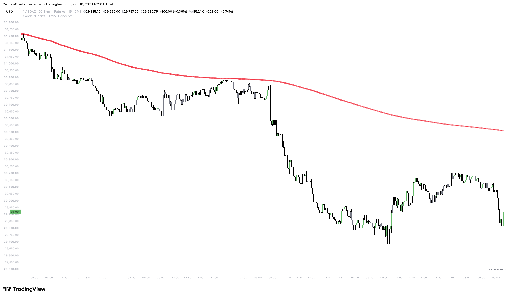

# Trend Map

<figure><figcaption></figcaption></figure>

**Trend Map** projects higher-timeframe trend context directly onto your current chart, keeping the broader market swing in view without the need to switch tabs. It plots the running average of the higher timeframe's highs and lows, coloured by whether that average is rising or falling, so your lower-timeframe trades stay aligned with the macro trend.

### How It Works

Trend Map calculates:

* **Higher Timeframe Selection:** Uses an automatic mapping based on your chart interval or a custom timeframe of your choice.
* **Intrabar Range Accumulation:** Continuously collects all highs and lows formed during the active higher-timeframe bar.
* **Running Cumulative Average:** Computes the ongoing average of all accumulated highs and lows within that session.
* **Dynamic Trend Slope:** Sets line color based on direction—green when the running average is rising (bullish) and red when it is falling (bearish).
* **Session Maturity Gradient:** Calculates an intrabar time gradient that tracks elapsed bars against the total expected duration of the higher-timeframe session.

The indicator resets its tracking at the open of each new higher-timeframe bar, marking the transition with a reset dot and a brief background flash while breaking the line to avoid artificial diagonal connections.

#### Key Features

### Higher-Timeframe Trend Line

Trend Map plots a dual-layer baseline across your chart:

* **Core Line:** A crisp, solid line tracking the exact running average of the higher timeframe.
* **Glowing Aura:** A translucent halo reflecting the trend color and session maturity.

The line turns **green** when the higher-timeframe average is rising (bullish) and **red** when it is falling (bearish).

### Automatic Timeframe Mapping

When set to **Automatic**, Trend Map derives the ideal higher timeframe from your active chart interval:

* **1m to 3m charts:** Daily (`1D`)
* **5m to 30m charts:** Weekly (`1W`)
* **60m (1H) charts:** Monthly (`1M`)
* **240m (4H) charts:** Quarterly (`3M`)
* **Daily (1D) charts:** Yearly (`12M`)

You can also switch to **Custom** mode to manually choose any timeframe you prefer.

### Session Transition Markers

When a new higher-timeframe bar opens, Trend Map highlights the reset point:

* **Reset Dot:** A small circular marker plotted at the baseline where the new higher-timeframe session starts.
* **Background Flash:** A subtle one-bar tint on the chart background to signal that a new period has begun.

### Time-Elapsed Gradient (Session Maturity)

The glowing aura around the line acts as a visual timer for the higher-timeframe session:

* **Bright, saturated glow:** The higher-timeframe session is fresh, indicating ample room for trend expansion.
* **Faded, thin aura:** The session is nearing completion, warning that momentum may slow or consolidate into the close.

### Clean Session Breaks

Rather than bridging the end of a previous session to the start of a new one with a misleading diagonal line, Trend Map cleanly breaks the line at session boundaries using non-bridging line breaks. This keeps historical levels accurate and prevents false slope reads.
